# 원천 파일로 Geo DB 업데이트

[GitHub Wiki에서 보기](https://github.com/digitie/kor-travel-geo/wiki/202610-Geo-DB-%EC%97%85%EB%8D%B0%EC%9D%B4%ED%8A%B8)

## 현재 실행 상태

원천 11종·86개 파일 8,223,492,364바이트의 순차 등록과 원본 크기·전체 SHA256 대조를 마쳤다. 새 백업의 깊은 검증, API·코드 서버·UI 정식 이미지 배포, 새 로그인·로그아웃·보호 화면·인증 프록시 검증도 통과했다.

첫 본 배치는 2026-10-31 10:19:33 KST에 원천 7개 적재 뒤 정합성 오류로 실패했다. 이 시도의 핵심 원천 51개 파일은 모두 처리됐다. 한글 ZIP을 주소·관련 지번 두 작업에서 재사용해 6개 카테고리에서 작업 7개를 실행했다. 정합성 검사 10개도 모두 실행됐고 최종 판정은 ERROR였다. 당시 MV 갱신·새 서빙 릴리스는 차단됐으며 실패 이력을 보존한다.

후속 주소 연결 수정은 PR #611·#612로 머지했다. 사용자는 **원천 보존·불량 좌표 격리·검증된 대체 좌표 적용 후 정상 승격**을 선택했다. 좌표 격리 [PR #613](https://github.com/digitie/kor-travel-geo/pull/613)과 게시 호출 수정 [PR #614](https://github.com/digitie/kor-travel-geo/pull/614)는 각각 실제 PostGIS 80개(새 좌표 정책 13개 포함, 생략 0개)와 CI 5개를 통과해 머지됐다. #614의 수정 전 실패 재현과 수정 후 관련 21개·백엔드 1,990개 통과도 확인했다. 새 API·코드 서버 이미지 배포와 마이그레이션 `0031`은 완료됐고, 실제 실행 컨테이너의 소스 185개 파일·의존성·게시 호출·캐시 권한 검증 및 두 브라우저 live UI 회귀도 통과했다. UI·공용 Dagster 컨테이너는 보존했다.

같은 등록 원천으로 새 재구축 준비 `job_78d60f36940645ee8fe6eec7964edcc0`을 2026-10-31 15:17 KST에 실제 UI에서 제출했다. Dagster 실행은 `7e8e871e-c002-47d6-8c2e-4f5bbfce3151`이며 시작·진행을 확인했다. 중간 적재 재개가 지원되지 않아 준비와 원천 적재부터 재실행하며 재업로드는 하지 않는다. 새 전체 적재·정합성·MV·서빙 릴리스는 아직 완료 전이다. 실제 격리·대체·좌표 미제공 건수와 성공한 전체 DB 로드 시간도 아직 확정되지 않았다.

매칭 세트 검증과 추가 원천의 무결성 점검은 통과했으며 실패·격리는 0개다. 준비 과정의 캐시 권한·Dagster 연결·하위 작업 검색 문제는 복구·테스트하고 코드에 반영했다. 네 번째 파일 준비는 2026-10-30 06:29:11 KST에 완료됐고, 현재 DB 배치는 2026-10-30 06:30:29 KST에 시작해 원천 7개를 순차 적재했으나 정합성 승격 조건을 통과하지 못해 종료됐다. 이전 준비 실패는 아래 복구 기록에서 별도로 확인한다.

파일 전송·초안 생성에는 운영 API에 연결한 검증 UI를 사용했고, 재구축은 정식 운영 UI에서 제출했다. 아래 화면과 대조 기록은 회귀 테스트의 모의 데이터와 구분되는 실제 원천 실행 결과다.

## 1. 원천과 기준월 확인

원본 압축파일을 보존한다. 폴더 이름과 실제 자료 기준월이 같다고 가정하지 않는다.

| UI 카테고리 | 이번 원천 | 기준월 |
| --- | --- | --- |
| 도로명주소 한글 전체분 | `202609_도로명주소 한글_전체분.zip` | `202609` |
| 위치정보요약DB | `202609_위치정보요약DB_전체분.zip` | `202609` |
| 내비게이션용DB | `202609_내비게이션용DB_전체분.7z` | `202609` |
| 도로명주소 전자지도 | 시도별 ZIP 16개 | `202610` |
| 도로명주소 출입구 정보 | `도로명주소출입구_전체분_…zip` 16개 | `202610` |
| 구역·건물·건물군 내 동 도형 | 카테고리별 시도 ZIP 16개 | `202610` |
| 주소DB | `202609_주소DB_전체분.zip` | `202609` |
| 상세주소DB | `202609_상세주소DB_전체분.zip` | `202609` |
| 건물DB | `202609_건물DB_전체분.zip` | `202609` |

이번 폴더에는 90개 파일이 있다. 현재 카탈로그가 지원하는 11개 카테고리는 86개 파일에 해당한다. 도로명·사물주소·상세주소 표시·상세주소 동 표시 전체분 4개는 현재 카탈로그의 적재 대상이 아니므로 원본을 보존한다.

서빙 DB 재구축에 연결된 원천은 한글·위치·내비게이션·전자지도·출입구·구역 6개 카테고리다. 나머지 5개는 검증 또는 후속 기능을 위한 원천 등록 대상이다. 등록 완료가 곧 해당 자료의 서빙 좌표 사용을 뜻하지 않는다.

대표 출입구는 위치정보요약을 우선 사용하고, 도로명주소 출입구는 한글 주소와 기준월이 같을 때만 후보로 선택한다. 이번 도로명주소 출입구는 `202610`, 한글 주소는 `202609`이므로 출입구 원천 6,411,242건의 적재 완료와 실제 대표좌표 사용 건수를 구분한다.

2026년 7월 이후 자료는 전남광주통합특별시 코드 `12`를 포함한 16개 시도다. 이전 17개 시도 자료와 섞지 않는다. [행정안전부의 변경 공지](https://www.mois.go.kr/frt/bbs/type001/commonSelectBoardArticle.do?bbsId=BBSMSTR_000000000052&nttId=127039)를 참고한다.

## 2. 관리자 로그인과 현재 상태 확인

운영 관리 UI에서 로그인하고 **관리 홈 → 원천 파일**로 이동한다. 기존 구성과 사용 가능한 백업을 확인한다. 아래는 이번 실행의 실제 로그인 성공 화면이다.

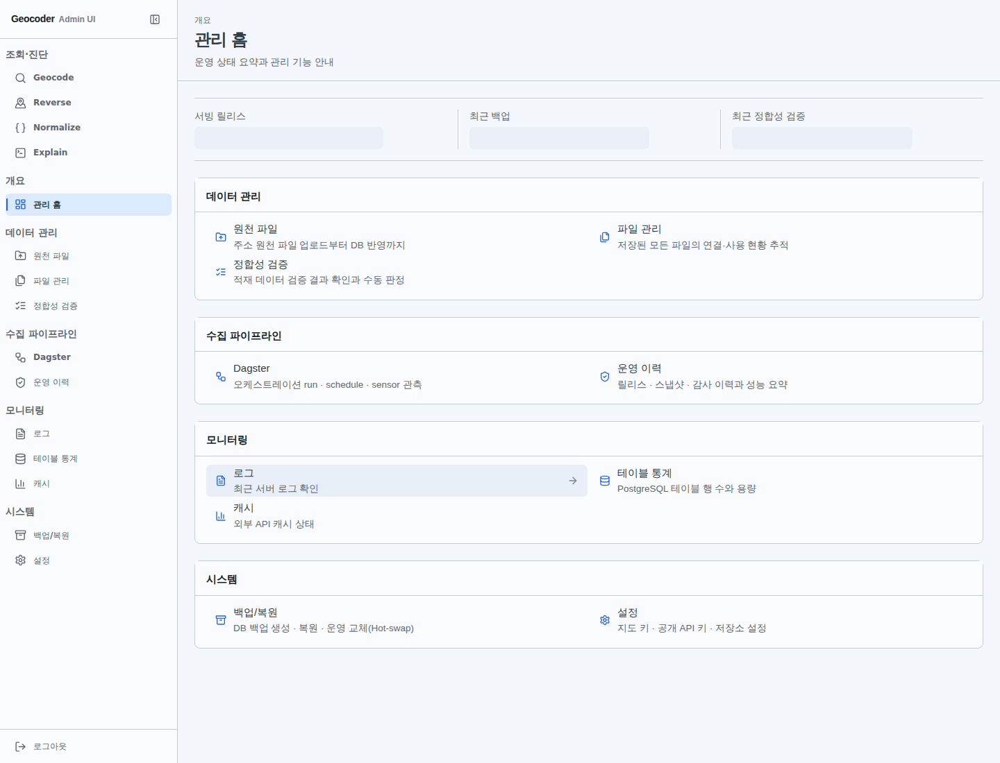

갱신 전 **Geocode**에서 공개 주소 `서울특별시 강남구 테헤란로 152`를 조회해 `OK` 응답과 지도 위치를 기록했다. 완료 뒤 같은 주소를 다시 조회해 비교한다.

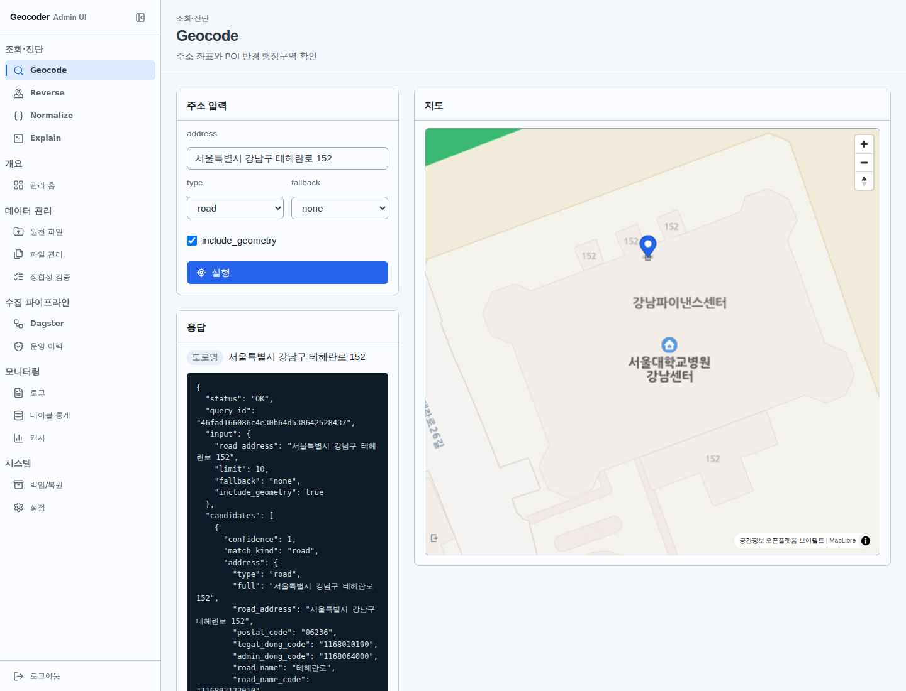

## 3. 백업 확인

**백업/복원**에서 사용할 수 있는 백업과 생성 시각을 확인한다. 새 백업이 필요하면 **백업** 탭에서 실행하고 완료를 확인한 뒤 원천 등록과 DB 적재로 넘어간다. 백업 작업의 완료와 백업 파일의 `available` 상태를 모두 확인한다. 작업 식별자와 결과 화면을 함께 기록한다.

이번 실행은 `serving-ready`, 병렬 작업 수 2, 압축 레벨 3으로 백업했다. 작업 `job_d8ff07a16e9f46779580ababd0a1edd8`은 완료됐고, Dagster 실행도 `SUCCESS`다. 새 파일은 4,480,406,943바이트이며 UI의 첫 행에서 `AVAILABLE`을 확인했다. 아래의 과거 백업 행들과 생성 시각을 구분한다.

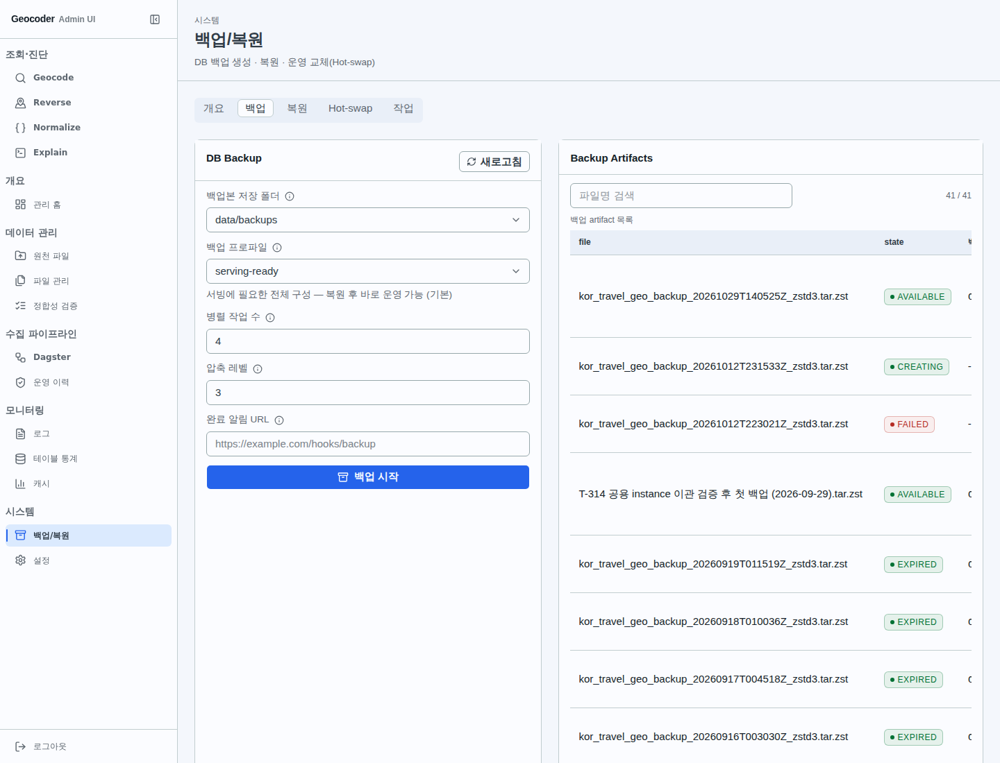

**개요 → 무결성 검증 → CLI 명령 보기**는 `ktgctl backup verify <id> --deep`을 안내한다. 이 단계는 현재 UI에서 직접 실행할 수 없다. 운영자가 실제 백업 ID로 명령을 실행하고 JSON 결과의 `ok`, `archive_sha256_matches`, `internal_checksums_ok`, `manifest_ok`가 모두 `true`인지 확인한다. 명령의 종료 코드만으로 성공을 판단하지 않는다. 복원 드릴과 실제 복원 실행은 이 무결성 확인과 별도다.

이번 새 백업은 위 네 검증 항목이 모두 `true`, 오류 목록은 비어 있는 것을 확인했다.

## 4. 카테고리별 업로드와 등록

**원천 파일 → 업로드 마법사**에서 카테고리와 기준월을 선택한다. 단일 파일 자료는 원본 ZIP·7z를, 시도 자료는 해당 카테고리의 16개 ZIP을 지정한다. 한 카테고리의 업로드·사전 점검·등록 완료를 확인한 뒤 다음 카테고리로 진행한다.

시도별 자료는 **업로드 세션 열기**를 누른 뒤 각 시도 이름에 맞는 파일을 하나씩 선택한다. 완료한 파일은 그대로 두고, 대기·실패한 시도부터 이어서 선택한다. 모든 파일을 전송한 뒤 사전 점검이 실행된다. 손상 파일을 다시 선택하면 해당 파일만 처음부터 교체 전송한다. 한 카테고리를 등록한 뒤 원본과 수신 크기·전체 파일 SHA256을 대조하고 다음 카테고리로 넘어간다.

아래는 전자지도에서 서울·전남광주 파일을 전송한 실제 중간 화면이다. `2/16`은 파일 두 개의 수신 완료를 뜻하며, 카테고리 전체 등록은 모든 파일의 전송·점검 뒤 진행한다.

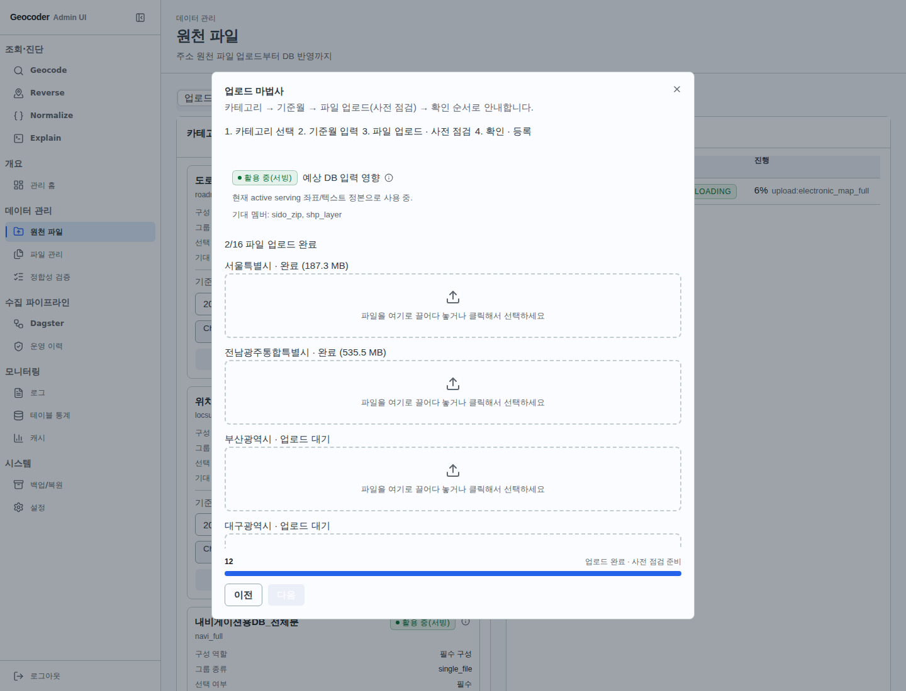

사전 점검에서 필수 멤버 결손은 해결한 뒤 등록한다. SHP의 선택 `.prj` 누락 같은 경고는 내용과 좌표계 해석을 확인하고 기록한다.

### 이번 실행의 등록 확인

| 카테고리 | 기준월 | 파일 수 | 원본 크기·SHA256 대조 | 상태 |
| --- | --- | ---: | --- | --- |
| 위치정보요약DB | `202609` | 1 | 일치 | `available` |
| 도로명주소 한글 전체분 | `202609` | 1 | 일치 | `available` |
| 내비게이션용DB | `202609` | 1 | 일치 | `available` |
| 도로명주소 전자지도 | `202610` | 16 | 모두 일치 | `available` |
| 도로명주소 출입구 정보 | `202610` | 16 | 모두 일치 | `available` |
| 구역의 도형 | `202610` | 16 | 모두 일치 | `available` |
| 도로명주소 건물 도형 | `202610` | 16 | 모두 일치 | `available` |
| 건물군 내 상세주소 동 도형 | `202610` | 16 | 모두 일치 | `available` |
| 주소DB | `202609` | 1 | 일치 | `available` |
| 상세주소DB | `202609` | 1 | 일치 | `available` |
| 건물DB | `202609` | 1 | 일치 | `available` |

최초 실패 세션을 유지하면서 위치정보요약 원본 151,895,900바이트를 다시 전송했다. 전체 SHA256 `0a71f478c9a2f8441f39058b857ae9d2d63754b605180bac5ed4119f7a07ae23`이 원본과 등록 파일에서 같았다.

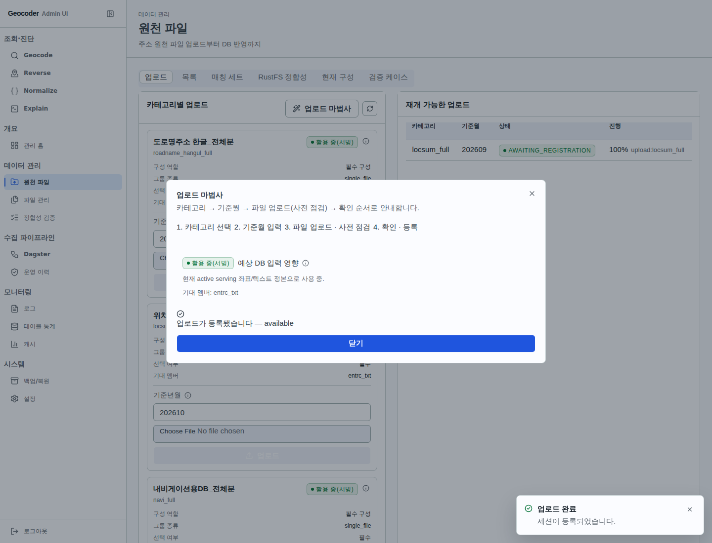

한글 전체분은 92,134,273바이트이며 업로드·사전 점검·등록 뒤 원본 크기와 전체 SHA256이 일치했다.

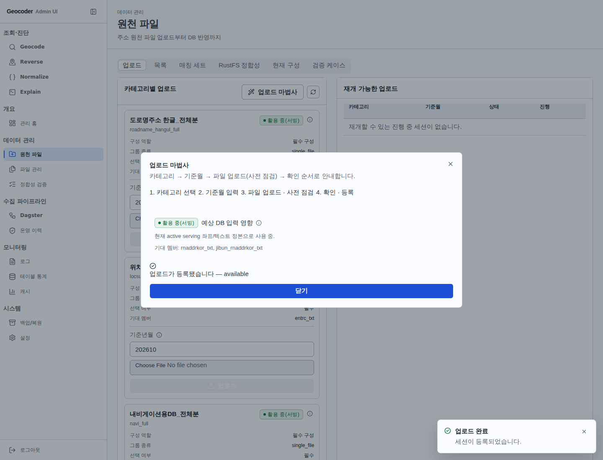

내비게이션 7z는 333,752,676바이트이며 필수 멤버 점검·등록 뒤 원본 크기와 전체 SHA256이 일치했다.

전자지도는 16개 파일 4,572,487,429바이트를 등록했다. 전자지도와 구역 도형에서 선택 `.prj` 누락 경고를 확인했으며, 좌표계는 원천 사양에 따른 `EPSG:5179`다. 필수 레이어 결손이나 점검 실패는 없었다. 출입구 정보는 경고 없이 통과했다.

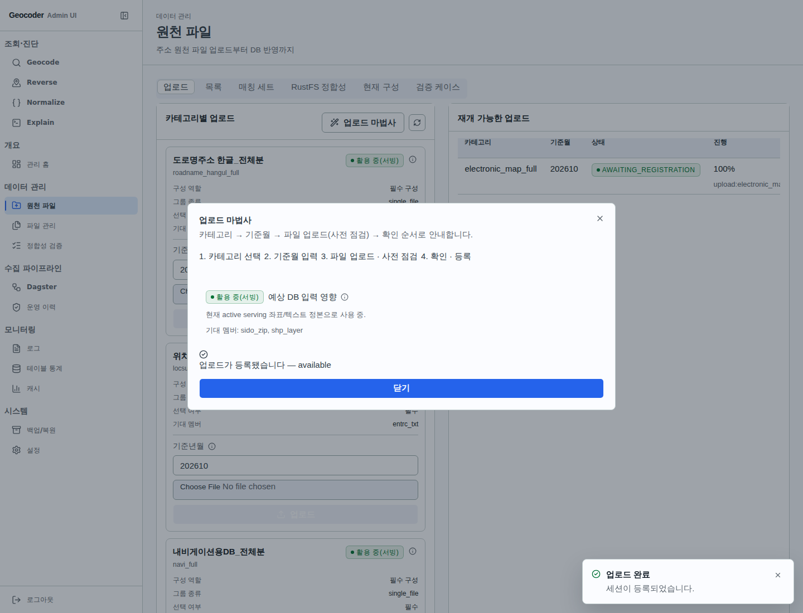

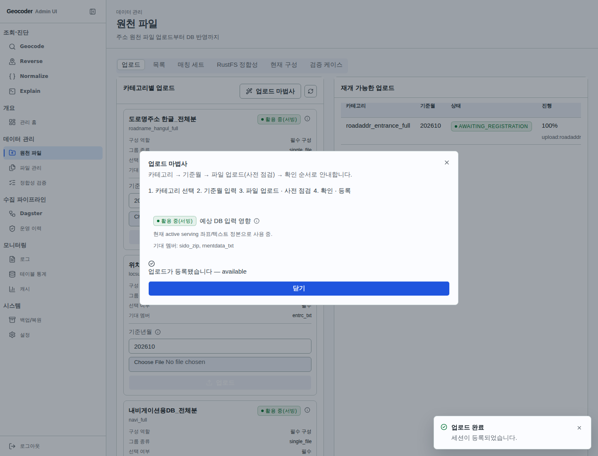

건물 도형은 16개 원본과 대조한 뒤 등록했다. 화면의 **승격 보류(NO-GO)** 표시는 기존 대표좌표 평가 결과이며 등록 성공과 구분한다. 이번 재구축에서도 이 원천을 서빙 좌표로 승격하지 않는다. 선택 `.prj` 누락 경고만 있고 필수 멤버 결손은 없었다.

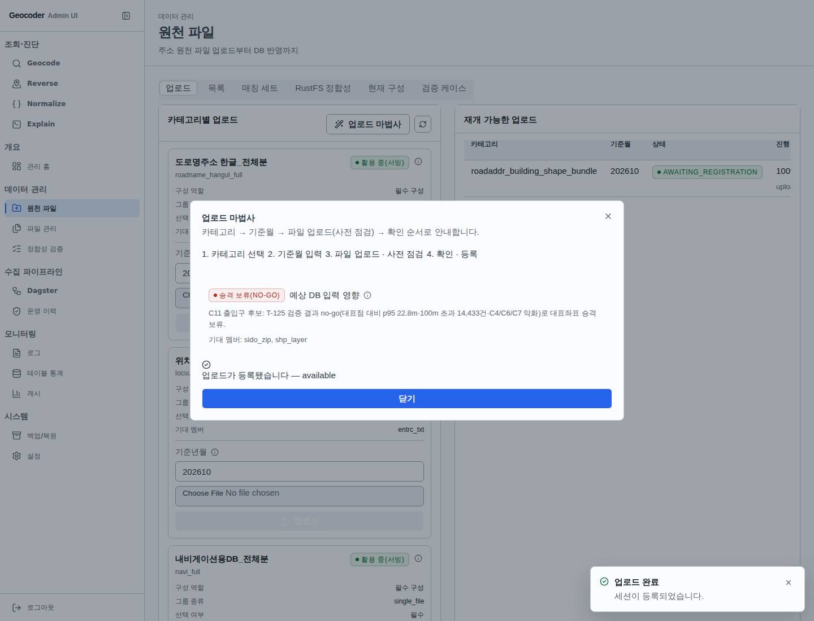

건물군 내 동 도형도 16개 파일의 등록과 원본 대조를 마쳤다. 상세주소 기능 후보 분류를 유지하며 이번 서빙 좌표에는 사용하지 않는다.

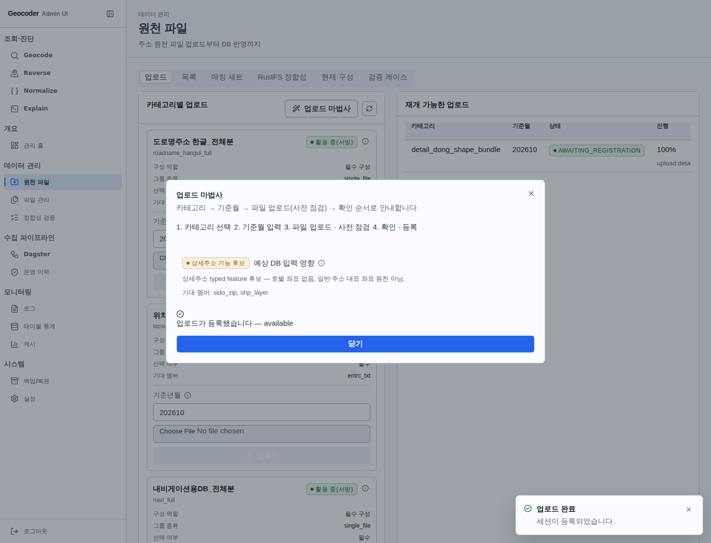

주소DB·상세주소DB·건물DB도 각각 순서대로 등록하고 원본과 대조했다. 주소·건물DB는 검증 전용, 상세주소DB는 상세주소 기능 후보 분류를 유지한다.

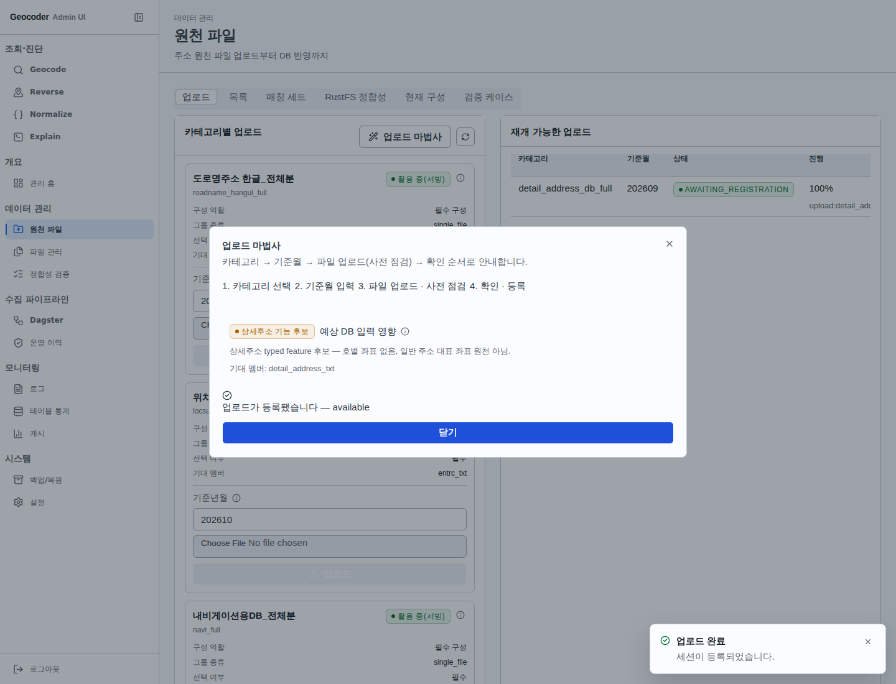

## 5. 매칭 세트와 DB 재구축

**매칭 세트 → 새 매칭 세트 만들기**에서 이름과 구성 프로파일을 입력하고 이번에 등록한 카테고리별 그룹을 선택한다. 기본 구성은 한글·위치·내비게이션·전자지도, 권장 구성은 출입구·구역을 추가한다. 카테고리별 기준월을 다시 확인하고, 서로 다른 월이면 확인란을 체크한 뒤 **초안 생성**을 누른다.

이번 세트는 `f92ec587-370d-43e4-8e22-47fe5de543ae`이며 11개 그룹을 연결한 권장 구성이다. `validate` 결과는 `ok: true`, `state: validated`, 무결성 경보 없음, 거절 사유 없음이다.

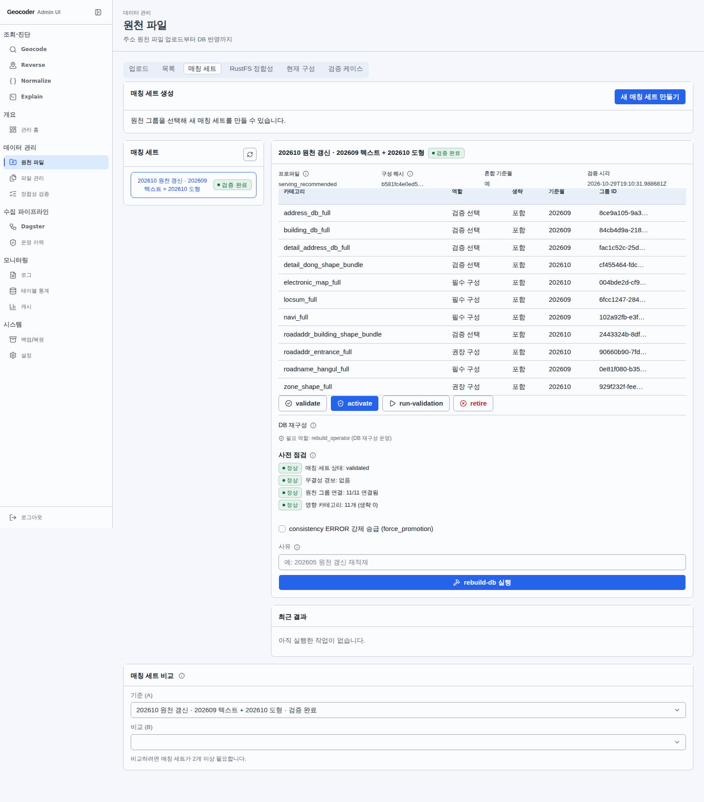

**run-validation**도 실제 원천의 사용 직전 무결성을 확인했다. 실패 0개·격리 그룹 0개이며 C11·C12·C13·C16·C17은 실행 가능, 추가 원천이 없는 C14·C15는 건너뜀이다. 이 결과는 입력 게이트를 뜻하며 무거운 보강 지표 계산의 완료를 뜻하지 않는다.

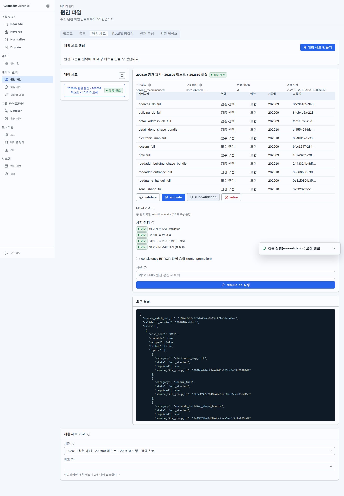

생성만으로 DB가 바뀌지는 않는다. 선택된 초안에서 **검증(validate)** 작업을 실행하고, 검증을 통과한 세트에서 DB 재구축을 시작해 작업 식별자를 기록한다. **Dagster**와 작업 상세 화면에서 각 단계의 종료를 확인한다.

이번 재구축 요청은 정식 운영 UI에서 강제 승격 없이 제출했다.

| 구분 | 식별자·결과 |
| --- | --- |
| 최초 준비 작업 | `job_f20aa6c94bb1407ca6210f9afc2f1b6a` — 권한 오류로 실패, 하위 배치 없음 |
| 최초 준비 Dagster 실행 | `de6758d2-b725-42e0-a591-faa9aea43996` — `FAILURE` |
| 최초 제출 시각 | 2026-10-30 04:27 KST |
| 두 번째 준비 작업 | `job_eab457d8d3d445298557594e7d828573` — 하위 작업 제출 실패 |
| 재시도 Dagster 실행 | `5d2b2442-d038-482b-8fde-828c3bce88a8` |
| 재시도 제출 시각 | 2026-10-30 04:41 KST |
| 세 번째 준비 작업 | `job_a3a7722ffc50461187dd15e8c37f25fe` — 준비 완료, 하위 배치 실패 |
| 세 번째 준비 Dagster 실행 | `7d11a79d-f485-437c-9feb-412b6eda5420` |
| 세 번째 제출 시각 | 2026-10-30 05:29 KST |
| 세 번째 하위 배치 | `batch_6cc24f4a45f944f289d7952048b34a85` — 준비 작업 오선택으로 실패, 원천 적재 없음 |
| 네 번째 준비 작업 | `job_a67da58095c94e318d423a69794f9d06` — 준비 완료 |
| 네 번째 준비 Dagster 실행 | `2d68ea1b-6d78-42a5-86ed-5f406c53d9bd` |
| 네 번째 제출 시각 | 2026-10-30 06:03 KST |
| 현재 원천 적재 배치 | `batch_977f870ebfd54b68a4199b96a07523eb` — 원천 7/7 완료·정합성 ERROR로 전체 배치 실패 |
| 현재 배치 Dagster 실행 | `89859e48-4871-4af6-81d9-9b73d9484f14` |
| 실제 원천 적재 시작 | 2026-10-30 06:30 KST |
| 강제 승격 | 사용하지 않음 |

[두 번째 준비 요청 원본 화면](assets/match-set-rebuild-submitted-retry.png)

[세 번째 준비 요청 원본 화면](assets/match-set-rebuild-submitted-third.png)

아래는 세 번째 시도의 **파일 준비와 하위 배치 제출 성공** 화면이다. 이 뒤 배치 자체는 별도 오류로 실패했으므로 DB 갱신 완료를 뜻하지 않는다.

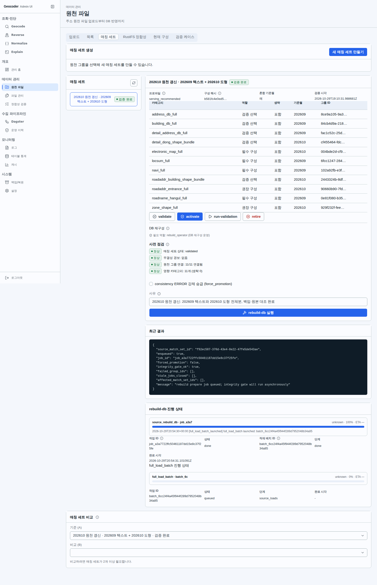

준비 작업은 무결성 확인과 압축파일 준비 뒤 하위 `full_load_batch`를 실행한다. 준비 작업의 `done`만으로 완료로 판단하지 않는다. 하위 배치의 원천 적재 7개·정합성·MV 갱신과 새 서빙 릴리스까지 확인한다.

이번 배치는 다음 원천 작업을 순서대로 실행한다. 한글 원천 하나에서 텍스트와 관련 지번을 나누어 적재하므로 서빙 원천 6종에서 작업 7개가 만들어진다. 원천 작업 7개는 모두 완료됐으나 정합성 최종 ERROR로 후속 MV가 차단됐다. MV 갱신·새 서빙 릴리스와 실제 UI 조회까지 확인해야 전체 배치 완료로 판단한다.

| 순서 | 작업 | 원천 기준월 | 현재 결과 |
| --- | --- | --- | --- |
| 1 | `shp_polygons_load` — 전자지도 | 202610 | 완료 |
| 2 | `locsum_load` — 위치정보요약 | 202609 | 완료 |
| 3 | `navi_load` — 내비게이션 | 202609 | 완료 |
| 4 | `roadaddr_entrance_load` — 출입구 | 202610 | 완료 |
| 5 | `juso_text_load` — 한글 주소 | 202609 | 완료 |
| 6 | `juso_parcel_link_load` — 관련 지번 | 202609 | 완료 |
| 7 | `sppn_makarea_load` — 구역 도형 | 202610 | 완료 |

전자지도는 각 시도에서 경계·코드·도로 레이어를 순서대로 읽고 건물 도형을 마지막에 처리한다. 16개 시도의 레이어가 끝난 뒤에도 도형 정리·통계·반경 파생 테이블 처리가 남는다. 건물 누적 건수만으로 전체 배치 진행률을 계산하지 않으며, 같은 건수에서 도로 레이어나 후처리가 실행 중일 수 있다.

전체분 DB 재구축은 새 원천에 없는 이전 키도 정리한다. 모든 시도의 파일과 기준월을 확인하고, 복구할 수 있는 백업이 완료된 뒤 실행한다. 빈 원천이나 일부 행만 읽는 설정으로 전체분을 교체하지 않는다.

전자지도 작업 `job_b394d22f53cd4cfea0faf6553b0a013e`는 2026-10-30 13:34:26 KST에 완료됐다. 건물 도형 10,684,220건은 원천 16개 DBF 헤더 합계와 정확히 일치했다. 같은 배치에서 위치정보요약이 이어서 시작됐고, 실제 작업 설정은 원천 7개 모두 `replace=true`·행 수 제한 없음으로 확인했다.

아래 실행 목록은 **첫 전자지도 종료 뒤에도 전체 배치는 진행 중**인 것을 보여준다. 전자지도 종료 시각은 작업의 DB 기록으로 대조했으며 전체 배치의 성공으로 세지 않는다.

위치정보요약 작업 `job_502413d0f91245489821218e49e9b27b`는 2026-10-30 15:28:20 KST에 완료됐다. DB 기록상 소요 시간은 1시간 53분 54초이며 적재 기록은 6,410,686건·기준월 202609다. 임시 COPY 이후 이전 키 정리와 본 테이블 반영까지 마쳤고, 내비게이션은 15:28:20 KST에 이어서 시작했다.

아래는 원천 두 개 완료 뒤에도 같은 전체 배치가 계속 실행 중인 당시의 원본 화면이다. 원천 2/7 완료와 전체 배치 완료를 구분한다.

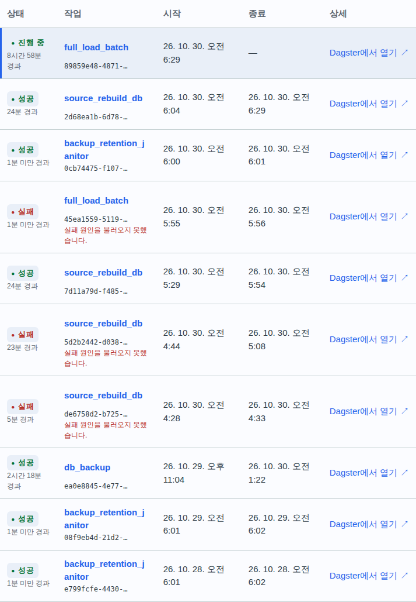

위치정보요약 원본을 전수 재집계하면 물리 입력은 6,424,765행이고, 좌표가 없는 14,079행을 제외한 처리 대상은 6,410,686행이다. 원천 자연키의 중복으로 3행이 합쳐져 실제 저장은 6,410,683행이다. 이 차이는 원본 SHA256을 확인한 같은 ZIP에서 재현됐으며 좌표가 같은 중복 키와 나머지 속성의 차이를 확인했다. 처리 건수와 저장 건수를 같은 값으로 기록하지 않는다.

내비게이션 작업 `job_08af2a85066d4b99847bc4dbf1de2a3b`는 2026-10-30 19:58:34 KST에 완료됐다. 실측 소요 시간은 4시간 30분 14초이고 중심점 적재 기록은 10,683,827건·기준월 202609다. 중심점 반영과 내비게이션 출입구 처리를 같은 트랜잭션에서 마친 뒤, 도로명주소 출입구가 같은 배치에서 19:58:34 KST에 시작됐다.

아래 원본 실행 목록은 세 번째 원천 종료 뒤에도 같은 전체 배치가 계속 진행 중인 화면이다. 원천 3/7 완료와 개별 작업 시각은 DB 기록으로 대조했으며 전체 배치 완료와 구분한다.

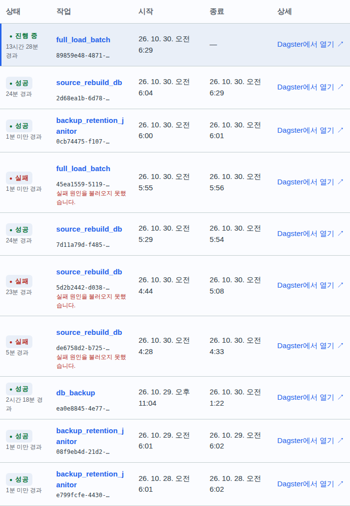

출입구 원천은 16개 ZIP의 RNENTDATA TXT를 전수 집계한 물리 입력 6,422,987행이다. 좌표가 없는 행 제외와 키 중복 정리 전의 수치이며, 최종 테이블 행 수와 구분한다. COPY 종료 뒤에도 본 테이블 입력과 트랜잭션 확정이 남으므로 파일 읽기 완료를 적재 완료로 세지 않는다.

출입구 작업 `job_b3eb598bf39e48a99309652e775b04ea`는 2026-10-30 21:56:17 KST에 완료됐다. 실측 소요 시간은 1시간 57분 43초이며 처리·반영 기록은 모두 6,411,242행·기준월 202610이다. 원본 16개 파일을 좌표 조건으로 다시 전수 집계해 좌표값이 없는 11,745행을 제외한 6,411,242행이 처리 기록과 정확히 일치함을 확인했다. 키 중복 정리로 추가 감소한 행은 없었다. 한글 주소 작업은 같은 배치에서 21:56:18 KST에 이어서 시작됐다.

뒤이은 C10의 실제 테이블 집계에서도 도로명주소 출입구 6,411,242행을 확인했다. 원본 입력 6,422,987행과 저장된 행 수를 구분한다.

아래 원본 실행 목록은 네 번째 원천 종료 뒤에도 같은 전체 배치가 계속 진행 중인 화면이다. 원천 4/7 완료와 개별 작업 시각은 DB 기록으로 대조했으며 전체 배치 완료와 구분한다.

한글 주소 작업 `job_34606af037ab405fbe7f060899e9da7a`는 2026-10-31 01:34:18 KST에 완료됐다. 2026-10-30 21:56:18 KST부터 실측 3시간 38분 1초가 걸렸으며 적재 기록은 6,424,765건·기준월 202609다. COPY 뒤 이전 키 정리와 본 테이블 반영·트랜잭션 확정을 마쳤다. 같은 한글 ZIP의 관련 지번 작업은 01:34:18 KST에 이어서 시작했다.

아래는 다섯 번째 원천 종료 뒤에도 같은 전체 배치가 계속 진행 중인 원본 화면이다. 원천 5/7 완료와 개별 작업 시각은 DB 기록으로 대조했으며 전체 배치 완료와 구분한다.

관련 지번 작업 `job_ce3f3f08c1604ca3ab3c47a79353a374`는 2026-10-31 02:15:22 KST에 완료됐다. 실측 소요 시간은 41분 4초이며 적재 기록은 1,770,572건·기준월 202609다. 같은 한글 ZIP의 주소·관련 지번 두 작업이 모두 끝났고 구역 도형은 02:15:23 KST에 이어서 시작했다.

아래는 여섯 번째 원천 종료 뒤에도 같은 전체 배치가 계속 진행 중인 원본 화면이다. 원천 6/7 완료와 개별 작업 시각은 DB 기록으로 대조했으며 전체 배치 완료와 구분한다.

마지막 구역 도형 작업 `job_f950fd26b2cb4c6a8413622f405137c3`는 2026-10-31 02:23:38 KST에 완료됐다. 실측 소요 시간은 8분 16초이며 적재 기록 24,204건·기준월 202610은 원본 16개 DBF의 헤더 합계와 정확히 일치했다. 핵심 51개 파일의 원천 적재가 끝났고 정합성 검사는 02:23:39 KST에 시작됐다.

아래는 원천 7개를 모두 마친 뒤에도 같은 전체 배치가 정합성 검사를 계속하는 원본 화면이다. 원천 완료와 정합성·MV·새 릴리스까지의 전체 배치 완료를 구분한다.

### 정합성 오류로 종료된 실행

2026-10-31 10:19:33 KST에 정합성 보고서가 ERROR로 확정돼 전체 배치가 실패했다. 보고서 작업의 완료와 전체 배치의 성공을 구분한다. MV 작업은 생성되지 않았고 새 서빙 릴리스도 게시되지 않았다. 원천 7개 완료 기록과 적재 데이터를 보존해 원인을 진단한다.

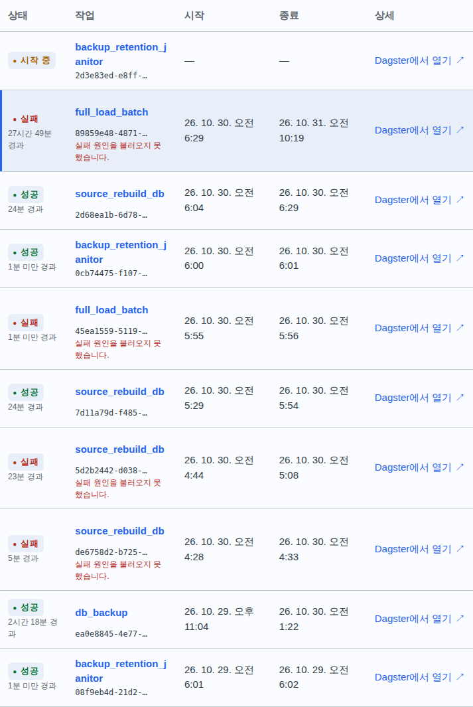

| 검사 | 결과 | 위반 건수 | 확인 내용 |
| --- | --- | ---: | --- |
| C1 | WARN | 30,802 | 텍스트만 존재 |
| C2 | ERROR | 30,181 | 도형만 존재: 주소 미연결 29,587·키 누락 594 |
| C3 | WARN | 3,790,441 | 대표 출입구 미해소 |
| C4 | ERROR | 3,020 | 50m 초과 3,020건 중 500m 초과 12건 |
| C5 | WARN | 206 | 내비게이션 중심점 거리 |
| C6 | ERROR | 701 | 우편번호 구역 밖 |
| C7 | ERROR | 5,988 | 읍면동 경계 밖 |
| C8 | WARN | 22,257 | 도로 연결 |
| C9 | OK | 0 | 지번 연결 |
| C10 | WARN | 7 | 집계 대상 7개 테이블·기준월 2개 |

보고서 식별자는 consistency_2ded5afac6244b078125173a89ec108a다. 아래 원본 화면은 실제 ERROR 결과와 C4 거리 표본을 보여준다. 가장 먼 표본은 약 181km로, 원본 좌표·변환·주소 연결을 대조하기 전에는 정상 좌표로 취급하지 않는다.

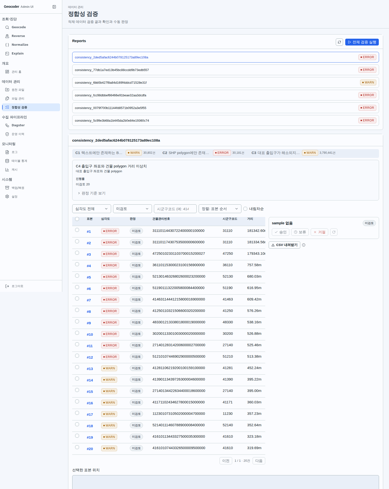

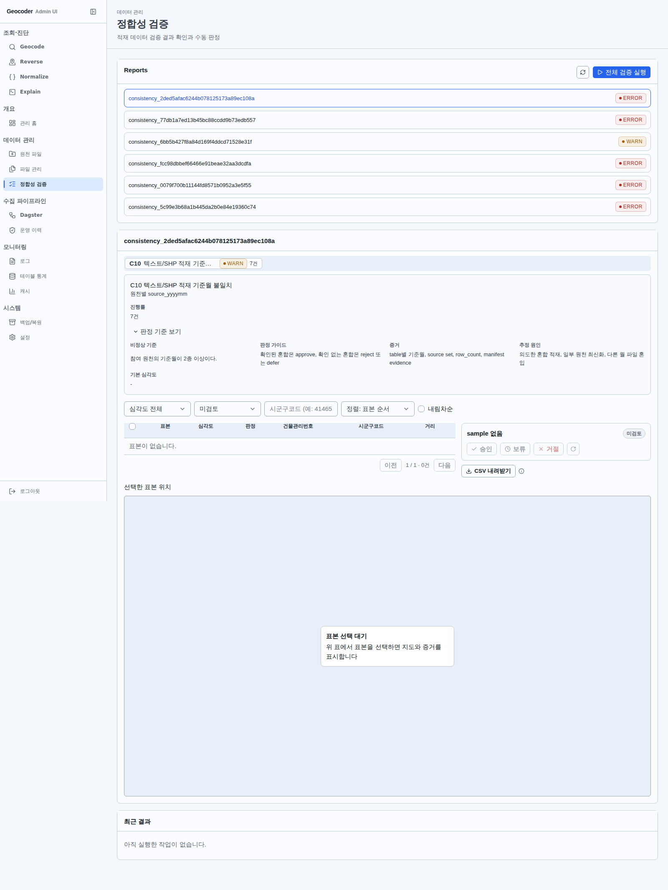

진단에서 같은 도로·건물번호·우편번호의 위치정보요약 읍면동 코드 끝 00과 한글 주소의 상세 리 코드가 전체 일치 조건 때문에 연결되지 않는 표본을 확인했다. 또한 배치의 주소 연결 호출이 정합성 뒤 MV 단계에만 있어 검사 전 연결 처리가 누락됐다. [PR #611](https://github.com/digitie/kor-travel-geo/pull/611)에서 검사 전 연결·읍면동 8자리 비교·재적재의 이전 파생 연결 제거를 수정했다. 순서와 실패 전파 회귀는 수정 전 실패·수정 후 통과이며 실제 PostgreSQL을 포함한 CI 5개를 통과했다. 11:11:57 KST에 운영 코드 서버 3개 파일의 반영·새 import·컨테이너 및 이미지 보존을 확인했다. 신규 전체 재검증은 아직 남아 있다.

C2 표본의 같은 주소는 원본 한글에서도 도로 코드 `112004103113`, 도형에서는 `111404103113`이었다. [PR #612](https://github.com/digitie/kor-travel-geo/pull/612)는 기존 코드 조회를 보존하면서 도형의 소재지 시군구와 도로 번호 조합으로도 연결한다. 법정동 10자리·건물구분·본번/부번 조건과 원본 코드·물리 건물관리번호는 보존한다. 실제 PostgreSQL의 양쪽 코드 조회·다른 법정동 제외·식별자 보존·품질 CSV 회귀를 포함한 CI 5개를 통과해 머지했다. 새 식 인덱스와 정식 이미지 반영·실제 UI 검증은 준비 중이다.

### 원본 좌표와 경계 위반 대조

C4 대표 5개 표본을 원본 ZIP의 해당 행과 대조한 결과 좌표가 모두 DB와 같았다. 다음 3개는 약 179~181km 떨어져 있어 코드 연결 수정과 구분되는 원천 품질 문제다. 읽기 전용 추가 검증에서 이 3개 주소의 NAVI 후보 4개 모두 같은 주소·기준월이고 대응 건물·기대 우편구역·읍면동 경계 내부임을 확인했다. 아직 실제 좌표 대체나 승격에 사용하지 않았다.

| 주소 | 기존 보고서의 건물 도형 거리 | 원본 좌표와 DB | NAVI 대체 후보 검증 |
| --- | ---: | --- | --- |
| 울산광역시 중구 병영성11길 1 | 181,342.60m | 일치 | 주소·월 일치, 경계 3종 통과 |
| 울산광역시 중구 종가20길 6 | 181,334.56m | 일치 | 주소·월 일치, 경계 3종 통과 |
| 경상북도 상주시 성동로 152-27 | 179,343.10m | 일치 | 후보 2개 모두 주소·월 일치, 경계 3종 통과 |

우편번호 구역 위반 3개 표본은 경계에서 약 2.65~6.51m, 읍면동 경계 위반 3개 표본은 약 0.26~10.16m였다. 이는 전체 위반의 최솟값·최댓값이 아니다. 큰 좌표 오류와 경계 주변의 차이를 같은 원인으로 묶지 않는다. 후속 처리 방침은 아래와 같이 확정됐으며, 실제 재검증 결과가 나오기 전에는 새 승격을 완료로 기록하지 않는다.

### 확정된 후속 처리 방침

사용자는 1번인 **불량 좌표 격리·검증된 대체 좌표 적용 후 정상 승격**을 선택했다. 원천 정정이나 예외 승격에 대한 회신 대기 상태는 해소됐다. 강제 승격을 승인한 것은 아니며 `forced_promotion`은 사용하지 않는다.

1. 원본 압축파일·원천 테이블의 좌표·식별자·기준월은 보존한다. 별도 판정 이력에 원천 manifest, 원본 좌표, 사유와 대체 좌표의 출처를 기록한다.
2. 대표 좌표의 주소·기준월과 건물·우편구역·읍면동 경계를 검사한다. 건물 거리의 50m 경고·500m 오류 기준과 경계 포함 판정은 유지한다. 서빙에 부적합한 좌표를 격리하며 원천 오류 건수를 없애지 않는다.
3. 같은 주소·기준월의 NAVI 좌표 중 대응 건물 내부이고 기대 우편구역·읍면동 경계 안에 있는 좌표만 대체로 사용한다. 검증된 대체가 없으면 그 주소의 좌표를 제공하지 않는다. 불량 원래 좌표로 되돌리지 않는다.
4. 원문 주소에 연결되지 않는 도형도 원천에 보존하고 일반 서빙 조회에서 제외한다. 정합성 보고서는 원천 위반·격리·대체·좌표 미제공과 실제 서빙 오류를 구분한다. 격리되지 않은 서빙 오류는 계속 ERROR로 차단한다.
5. 정합성이 통과한 동일 판정 이력으로 MV를 만들고 새 릴리스를 검증한다. 실제 격리·대체·미제공 건수, 원천 보존 여부, Geocode/Reverse 화면과 소요 시간은 실행 후 기록한다.

위 표본의 대체 후보는 읽기 전용 공간 검증을 통과했다. 전체 자료의 실제 판정 이력과 서빙 대체 결과는 아직 없으며, 기존 실패 보고서의 위반 건수를 수정 후 잔여 오류나 고유 주소 수로 간주하지 않는다.

### 코드 배포 뒤 두 브라우저 회귀

병합 소스 `991068d7225b68a233e840d9a996904836f28719`의 새 API·코드 서버를 정식 Manager 잠금 안에서 배포하고, 2026-10-31 14:59:30 KST에 서비스 검증 `healthy`를 확인했다. 실행 중인 두 컨테이너에서도 소스 파일 해시·의존성·게시 호출 계약을 확인했다. DB 주소 연결 인덱스와 좌표 판정 이력 스키마 `0031` 검증도 통과했다.

Chromium과 Firefox에서 새 로그인·잘못된 비밀번호 차단·보호된 관리자 조회를 확인했다. `서울특별시 성동구 동호로5길 207`은 외부 fallback 없이 실제 건물 도형과 지도 마커를 표시했고, 같은 좌표의 200m Reverse에도 같은 건물이 포함됐다. 실제 지도 worker와 VWorld 타일 수신도 검증했다. 이 검사는 **기존 서빙 버전에서의 코드 배포 검증**이며 새 원천 DB 전체 갱신 완료를 뜻하지 않는다.

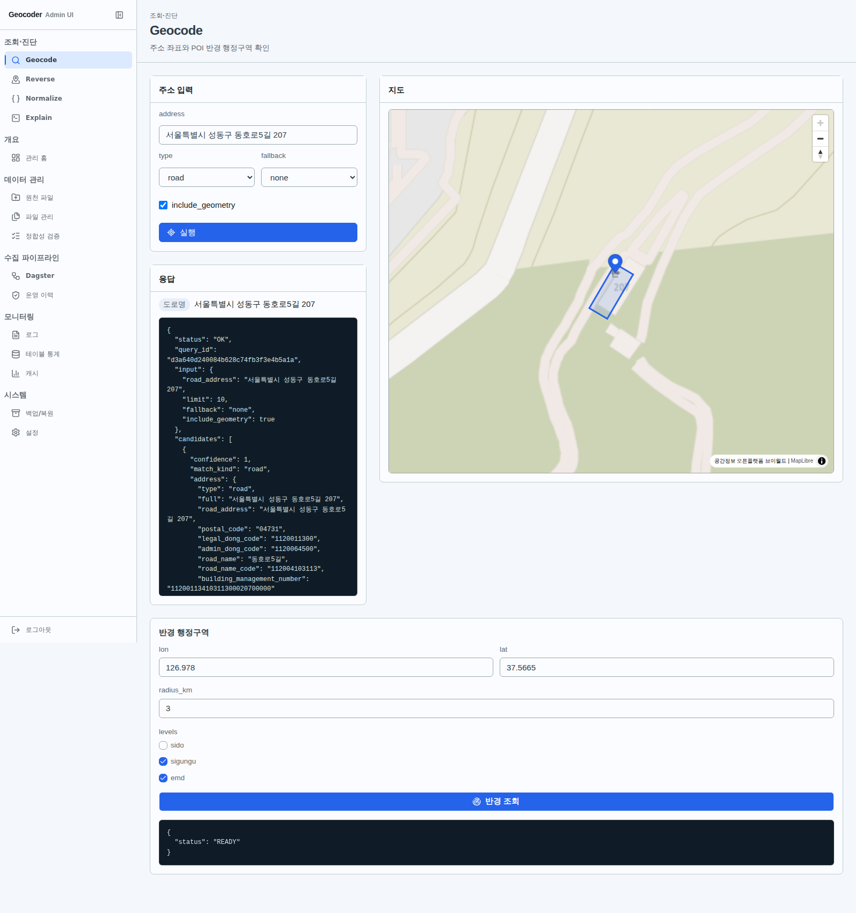

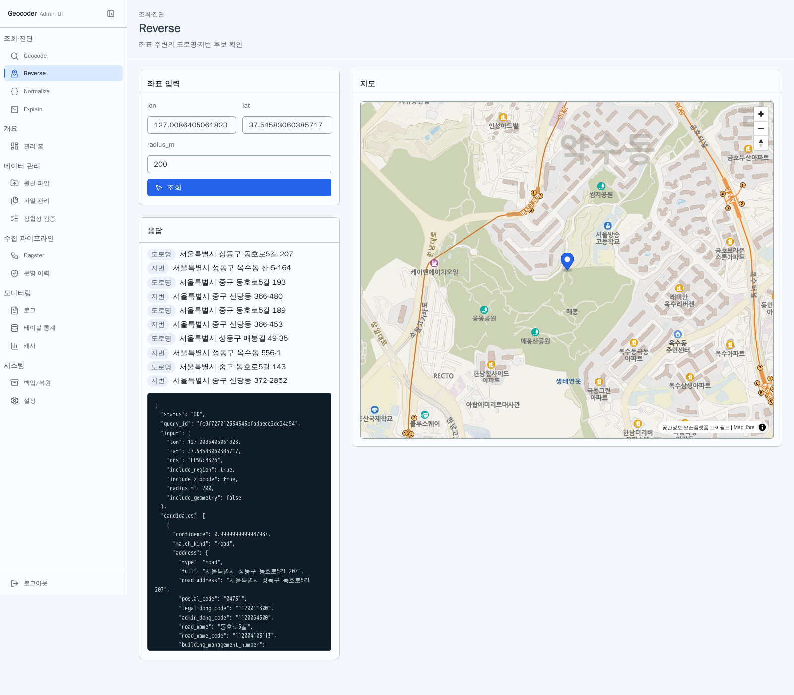

### 격리 방침을 반영한 같은 원천 재실행

이전 원천 7개 완료·정합성 ERROR·MV 미실행을 보존하고, 새 이미지와 두 브라우저 검증 뒤 같은 검증 완료 매칭 세트로 재구축을 제출했다. **consistency ERROR 강제 승급**은 체크하지 않았으며 응답의 `forced_promotion`도 `false`다. 아래 요청 완료 화면과 준비 작업의 대기 상태는 전체 적재 성공과 구분한다.

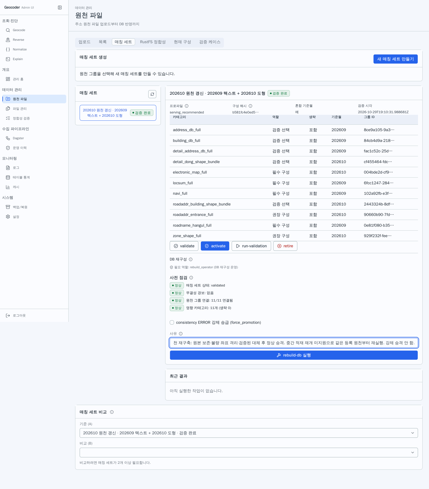

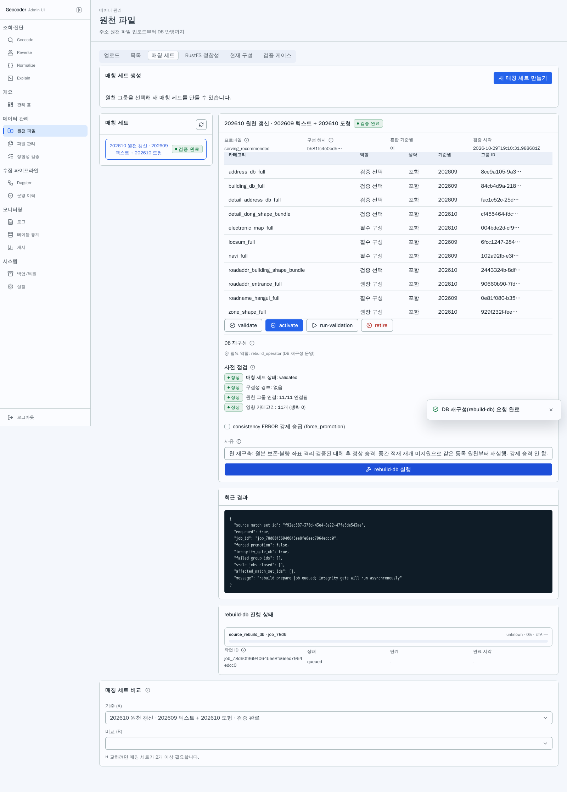

## 6. 실패한 단계에서 재개

실패 메시지·작업 식별자·마지막 성공 단계를 먼저 기록한다. 실행 중인 작업이 남았는지 확인하고 중복 실행하지 않는다.

- 업로드 실패: **재개 가능한 업로드**에서 세션을 연다. 저장한 원본과 수신 크기·체크섬이 다르면 해당 파일을 다시 업로드한다.
- 사전 점검 실패: 잘린 파일이나 빠진 멤버를 해결하고 같은 세션에서 사전 점검을 다시 실행한다.
- 적재 실패: 현재 전체분 재구축 UI는 배치 중간부터의 재개를 지원하지 않는다. 기존 작업이 종료됐음을 확인하고 원인을 수정·테스트한 뒤 같은 등록 원천으로 재구축을 처음부터 실행한다. 완료한 업로드를 다시 전송할 필요는 없다.
- 정합성 오류: 원인을 해결하고 재검증한다. 확인되지 않은 오류를 넘겨 서빙 승격하지 않는다.

### 브라우저 실행 환경과 세션 복구

Linux Firefox의 처음 실행 환경에서는 WebGL2가 제공되지 않아 주소 응답이 OK여도 지도 캔버스가 생성되지 않았다. 실제 실패 화면은 아래와 같다. 가상 디스플레이와 Mesa 소프트웨어 렌더러에서 WebGL2를 검증한 뒤 Firefox의 지도·타일·worker·Geocode·Reverse 전체 회귀가 통과했다. Chromium의 완료 검증은 보존하고 실패했던 Firefox 단계만 재실행했다. UI의 WebGL2 확인을 제거하거나 빈 지도를 성공 화면으로 사용하지 않았다.

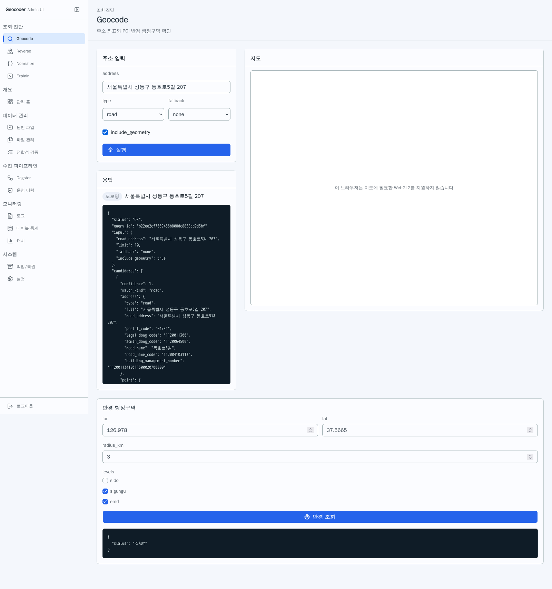

관리 UI 세션은 브라우저 식별값에 연결된다. Firefox 세션을 Chromium에서 재사용해 401이 발생한 뒤 브라우저별 세션을 구분하고 같은 Firefox 세션으로 재구축을 제출했다. 인증 차단을 우회하거나 브라우저 식별 검증을 완화하지 않았다. 이 인증 실패에서는 DB 재구축 요청이 생성되지 않았다.

### 긴 적재 중 연결·로그인 복구

브라우저나 관찰 연결이 끊겼다면 먼저 **Dagster** 화면(`/admin/dagster`)을 다시 연다. 로그인 화면으로 이동하면 UI에서 로그인한 뒤 **Recent runs**의 기존 `full_load_batch` 실행을 선택한다. **Run detail**의 전체 배치 식별자와 현재 실행 식별자가 앞서 기록한 값과 같은지 확인한다. 작업 상태와 원천 자식의 상태를 조회하고, 연결이 끊겼다는 이유만으로 재구축을 다시 제출하지 않는다.

이번 실행은 실제 UI 로그아웃·재로그인 뒤 같은 배치와 원천 자식 7개를 다시 확인했다. 이 관찰 복구 과정에서 적재·취소 요청은 발생하지 않았다. 아래는 같은 실행을 복구한 당시의 진행 화면이며 DB 완료 화면은 아니다.

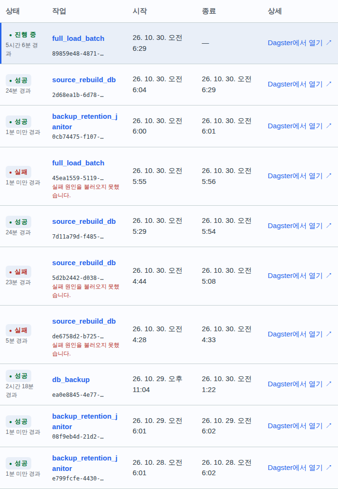

### 장시간 전체분의 자동 종료 상한

실행이 길어질 때는 같은 실행 ID·시작 시각과 현재 단계·실행 신호를 대조하고 실제 자동 종료 상한을 확인한다. `dagster/max_runtime`은 초 단위이며 172,800초는 48시간이다. 이 값은 허용 상한이고, 전체 DB 실측 시간은 7절의 DB 시작·종료 기록으로 계산한다.

이번에는 원천 7개 적재만 19시간 53분이 걸렸고 정합성 공간 검사도 이어져 배치가 22시간에 가까워졌다. 2026-10-31 04:31:50 KST에 현재 실행 `89859e48-4871-4af6-81d9-9b73d9484f14`의 상한 태그 하나를 기존 86,400초에서 172,800초로 높였다. 실제 Dagster 1.13.24의 경계 5건과 독립 임시 instance의 상태·다른 태그 보존 검증을 먼저 통과했다. 상세 UI는 태그 조회만 지원해 공식 instance API로 변경하고, 같은 실행 ID·시작 시각·진행 상태와 다른 태그 보존을 API·실제 UI에서 확인했다.

[PR #610](https://github.com/digitie/kor-travel-geo/pull/610)은 최종 태그를 만드는 복구 정책에 전국 전체분의 48시간 상한을 반영했으며 CI 5개와 리뷰 대기 뒤 머지됐다. 관련 회귀·Dagster 150개·백엔드 1,973개(170개 건너뜀), Ruff·백엔드 타입·의존 방향 검사를 통과했다. 추가 Dagster strict의 기존 진단 13개는 main과 같고 새 진단은 0개다. 운영에서는 이미지·컨테이너를 유지한 실행 설정 보정으로 같은 배치를 계속했다.

아래 원본은 `max_runtime: 172800`과 같은 배치를 표시한다. 이 Linux 브라우저의 시각은 UTC이며 본문의 실측 표는 KST다. `Started`는 진행 중을 뜻하며 정합성·MV·새 릴리스까지의 완료 판정은 별도로 확인한다.

2026-10-31 06:30:57 KST의 공식 실행 기록에서 Dagster 시작 뒤 24시간이 지난 같은 실행의 `STARTED`와 상한 172,800초를 재확인했다. 아래는 06:31:26 KST에 촬영한 실제 UI 원본으로, 24시간 경과 표시와 동일 배치·48시간 상한을 보여준다. 이 확인은 실행 상한 보정의 실제 경계 검증이며 전체 DB 완료를 뜻하지 않는다.

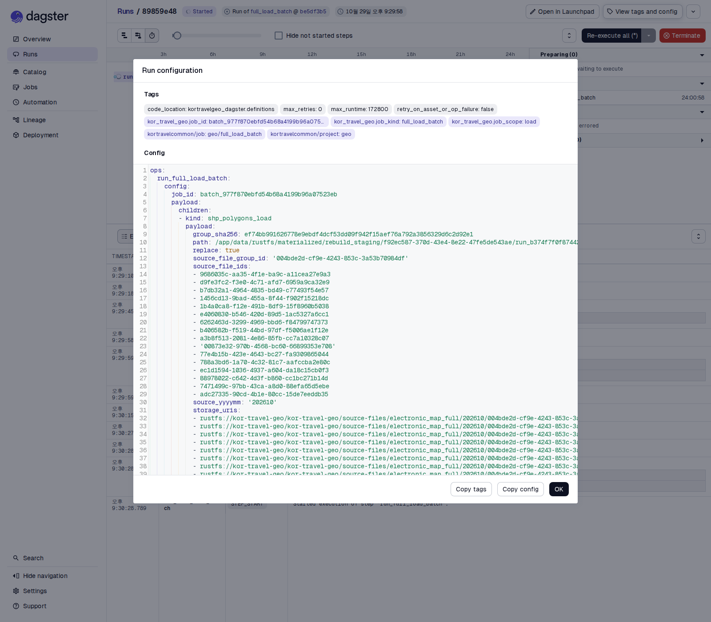

### 이번 실행의 실패와 수정

이번 첫 실패는 업로드 완료 표시 뒤 `필수 member 누락: entrc_*`가 나왔으나 원인은 프록시에서 본문이 잘린 것이었다. 원본은 보존했고 잘린 파일은 등록하지 않았다.

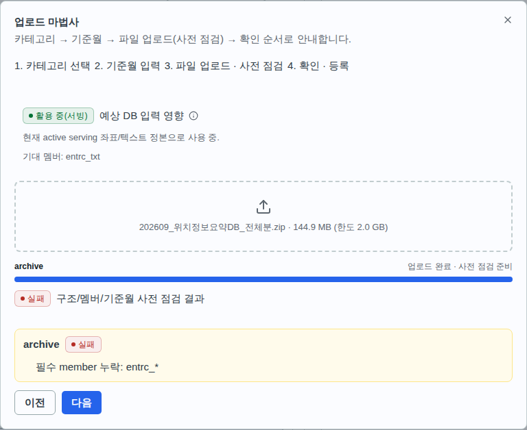

전자지도는 16개 전송을 마친 뒤 압축파일 점검 중 프록시의 5분 응답 헤더 제한으로 실패했다. 아래 화면의 `16/16`과 **사전 점검 다시 시도**를 확인한다.

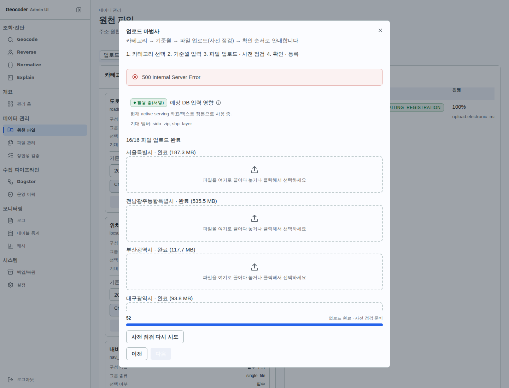

원천 점검 요청에만 충분한 응답 대기를 적용하고 단위·실제 HTTP·두 브라우저 회귀를 통과한 뒤, 같은 세션에서 사전 점검부터 재개했다. 16개 파일을 다시 전송하지 않았다. 재점검에서 경고와 기준월을 확인하고 등록했다.

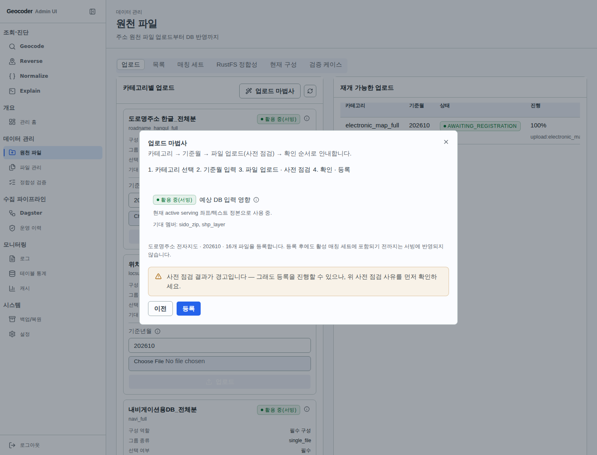

재구축의 첫 준비 작업은 원천 무결성을 통과한 뒤 `/app/data/rustfs` 생성 권한으로 실패했다. 백업 바인드의 부모 `/app/data`가 `root` 소유인 것을 확인했고, 필요한 캐시 디렉터리를 실제 실행 사용자 소유로 준비했다. 같은 사용자와 백업 바인드를 포함한 새 컨테이너에서 기존 실패·수정 뒤 쓰기 성공을 대조했다. 운영 이미지 ID와 패키지 코드는 유지했다.

Dockerfile에는 기본 데이터 디렉터리를 기존 소유권 설정 전에 생성하는 한 줄 수정을 반영했다. [PR #606](https://github.com/digitie/kor-travel-geo/pull/606)은 CI 5개와 리뷰 대기 뒤 머지됐다. 이후 컨테이너를 재생성할 때는 이 수정이 반영된 이미지를 사용한다. 실패한 준비 작업과 Dagster 실행이 모두 종료됐음을 확인하고 같은 등록 원천·매칭 세트로 준비를 다시 시작했다. 업로드는 반복하지 않았다.

두 번째 준비는 압축 원천 준비를 끝냈으나 코드 서버에 공용 Dagster 접속 주소가 빠져 하위 적재 제출에 실패했다. 생성된 실패 배치의 원천 자식 7개는 모두 취소됐으며 실제 적재는 시작하지 않았다. 같은 worker의 설정 경로에서 연결 실패를 재현하고 API와 같은 공용 주소를 읽게 한 뒤 버전·하위 작업 조회 성공을 확인했다. 이미지와 컨테이너를 유지한 설정 보정이며 Manager 정본의 재발 방지 구성은 별도로 반영한다.

실패한 실행이 모두 종료됐음을 확인하고 같은 등록 원천에서 세 번째 준비를 시작했다. 현재 UI는 준비 중간부터 이어서 실행하는 기능이 없어 파일 준비부터 다시 수행한다. 업로드·등록·매칭 세트 검증은 보존했다. 이후 코드 서버를 재생성할 때는 데이터 디렉터리 수정 이미지와 공용 접속 주소 구성을 함께 적용한다.

공용 접속 선언의 재발 방지는 [Manager PR #575](https://github.com/digitie/kor-travel-docker-manager/pull/575)로 머지됐다. 세 번째 시도는 준비를 마치고 배치를 제출했지만, 완료된 준비 작업을 원천 자식으로 잘못 고르는 조회 오류로 배치가 즉시 실패했다. 원천 7개는 모두 시작 전 취소됐다.

실제 부모가 해당 배치인 자식만 선택하도록 한 줄 수정하고 수정 전 SQL 회귀 실패·수정 후 통과, 전체 테스트와 실제 PostgreSQL CI를 확인했다. 운영의 읽기 전용 조회에서도 8개 오선택에서 원천 7개 선택으로 바뀐 것을 확인했고 이미지·컨테이너는 유지했다. [PR #607](https://github.com/digitie/kor-travel-geo/pull/607)은 머지됐다. 모든 이전 작업 종료를 확인한 뒤 같은 원천으로 네 번째 준비부터 다시 시작했다.

주소 응답은 200이지만 지도가 worker 로딩 실패로 남는 문제도 확인했다. 실제 worker 생성 주소가 빈 값인 것을 재현하고, 설치된 같은 버전의 worker를 정적 번들 자산으로 지정했다. [PR #608](https://github.com/digitie/kor-travel-geo/pull/608)은 테스트·실제 후보 지도 검증·CI·리뷰 대기 뒤 머지됐다.

정식 UI 이미지 `kor-travel-geo-ui:rel-e70e4827d250`를 기존 Manager 변경 잠금 안에서 UI 하나에만 적용했다. 헬스체크·현재 이미지 대조, 새 로그인·로그아웃·비인증 차단·인증 프록시 200을 확인했고 API·코드 서버 컨테이너는 유지했다. 실제 운영 Geocode/Reverse의 worker 각 1개와 VWorld 타일 각 16개 수신도 확인했다.

아래는 **원천 적재 진행 중에 UI 교체만 검증한 화면**이다. 지도·좌표 표시 성공과 DB 갱신 완료는 구분한다. 운영 건물 도형과 새 데이터 버전은 원천 적재·정합성·MV 갱신 뒤 다시 확인한다.

[운영 Geocode의 worker·지도 표시 확인](assets/production-map-geocode-success.png)

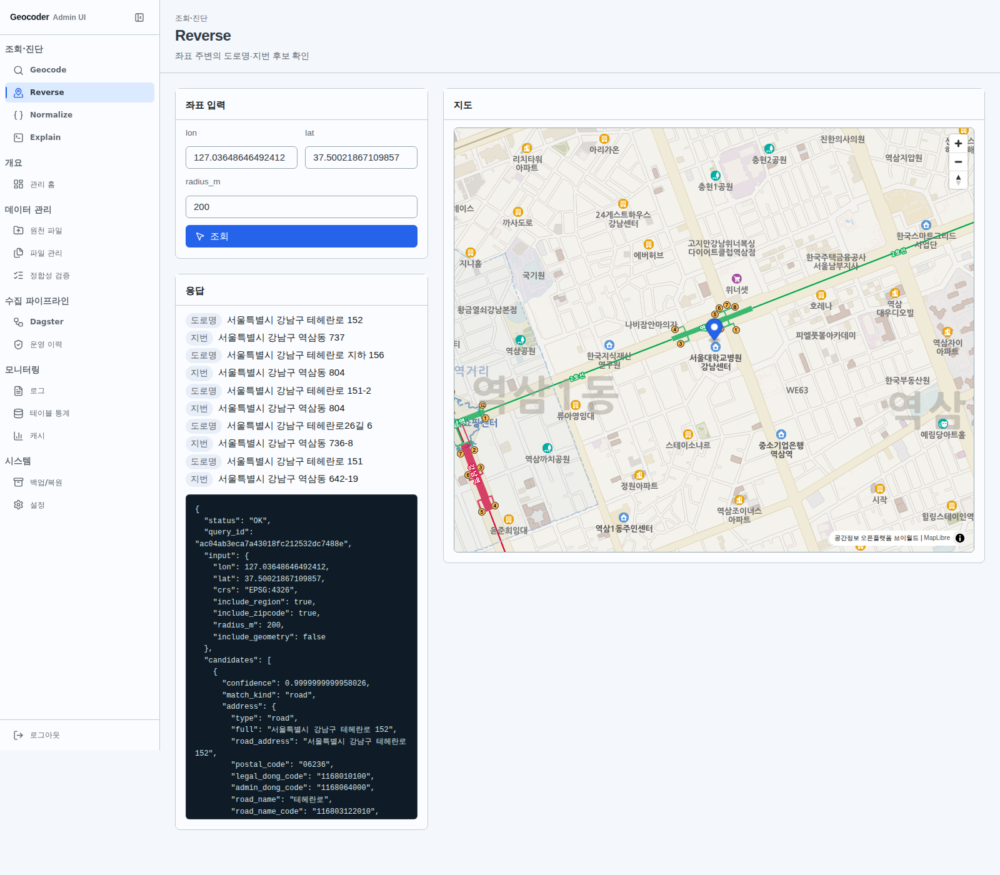

이벤트 날짜가 58797년으로 표시되는 문제는 원본 응답의 밀리초 문자열을 초로 해석한 오류였다. [PR #609](https://github.com/digitie/kor-travel-geo/pull/609)에서 이벤트만 밀리초로 변환하고 실행 메타데이터의 초 단위 처리는 유지했다. 실제 응답 기반 회귀·전체 프론트 검사·두 브라우저 E2E·CI·리뷰 대기를 통과한 뒤 정식 UI 이미지 `kor-travel-geo-ui:rel-0545f8389820`를 UI 하나에만 적용했다.

새 로그인·로그아웃·비인증 차단·인증 프록시 200, 동일 실행의 실제 이벤트 날짜를 다시 확인했다. API·코드 서버 컨테이너 ID와 시작 시각은 유지됐다. 아래는 **2026-10-30 12:55 KST의 시간 표시 수정 성공** 화면이며, DB 배치는 계속 실행 중이다.

[UI 교체 뒤 같은 배치의 진행 상태 확인](assets/dagster-event-time-fixed-runs.png)

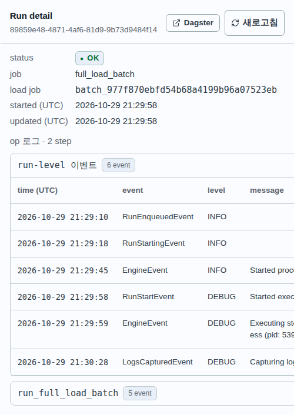

상세 시간 열은 UTC이며 이 매뉴얼의 작업 시간 표는 KST다. 상세의 `status OK`는 조회 응답 상태이므로 적재 완료로 판단하지 않는다. 전체 완료는 실행 목록의 성공, 원천·정합성·MV 작업 종료와 새 서빙 릴리스로 확인한다. 전체 DB 실측 시간은 아래의 DB 배치 기록을 기준으로 한다.

이후 코드 서버를 재생성할 때는 PR #606·#607·#610 이후 수정이 반영된 이미지와 Manager #575의 공용 접속 구성을 함께 사용한다. 준비·적재 작업을 실행 중인 코드 서버는 재생성하지 않는다. 이번 후속 교체는 이전 작업 종료를 확인하고 새 재구축 제출 전에 진행했다.

## 7. 완료 판정

### 전체 DB 로드 실측 시간

전체 DB 로드 시간은 `full_load_batch` 작업의 `started_at`부터 `finished_at`까지로 계산한다. 원천 7개 순차 적재·정합성 검사·MV 갱신과 서빙 릴리스 게시를 포함한다. 업로드·백업·파일 준비·이전 실패 복구는 별도 구간으로 기록한다. DB에 저장된 시작·종료 시각을 사용하며, 아래 표는 KST(UTC+09:00)다. 시작·종료 시각은 초 아래를 생략해 표시하고 소요 시간은 원래 시각 차를 초 단위로 반올림한다. 따라서 표의 표시 시각만 뺀 값과 실측 소요 시간이 1초 다를 수 있다.

| 구간 | 시작 시각(KST) | 종료 시각(KST) | 실측 소요 시간 |
| --- | --- | --- | --- |
| **첫 본 배치 — 실패한 시도** | **2026-10-30 06:30:29** | **2026-10-31 10:19:33** | **27시간 49분 5초** |
| 전자지도 | 2026-10-30 06:30:29 | 2026-10-30 13:34:26 | 7시간 3분 57초 |
| 위치정보요약 | 2026-10-30 13:34:26 | 2026-10-30 15:28:20 | 1시간 53분 54초 |
| 내비게이션 | 2026-10-30 15:28:20 | 2026-10-30 19:58:34 | 4시간 30분 14초 |
| 출입구 | 2026-10-30 19:58:34 | 2026-10-30 21:56:17 | 1시간 57분 43초 |
| 한글 주소 | 2026-10-30 21:56:18 | 2026-10-31 01:34:18 | 3시간 38분 1초 |
| 관련 지번 | 2026-10-31 01:34:18 | 2026-10-31 02:15:22 | 41분 4초 |
| 구역 도형 | 2026-10-31 02:15:23 | 2026-10-31 02:23:38 | 8분 16초 |
| 정합성 검사 — 최종 ERROR | 2026-10-31 02:23:39 | 2026-10-31 10:19:33 | 7시간 55분 54초 |
| MV 갱신·서빙 릴리스 | 미실행 | 정합성 오류로 차단 | 해당 없음 |
| 파일 준비 — 네 번째 시도, 별도 구간 | 2026-10-30 06:05:15 | 2026-10-30 06:29:11 | 23분 55초 |

실패한 첫 본 배치 식별자는 `batch_977f870ebfd54b68a4199b96a07523eb`다. 이 시도의 종료와 소요 시간은 DB 기록으로 확정했다. 성공한 전체 DB 갱신 시간은 아니며 원천 7개 구간만 합하면 19시간 53분 9초다. 새 준비 `job_78d60f36940645ee8fe6eec7964edcc0`의 대기·준비 시간과 이후 새 DB 배치의 실제 시작·종료, 이전 실패와 수정 대기를 포함한 전체 경과 시간은 구분해 추가한다. 아직 성공한 전체 갱신 시간은 없으며 예상 완료 시각을 실측값으로 넣지 않는다.

적재 작업 완료, 정합성 결과, 새 서빙 릴리스와 데이터 기준월을 확인한다. Geocode·Reverse를 실제 UI에서 실행해 결과를 확인하고 각 성공 화면을 기록한다. 최종 실행 결과와 전체 로드 실측 시간은 완료 후 갱신한다. 현재까지의 성공 화면과 결과는 본문 처음에 연결한 GitHub Wiki에도 게시한다.
