# 원천 파일로 Geo DB 업데이트

[GitHub Wiki에서 보기](https://github.com/digitie/kor-travel-geo/wiki/202610-Geo-DB-%EC%97%85%EB%8D%B0%EC%9D%B4%ED%8A%B8)

## 최종 완료: 정상 승격·새 키·실제 UI 검증

DB 적재는 **2026-11-02 19:41:58 KST**에 MV·릴리스 기록 커밋을 마쳤다. 같은 복구 배치가 DONE, Dagster가 SUCCESS이며 강제 승격 없이 정상 게이트를 통과했다. 최초 DB 시작부터 최종 DB 완료까지 **85시간 11분 29초**, 완료 원천 6종을 재사용한 유실분 복구 배치는 **48시간 35분 3초**다. 아래 실측 표에서 실패·취소·대기와 내부 중첩 구간을 구분한다.

서빙 릴리스는 `b2baacde-2927-41f2-8f89-b460d5929fe6`, 버전은 `dv1-301b1ef37137fa2a5af1cbe18a3130d3`, 실제 내용 지문 토큰은 `dd1-4aa3f4543f7db74aba676ca2a6e5860e`이다. 새 주소 MV는 **6,424,765건**, 건물 도형은 **10,684,220건**이다. 원천 7종의 실제 건수·기준월과 16개 시도 × 9개 레이어 **144개 전부**가 원본과 일치했다. 강원·경기도 모든 레이어를 전수 대조했고, 다른 완료 원천 6종은 다시 적재하지 않았다.

격리 좌표 **11,302건 전부**에서 실제 서빙 좌표가 검증된 대체 또는 NULL 판정과 일치했다. 대체 4,568건·미확보 6,734건, 미연결 건물 도형 격리 375건이며 주요 이상 좌표 3건은 원본을 보존하고 새 제공 좌표로 바뀌었다. 전체 좌표 미제공 C3는 18,692건이므로 격리 후 미확보 6,734건과 구분한다. WARN 8개·INFO 1개·OK 1개·ERROR 0개와 원천 정정 대기는 아래 정합성 표에 남긴다.

적재 완료 후 병합된 소스의 API·Dagster·UI ARM 이미지를 각각 검증해 유휴 상태에서 배포했다. 운영 API·Dagster에 설치된 소스는 각각 169개·185개 대조를 통과했다. Geo 전용 VWorld 키는 Git 밖 운영 설정에만 반영했고, 다른 환경 값과 공유 서비스 컨테이너는 보존했다. 설치된 백엔드의 실제 VWorld 응답과 두 브라우저의 런타임 설정·실제 WMTS 이미지 요청이 같은 새 키를 사용하는지 확인했다. 키 값과 요청 URL은 매뉴얼·코드·Git 이력에 싣지 않는다.

Geo 전용 키 적용과 운영 건강 상태 확인 완료는 **2026-11-03 00:19:08 KST**다. 위의 DB 적재 완료 시각과 구분한다.

실제 Linux에서 주소 시나리오 14개와 통계 시나리오 4개를 각각 Chromium → Firefox 순서로 검증해 **총 18개**를 통과했다. 요청·응답을 대체하지 않았고 재적재·새 전체 검사·표본 승인·강제 승격 요청은 없었다. 좌표가 없는 주소는 같은 화면의 직전 정상 마커가 사라지는지도 확인했다. 후속 절의 진행 중 표시는 관찰 당시의 이력이다.

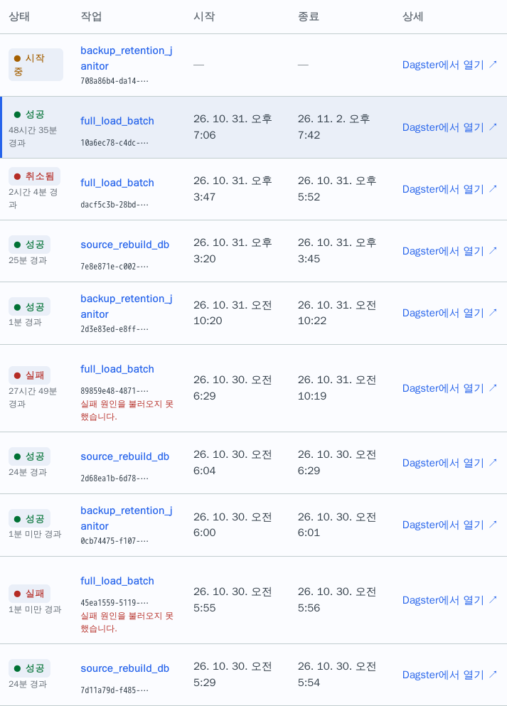

[같은 실행 완료 상세 원본](assets/repair-dagster-20261102T040437320Z-live-stage-003-detail.png)

### 전체 DB 로드와 단계별 최종 실측

| 구간 | 시작 시각(KST) | 종료 시각(KST) | 실측 소요 시간 |
| --- | --- | --- | --- |
| **최초 DB 시작부터 MV·릴리스 기록 완료까지 전체 경과** | 2026-10-30 06:30:29 | 2026-11-02 19:41:58 | 85시간 11분 29초 |
| 유실분 복구 배치 — 완료 원천 6종 재사용 | 2026-10-31 19:06:55 | 2026-11-02 19:41:58 | 48시간 35분 3초 |
| 유실 전자지도·도형 후처리 | 2026-10-31 19:06:56 | 2026-11-01 01:20:59 | 6시간 14분 2초 |
| 정합성 전체 — 주소 연결·좌표 품질·C1–C10 | 2026-11-01 01:20:59 | 2026-11-02 16:09:27 | 38시간 48분 28초 |
| MV 갱신·서빙 릴리스 | 2026-11-02 16:09:27 | 2026-11-02 19:41:58 | 3시간 32분 31초 |
| 좌표 품질 판정 — 정합성 내부 구간 | 2026-11-01 03:04:05 | 2026-11-01 19:00:48 | 15시간 56분 44초 |
| 릴리스 기록 트랜잭션·마무리 — MV 내부 구간 | 2026-11-02 19:28:48 | 2026-11-02 19:41:58 | 13분 11초 |
| 처음 시도부터 복구 배치 마무리까지 — 참고 | 2026-10-30 06:30:29 | 2026-11-02 19:41:58 | 85시간 11분 30초 |

완료 원천 6종의 기존 소요 합계는 12시간 49분 10초이며 전량 신규 적재 시간으로 표시하지 않는다. 릴리스 activated_at은 통계·지문 계산을 포함한 트랜잭션의 시작 시각일 수 있어 전체 실측의 종료로 사용하지 않는다. 종료는 릴리스 기록이 커밋된 뒤의 mv_refresh.finished_at이다. 초 단위 표시는 반올림하며 합계는 원시 초를 먼저 합산한 뒤 반올림한다. 위 표에는 서로 포함되는 구간이 있으므로 다시 합산하지 않는다. 업로드·백업·이미지 빌드·UI 검증 시간은 별도다. 과거 실패·취소 표는 그대로 보존한다.

최초 실패 배치 27시간 49분 5초와 취소 배치 2시간 3분 36초는 성공 실행 시간으로 합치지 않고 아래 과거 시도 표에 보존한다. 전체 경과 85시간 11분 29초에는 실패·취소·수정·대기가 포함된다. 실제 최종 DB 완료와 UI에서 성공을 관찰한 19:42:42 KST를 구분한다.

### 실제 주소·역지오코딩·통계 UI 검증

| 브라우저 | 실제 주소·시나리오 | Geocode·Reverse 결과 | 원본 화면 |
| --- | --- | --- | --- |
| chromium | 기준 주소 | 좌표·건물 도형·역지오코딩·새 키 지도 타일 통과 | [화면 1](assets/final-chromium-baseline-20261102T152119148Z-geocode-success.png) · [화면 2](assets/final-chromium-baseline-20261102T152119148Z-reverse-success.png) |
| chromium | 이전 도형 연결 누락 | 좌표·건물 도형·역지오코딩·새 키 지도 타일 통과 | [화면 1](assets/final-chromium-polygon-link-20261102T152119148Z-geocode-success.png) · [화면 2](assets/final-chromium-polygon-link-20261102T152119148Z-reverse-success.png) |
| chromium | 울산 병영성11길 1 | 좌표·건물 도형·역지오코딩·새 키 지도 타일 통과 | [화면 1](assets/final-chromium-ulsan-byeongyeong-20261102T152119148Z-geocode-success.png) · [화면 2](assets/final-chromium-ulsan-byeongyeong-20261102T152119148Z-reverse-success.png) |
| chromium | 울산 종가20길 6 | 좌표·건물 도형·역지오코딩·새 키 지도 타일 통과 | [화면 1](assets/final-chromium-ulsan-jongga-20261102T152119148Z-geocode-success.png) · [화면 2](assets/final-chromium-ulsan-jongga-20261102T152119148Z-reverse-success.png) |
| chromium | 상주 성동로 152-27 | 좌표·건물 도형·역지오코딩·새 키 지도 타일 통과 | [화면 1](assets/final-chromium-sangju-seongdong-20261102T152119148Z-geocode-success.png) · [화면 2](assets/final-chromium-sangju-seongdong-20261102T152119148Z-reverse-success.png) |
| chromium | 전남광주통합특별시 코드 12 | 좌표·건물 도형·역지오코딩·새 키 지도 타일 통과 | [화면 1](assets/final-chromium-code12-20261102T152119148Z-geocode-success.png) · [화면 2](assets/final-chromium-code12-20261102T152119148Z-reverse-success.png) |
| chromium | 검증 좌표 없음·이전 마커 제거 | 응답 OK·좌표 NULL·이전 마커 제거, Reverse 해당 없음 | [화면 1](assets/final-chromium-no-verified-point-20261102T152119148Z-geocode-success.png) · [화면 2](assets/final-chromium-no-verified-point-20261102T152119148Z-previous-point-before-null.png) |
| firefox | 기준 주소 | 좌표·건물 도형·역지오코딩·새 키 지도 타일 통과 | [화면 1](assets/final-firefox-baseline-20261102T152307347Z-geocode-success.png) · [화면 2](assets/final-firefox-baseline-20261102T152307347Z-reverse-success.png) |
| firefox | 이전 도형 연결 누락 | 좌표·건물 도형·역지오코딩·새 키 지도 타일 통과 | [화면 1](assets/final-firefox-polygon-link-20261102T152307347Z-geocode-success.png) · [화면 2](assets/final-firefox-polygon-link-20261102T152307347Z-reverse-success.png) |
| firefox | 울산 병영성11길 1 | 좌표·건물 도형·역지오코딩·새 키 지도 타일 통과 | [화면 1](assets/final-firefox-ulsan-byeongyeong-20261102T152307347Z-geocode-success.png) · [화면 2](assets/final-firefox-ulsan-byeongyeong-20261102T152307347Z-reverse-success.png) |
| firefox | 울산 종가20길 6 | 좌표·건물 도형·역지오코딩·새 키 지도 타일 통과 | [화면 1](assets/final-firefox-ulsan-jongga-20261102T152307347Z-geocode-success.png) · [화면 2](assets/final-firefox-ulsan-jongga-20261102T152307347Z-reverse-success.png) |
| firefox | 상주 성동로 152-27 | 좌표·건물 도형·역지오코딩·새 키 지도 타일 통과 | [화면 1](assets/final-firefox-sangju-seongdong-20261102T152307347Z-geocode-success.png) · [화면 2](assets/final-firefox-sangju-seongdong-20261102T152307347Z-reverse-success.png) |
| firefox | 전남광주통합특별시 코드 12 | 좌표·건물 도형·역지오코딩·새 키 지도 타일 통과 | [화면 1](assets/final-firefox-code12-20261102T152307347Z-geocode-success.png) · [화면 2](assets/final-firefox-code12-20261102T152307347Z-reverse-success.png) |
| firefox | 검증 좌표 없음·이전 마커 제거 | 응답 OK·좌표 NULL·이전 마커 제거, Reverse 해당 없음 | [화면 1](assets/final-firefox-no-verified-point-20261102T152307347Z-geocode-success.png) · [화면 2](assets/final-firefox-no-verified-point-20261102T152307347Z-previous-point-before-null.png) |
| chromium | 테이블 통계 — 적재된 테이블의 0행 표시 방지 | 실제 API의 MV 행 수·음수 없음·통계 기준 플래그 확인, 화면은 같은 세션의 관리 홈 | [원본](assets/table-stats-live-chromium-20261102T150027Z-1.png) |
| chromium | 테이블 통계 — 추정치·갱신 시각 표시 | 실제 표의 API 건수 일치·≈·통계 갱신 열 확인 | [원본](assets/table-stats-live-chromium-20261102T150027Z-2.png) |
| firefox | 테이블 통계 — 적재된 테이블의 0행 표시 방지 | 실제 API의 MV 행 수·음수 없음·통계 기준 플래그 확인, 화면은 같은 세션의 관리 홈 | [원본](assets/table-stats-live-firefox-20261102T150027Z-1.png) |
| firefox | 테이블 통계 — 추정치·갱신 시각 표시 | 실제 표의 API 건수 일치·≈·통계 갱신 열 확인 | [원본](assets/table-stats-live-firefox-20261102T150027Z-2.png) |

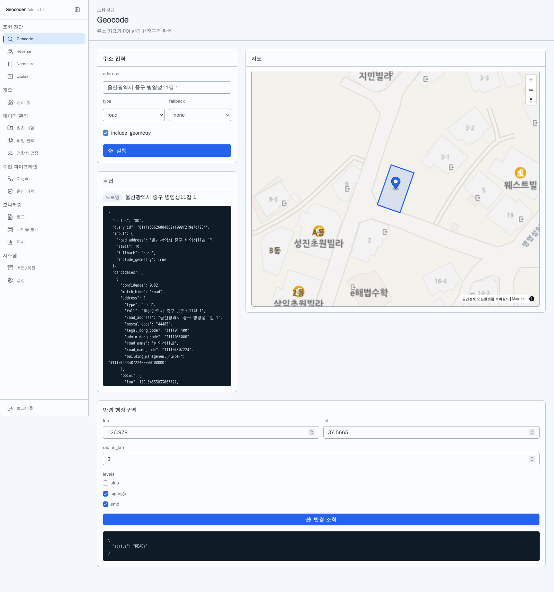

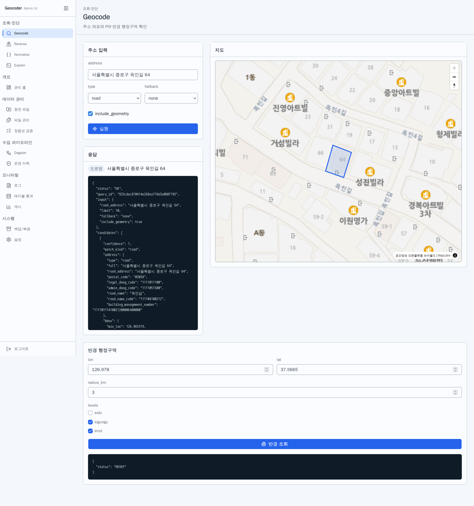

### 16개 시도 원본과 DB 전수 대조

아래 숫자는 원본 레코드 수와 동일한 실제 DB 행 수다. 아홉 레이어를 모두 대조했으며, 합계와 표 통계 추정값으로 일부 적재 여부를 판단하지 않았다. 원본의 빈 레이어는 0행으로 일치 판정한다.

| 지역 | 시도 | 시군구 | 읍면동 | 리 | 우편구역 | 도로선 | 도로구간 | 도로폭 | 건물 |
| --- | ---: | ---: | ---: | ---: | ---: | ---: | ---: | ---: | ---: |
| 강원특별자치도 | 1 | 18 | 298 | 1,142 | 1,809 | 52,223 | 1,283,140 | 90,894 | 595,196 |
| 경기도 | 1 | 47 | 747 | 1,398 | 6,263 | 115,796 | 2,683,148 | 215,942 | 1,652,031 |
| 경상남도 | 1 | 22 | 546 | 1,832 | 2,338 | 88,811 | 1,865,167 | 158,267 | 1,265,419 |
| 경상북도 | 1 | 23 | 525 | 2,692 | 3,115 | 123,798 | 2,346,041 | 166,225 | 1,409,550 |
| 대구광역시 | 1 | 9 | 212 | 187 | 1,557 | 25,886 | 360,075 | 38,391 | 290,964 |
| 대전광역시 | 1 | 5 | 177 | 0 | 1,106 | 9,294 | 235,467 | 34,391 | 139,251 |
| 부산광역시 | 1 | 16 | 192 | 62 | 2,302 | 31,065 | 431,633 | 70,255 | 379,224 |
| 서울특별시 | 1 | 25 | 467 | 0 | 5,664 | 66,683 | 749,777 | 62,513 | 591,225 |
| 세종특별자치시 | 1 | 1 | 33 | 117 | 155 | 4,213 | 100,194 | 7,435 | 55,893 |
| 울산광역시 | 1 | 5 | 84 | 118 | 629 | 10,023 | 209,150 | 22,347 | 162,445 |
| 인천광역시 | 1 | 11 | 156 | 122 | 1,354 | 18,382 | 368,634 | 35,589 | 249,327 |
| 전남광주통합특별시 | 1 | 27 | 623 | 2,552 | 2,932 | 100,893 | 1,920,295 | 174,451 | 1,323,157 |
| 전북특별자치도 | 1 | 15 | 410 | 1,464 | 1,558 | 80,991 | 1,369,847 | 158,036 | 801,052 |
| 제주특별자치도 | 1 | 2 | 74 | 122 | 511 | 17,721 | 371,904 | 27,850 | 261,749 |
| 충청남도 | 1 | 16 | 285 | 1,972 | 1,694 | 88,358 | 1,710,682 | 185,321 | 886,527 |
| 충청북도 | 1 | 14 | 238 | 1,381 | 1,532 | 41,912 | 1,027,696 | 81,323 | 621,210 |

### 실제 원천 7종 전수 대조

| 원천 테이블 | 실제 DB 행 수 | 기준월 |
| --- | ---: | --- |
| `tl_juso_text` | 6,424,765 | 202609 |
| `tl_juso_parcel_link` | 1,770,572 | 202609 |
| `tl_locsum_entrc` | 6,410,683 | 202609 |
| `tl_navi_buld_centroid` | 10,683,827 | 202609 |
| `tl_roadaddr_entrc` | 6,411,242 | 202610 |
| `tl_spbd_buld_polygon` | 10,684,220 | 202610 |
| `tl_sppn_makarea` | 24,204 | 202610 |

위치정보요약은 빈 레코드 제외 후 입력 6,410,686건에서 중복 자연키가 합쳐져 고유 6,410,683행이다. 처리 입력과 저장 행 수를 구분한다.

### 실패 지점 복구와 남은 원천 정정

최초 완료된 원천 6종과 강원·경기는 보존하고 취소로 유실된 14개 시도만 복구했다. 이후 같은 배치의 정합성·MV·정상 게시를 끝까지 이어갔다. 후속 검증 연결이 끊긴 경우에도 적재 DB는 재실행하지 않고 읽기 전용 검증 결과를 서버의 비공개 파일에 먼저 보존하도록 보완했다. 결과 저장의 큰 출력·오류·잘못된 JSON·시간 초과를 자식 프로세스로 검증한 뒤 재검증만 수행했다. UI 이미지 수신은 다른 관리 작업의 공용 잠금 때문에 보류돼, 전송 완료 파일의 크기·해시를 대조한 뒤 재전송·재빌드 없이 수신 적용부터 재개했다.

통계 API 검사는 브라우저 페이지를 열지 않는 시험이므로 최초 캡처에 빈 화면이 찍혔다. 기존 원본을 보존하고, 운영 검증 도구가 API 검사 성공 뒤 같은 세션의 관리 홈을 별도로 열어 실제 제목의 렌더링을 기다린 뒤 새 화면을 촬영하도록 고쳤다. 두 브라우저의 통계 4개를 다시 통과한 새 시도의 원본만 위 표에 연결한다. API 검사 화면은 같은 세션의 관리 홈이며, 실제 통계 표 검사는 별도 행으로 구분한다.

잔여 WARN은 원천·도로·건물 연결 정정 대기이며 오류를 수동 승인해 해제하지 않았다. 검증된 대체가 없는 좌표는 NULL로 제공한다. 정정 원천이 도착하면 기존 격리·원본 식별자와 대조해 정식 검증·정상 승격 절차를 다시 거친다.

## 작업 이력: 유실 전자지도만 복구

사용자의 **새로 적재하지 않고 기능 추가 후 이어서 진행** 지시에 따라 새 전체 배치를 취소했다. 배치 루트와 대기 원천 6개는 2026-10-31 17:51:27 KST, 실행 중이던 전자지도는 17:53:52 KST에 취소됐다. Dagster도 CANCELED이며 후속 읽기 전용 조회에서 실행 중 DB 쿼리는 없었다. 이후 완료 복구점이 없음을 확인한 사용자가 **유실 데이터의 신속한 적재**를 승인했다. 완료한 다른 원천 6종과 전자지도 두 지역을 보존해 유실분만 복구한다.

전자지도 재적재는 대상 테이블을 비운 뒤 일부를 채웠다. 건물 도형은 2,247,227건으로, 이전 완료 10,684,220건보다 8,436,993건이 부족했다. 등록 최신 백업은 이번 적재 전인 10월 29일 것이고 별도 플랫폼 백업 목록도 비어 있었다. 이 상태를 전체 완료로 간주하지 않는다. 완료한 강원·경기를 제외한 14개 시도만 `append`로 복구하며 미완성 다른 레이어는 먼저 별도 표에 백업·건수 검증 후 정리했다.

새 복구 배치는 `batch_50b8d72d98244f9092c6df21584dd46d`, Dagster는 `10a6ec78-c4dc-47fc-9cef-5a6da0301590`이다. 2026-10-31 19:03:07 KST 접수 당시 대기 상태였으며 실제 DB 시작 시각과 구분한다. 새 원천 자식은 전자지도 1개뿐이고 다른 6종은 기존 완료 작업을 참조한다. 이후 정합성→정상 게이트→MV·새 릴리스를 실행하며 강제 승격은 사용하지 않는다. 현재 UI에는 시도별 부분 복구 제출 기능이 없어 이번 복구 제출만 정식 애플리케이션 배치 경로로 수행하고 감사에 남겼다. 실행 확인은 실제 관리 UI에서 이어간다.

DB 배치는 19:06:55 KST, 전자지도 자식 `job_8fb1c7ec804944d39616b494649467b4`는 19:06:56 KST에 실제로 시작했다. 실제 관리 화면의 같은 Dagster 실행도 **진행 중**이다. 접수 대기와 DB 작업 시간을 합쳐 적재 소요 시간으로 기록하지 않는다.

전자지도 복구 자식은 2026-11-01 01:20:59 KST에 DONE으로 완료됐다. 실제 DB 시작 2026-10-31 19:06:56 KST부터 **6시간 14분 2초**이며, 강원·경기 보존분을 제외한 14개 시도 적재와 도형 보정·분할 도형 후처리를 포함한다. 완료 원천 6종은 재사용했으므로 전량 신규 적재 시간으로 기록하지 않는다. 같은 배치의 정합성 `job_a59e744afb9344d3bfd49612dbb6759e`는 01:20:59 KST에 시작했다. MV·새 릴리스·전체 DB 로드 완료는 아직이다.

**2026-11-02 16:32 KST 확인 기준** C1–C10 전체 보고서는 WARN 8개·INFO 1개·OK 1개, ERROR 0개로 저장됐다. 정합성 작업은 16:09:27 KST에 완료됐고 **강제 승격 없이 정상 게이트를 통과해 같은 배치의 MV 갱신을 시작했다.** 정합성 전체 실측은 주소 연결·좌표 품질 판정을 포함해 38시간 48분 28초다. 실제 Firefox에서 동일 보고서의 열 개 탭·건수·등급과 완료 작업을 대조했고 DB 작업 변경 요청은 0개였다. 새 서비스용 MV·릴리스·최종 전수 대조와 두 브라우저 실제 UI 검증은 아직이다. 원천 manifest 7개·완료 원천 6종·건물 10,684,220건은 유지한다. 앞선 관찰은 당시 상태의 이력이다.

2026-11-01 11:38:11 KST 앞선 대표 좌표 후보 추출 SQL의 실제 처리 활동도 읽기 전용으로 확인했다. DB 접속·포트·서버 시작 시각·컨테이너 안의 부모 PID를 대조한 뒤 같은 프로세스를 두 번 측정했다. 30.59초 동안 디스크 읽기 87.52 MiB와 CPU 사용 9.4초가 증가했다. 이 값은 검사가 계속 처리 중이라는 근거이며 전체 대비 진행률이나 남은 시간으로 해석하지 않는다. DB 누적 I/O 통계 두 조회의 값이 같았던 것만으로 정체라고 판정하지 않았다. 원천은 보존했고 앞선 품질 판정의 종료는 아래 DB 기록으로 확정했다. 15:57:35 KST 재측정에서도 같은 후보 추출 SQL을 전후 대조했고 30.66초간 읽기 39.63 MiB·CPU 4.06초 증가를 확인했다. 이후 후속 건물 도형 격리 SQL로의 전환을 별도로 확인했으며, 앞선 SQL의 종료 시각을 관찰 시각으로 대체하지 않는다.

### 좌표 품질 판정 완료와 남은 검증

DB에 저장된 품질 판정 시작은 **2026-11-01 03:04:05 KST**, 종료는 **2026-11-01 19:00:48 KST**다. 실측 차이는 **15시간 56분 44초**이며 원시 값은 57,403.642213초다. 판정 식별자는 `0d1dc7aa-3f89-40f6-bf8d-8b9e8fa83dca`다. 앞선 원천 적재·주소 연결, 이후 C1–C10·MV·새 릴리스 시간을 합친 전체 DB 완료 시간과 구분한다.

| 판정 대상·처리 | 건수 |
| --- | ---: |
| 격리 판정 좌표 | 11,302 |
| 검증된 NAVI 대체 좌표 기록 | 4,568 |
| 검증된 대체 좌표 미확보 — 서빙 좌표 NULL 판정 | 6,734 |
| 주소 텍스트와 미연결된 건물 도형 격리 기록 | 375 |

NAVI 대체는 같은 주소키·읍면동·기준월과 건물·우편번호·읍면동 경계 검증을 통과한 경우만 기록했다. 대체 좌표를 확보하지 못한 6,734건은 원천 정정·검증 자료 보강 대기로 남기고 원래 좌표를 고치지 않는다. 새 MV·릴리스에 실제로 반영됐는지와 최종 UI의 좌표·역지오코딩 결과는 후속 단계에서 검증한다. 강제 승격은 사용하지 않는다.

| 판정 종류 | 원인 | 건수 |
| --- | --- | ---: |
| 좌표 | 건물 거리 500m 초과 | 37 |
| 좌표 | NAVI 좌표가 건물 도형 밖 | 17 |
| 좌표 | 읍면동 경계 밖 | 9,879 |
| 좌표 | 우편번호 구역 밖 | 3,727 |
| 건물 도형 | 주소 텍스트 미연결 | 375 |

한 좌표에 여러 원인이 있어 원인별 건수는 중복 집계다. 이를 더해 고유 좌표 건수로 쓰지 않는다.

이전에 확인한 울산광역시 중구 병영성11길 1·종가20길 6과 경상북도 상주시 성동로 152-27은 격리 기록의 원본 좌표가 종전 값과 일치했고, 세 건 모두 같은 202609 기준월의 NAVI 대체 좌표가 기록됐다. 새 서빙 MV와 실제 UI의 검증을 마친 것으로 해석하지 않는다.

부모 배치의 진행률 `33.33%`는 원천 단계에서 기록한 값이 MV 구간에도 남아 있다. 현재 완료율로 해석하지 않고 자식 작업 상태·정합성 보고서·현재 단계로 판단한다. 원천과 정합성 자식은 DONE이며 MV 자식은 실행 중이다. 재사용한 완료 원천 6종과 최종 원본 전수 대조는 별도로 확인한다.

건물은 마지막 충북 621,210건까지 반영돼 10,684,220건이 됐다. 다른 완료 6종의 manifest도 유지됐다. 아래는 지역별 건물 반영을 실제 조회한 시각의 기록으로, 전자지도 작업 종료 시각과 구분한다.

| 확인 날짜·시각(KST) | 마지막 반영 건물 원천 | 누적 건물 manifest | 원본 10,684,220건 대비 |
| --- | --- | ---: | ---: |
| 2026-10-31 19:05:07 | 강원·경기 보존분 | 2,247,227 | 약 21.0% |
| 2026-10-31 20:24:05 | 경남 | 3,512,646 | 약 32.9% |
| 2026-10-31 20:42:45 | 경북 | 4,922,196 | 약 46.1% |
| 2026-10-31 20:53:39 | 대구 | 5,213,160 | 약 48.8% |
| 2026-10-31 21:03:24 | 대전 | 5,352,411 | 약 50.1% |
| 2026-10-31 21:19:31 | 부산 | 5,731,635 | 약 53.6% |
| 2026-10-31 21:41:10 | 서울특별시 | 6,322,860 | 약 59.2% |
| 2026-10-31 21:46:35 | 세종특별자치시 | 6,378,753 | 약 59.7% |
| 2026-10-31 21:51:57 | 울산광역시 | 6,541,198 | 약 61.2% |
| 2026-10-31 22:02:43 | 인천광역시 | 6,790,525 | 약 63.6% |
| 2026-10-31 22:51:43 | 전남광주통합특별시 | 8,113,682 | 약 75.9% |
| 2026-10-31 23:18:43 | 전북특별자치도 | 8,914,734 | 약 83.4% |
| 2026-10-31 23:29:27 | 제주특별자치도 | 9,176,483 | 약 85.9% |
| 2026-11-01 00:18:18 | 충청남도 | 10,063,010 | 약 94.2% |
| 2026-11-01 00:45:47 | 충청북도 | 10,684,220 | 100.0% |

확인 시각은 조회한 시점이며 지역 적재의 정확한 종료 시각이 아니다. 비율도 반영된 건물 건수 기준이므로 전체 단계의 진행률이나 정합성·게시 완료 판정으로 사용하지 않는다. 준비 테이블의 COPY 건수는 반영 완료 건수에 포함하지 않는다.

실제 UI의 동일 실행 관찰과 DB 작업 기록에서 전자지도 DONE·정합성 실행을 함께 확인했다. 아래 목록은 전체 배치가 계속 진행 중임을 보여 준다. 상세의 `OK`는 조회 성공이며 전체 배치 완료 판정이 아니다.

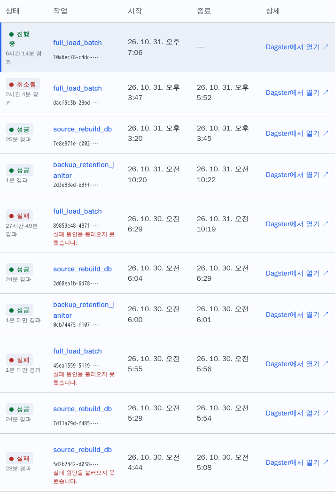

[같은 실행 상세 원본 화면](assets/repair-dagster-20261031T101246769Z-live-stage-002-detail.png)

### 전체 정합성 정상 통과와 MV 전환

정합성 보고서 `consistency_1a796d7d9bbc4ecc9456ff06ed05abfd`는 **2026-11-02 16:09:25 KST**에 검사 기록을 마쳤고 자식 작업은 **16:09:27.511384 KST**에 DONE으로 저장됐다. 시작 2026-11-01 01:20:59.593843 KST부터 **38시간 48분 28초**이며 원시 차이는 139,707.917541초다. 주소·도형 연결과 좌표 품질 판정을 포함한 정합성 전체 시간이다.

| 검사 | 등급 | 건수 | 판정과 잔여 조치 |
| --- | --- | ---: | --- |
| C1 텍스트에만 있는 건물관리번호 | WARN | 11,958 | 대응 도형·연결 자료 정정 대기 |
| C2 도형에만 있는 건물관리번호 | WARN | 375 | 모두 격리, 미격리 오류 0 |
| C3 검증된 제공 좌표 없음 | INFO | 18,692 | 약 0.2909%, 5% 경고 기준 미만 |
| C4 출입구·건물 거리 | WARN | 11,859 | 제공 좌표 50m 초과 11,805건, 500m 초과·ERROR 0 |
| C5 NAVI·건물 중심 거리 | WARN | 206 | 10m 초과, 원천 정정 대기 |
| C6 우편번호 구역 | WARN | 3,727 | 대체 1,039·대체 미확보 2,688, 제공 좌표 경계 위반·누락 도형·ERROR 0 |
| C7 읍면동 경계 | WARN | 9,879 | 대체 4,195·대체 미확보 5,684, 제공 좌표 경계 위반·누락 도형·ERROR 0 |
| C8 같은 도로명 폴리라인과 100m 초과 | WARN | 92,925 | 약 1.4506%, 원천·도로 연결 정정 대기 |
| C9 PNU 형식 | OK | 0 | 오류 없음 |
| C10 원천 기준월 | WARN | 7 | 사전 확인한 202609·202610 두 기준월의 원천 테이블 7개 |

검사별 건수는 중복될 수 있으므로 합산하지 않는다. C10은 주소 오류 7건이 아니라 **원천 테이블 수**다. C3의 제공 좌표 없음 18,692건에는 도형 연결 누락 11,958건과 격리 후 대체 미확보 6,734건이 포함된다. 따라서 6,734건을 전체 좌표 NULL 수로 표기하지 않는다. C6·C7의 격리 원인도 중복될 수 있다. 수동 표본 승인은 실행하지 않았으며 원천 좌표는 보존한다.

지정 Linux의 실제 Firefox에서 저장된 동일 보고서의 열 개 탭과 API 기록을 비교했다. 아래 원본은 화면을 수정하지 않았으며 새 전체 검사·표본 승인·강제 승격 요청은 없다. Reports 목록에 보이는 이전 ERROR 보고서는 과거 실패 이력이며 현재 선택된 WARN 보고서와 구분한다.

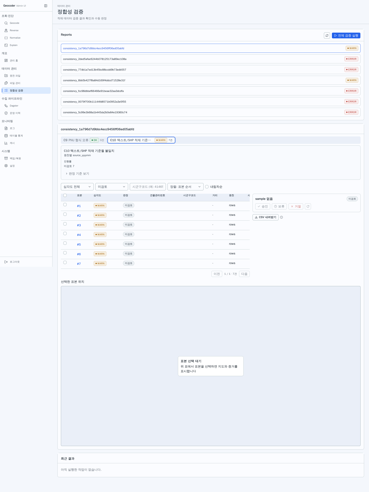

[같은 보고서 C1·C2·C3·C4의 원본 화면](assets/normal-gate-report-20261102T073235474Z-c1-overview.png)

[같은 보고서 C5·C6·C7·C8과 격리 표본의 원본 화면](assets/normal-gate-report-20261102T073235474Z-c6-quarantine.png)

MV 자식 `job_0666828babe747c985965f30a2e214d1`은 **16:09:27.653179 KST**에 시작했다. 완료된 품질 판정 `0d1dc7aa-3f89-40f6-bf8d-8b9e8fa83dca`를 재사용하므로 15시간 56분 44초 판정을 다시 실행한 것이 아니다. 새 MV·릴리스가 실제로 게시된 뒤 원천 전수 대조와 Geocode·Reverse·지도·좌표 NULL 동작을 확인한다. 운영 VWorld 키도 전체 DB 완료 후 Geo 전용 비공개 설정에 반영하고 실제 서버 요청과 지도 타일로 검증한다.

[같은 Dagster 실행과 배치 식별자를 보여 주는 상세 원본](assets/repair-dagster-20261102T040437320Z-live-stage-002-detail.png)

C8 실제 SQL은 15:15:35.884584 KST부터 완료 로그 16:03:43 KST까지 **약 48분 7초**다. C9는 완료 로그가 16:05:04 KST이며 실제 SQL 시작 시각은 관찰하지 못했다. C8 완료 로그부터의 간격 **81초**만 별도 기록하고 C9의 정확한 실행 시간으로 쓰지 않는다. C10은 실제 SQL 시작 16:05:04.819241 KST부터 완료 로그 16:09:25 KST까지 **약 4분 20초**다.

### C7 완료·C8 전환과 전체 실측 종료 기준

C7의 실제 SQL 시작은 2026-11-02 14:06:48.220146 KST, 완료 로그는 15:15:35 KST다. 초 단위 완료 로그 기준 **약 1시간 8분 47초**이며 원시 차이는 4,126.779854초다. C8 실제 SQL은 **2026-11-02 15:15:35.884584 KST** 시작해 도로명 폴리라인과 좌표의 인접성을 검사한다. 사례별 위반 건수·등급과 전체 정상 게이트는 전체 보고서 저장 뒤 확인한다.

전체 DB 로드 실측의 종료는 **릴리스 기록이 커밋된 뒤 최종 MV 자식 작업의 finished_at**으로 잡는다. 릴리스의 activated_at은 now()로 기록되며, 통계·지문 계산이 같은 트랜잭션에서 먼저 수행돼 실제 완료보다 앞설 수 있다. 이 메타데이터 값은 참고로 별도 보존한다. 전체 실측에 릴리스 기록 단계가 빠지지 않도록 가상 기록의 15분 차이를 포함하는지 검증했고, 잘못된 종료 기준 세 가지를 표 생성 전에 거부했다. 실제 전체 완료 표는 아직 만들지 않았다.

### C6 완료·C7 전환과 실측 기록

C6의 실제 SQL 시작은 2026-11-02 12:24:44.449900 KST, 완료 로그는 14:06:47 KST다. 초 단위 완료 로그 기준 **약 1시간 42분 3초**이며 원시 차이는 6,122.5501초다. 정확한 SQL 종료 시각과 완료 로그 시각을 구분한다. 우편번호 구역과 대표 좌표를 비교하는 실행을 마쳤으며, 사례별 위반 건수·등급은 전체 보고서 저장 뒤 확정한다.

C7 실제 SQL은 **2026-11-02 14:06:48.220146 KST** 시작했고 행정구역 경계와 좌표의 일치를 검사한다. 같은 복구 실행·완료 원천을 유지하며 C7–C10·정상 게이트·새 게시를 이어간다. 운영 VWorld 키는 현재 전체 DB 작업을 마친 뒤 비공개 설정에 적용하고 서버·지도 요청을 확인한다.

### 같은 실행의 만료 한도 연장과 관찰 인계

정상 검사를 원천 재적재 없이 계속하기 위해 2026-11-02 13:02:34 KST 현재 복구 실행의 최대 시간을 48시간에서 **72시간**으로 연장했다. 새 만료 한도는 **2026-11-03 19:06:18 KST**다. 이것은 실행을 보호하는 제한 시각이며 예상 완료 시각이 아니다. 설치된 Dagster의 메모리 내 제한 판정 9개와 임시 저장소 태그 변경 검증을 통과한 뒤 공식 실행 태그 갱신을 사용했다. 현재 실행 하나의 한도만 바꿨고 ID·시작 시각·다른 태그·정상 승격 조건은 유지했다.

이전 UI 관찰은 48시간 태그를 고정 검증하므로 변경을 감지한 뒤 관찰 연결만 정리했다. 새 실제 Firefox 관찰에서 72시간 태그·같은 배치·완료 원천을 대조했고 로그인 복구와 워크플로 변경 요청 0개를 확인했다. 같은 C6 SQL과 원천 manifest 7개도 유지됐다. 관찰 연결의 예정 종료를 DB 적재 실패로 기록하지 않는다.

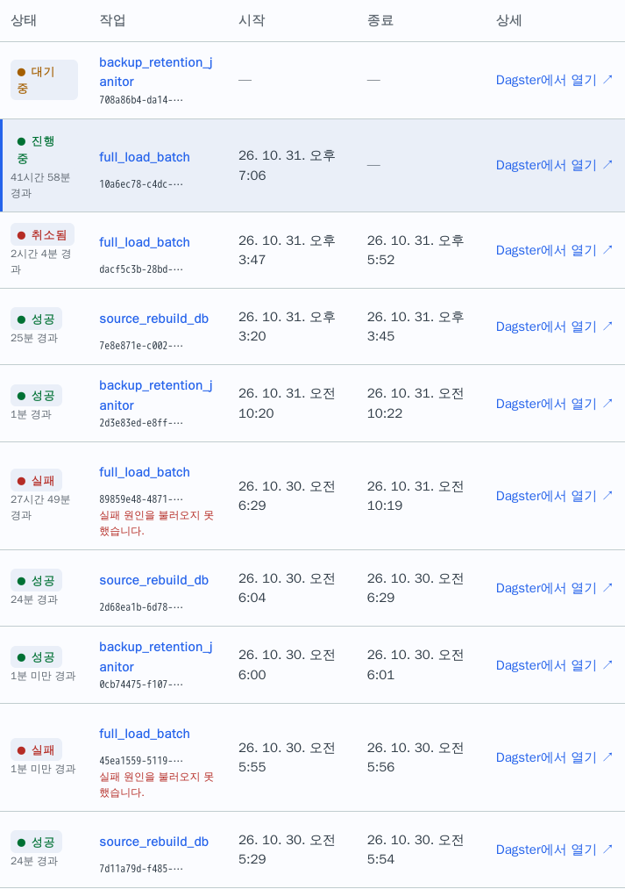

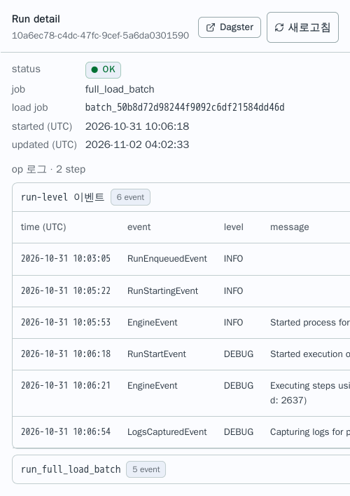

위 상세의 status OK는 조회 성공이다. 실행 완료는 목록의 성공 표시와 실제 Dagster SUCCESS·배치 DONE·새 게시를 함께 확인한다. 현재 전체 DB 완료·새 게시·최종 실제 UI 검증과 운영 VWorld 키 적용은 아직이다.

### C5 완료·C6 전환과 후속 설정 적용 순서

C5의 실제 SQL 시작은 2026-11-02 07:40:21.098876 KST, 완료 로그는 12:24:44 KST다. 초 단위 완료 로그로 계산한 소요 시간은 **약 4시간 44분 23초**이며 원시 차이는 17,062.901124초다. 완료 로그의 시각과 정확한 SQL 종료 시각을 구분한다.

C6의 실제 SQL은 **2026-11-02 12:24:44.449900 KST**에 시작했다. 대표 좌표와 기대 우편번호 기초구역의 경계 포함 여부를 검사한다. C1–C5 실행 완료는 사례별 정상 판정이나 전체 게이트 통과를 뜻하지 않는다. 전체 보고서·정상 게이트·MV·새 게시 뒤 전수 대조·최종 실제 UI를 확인하며 원천은 다시 적재하지 않는다.

운영 VWorld 키 변경은 사용자가 지정한 순서대로 **현재 전체 DB 작업 완료 후** 적용한다. 새 값은 비공개 설정에만 보관하고 코드·매뉴얼·Git 이력에 기록하지 않는다. 현재는 운영 설정을 바꾸지 않았으며, 적용 후 지오코딩 API와 실제 지도 타일 동작을 점검한다.

### C4 완료·C5 전환과 실측 기록

C4의 실제 SQL 시작은 2026-11-01 23:47:17.597274 KST, 완료 로그는 2026-11-02 07:40:20 KST다. 초 단위 완료 로그로 계산한 소요 시간은 **약 7시간 53분 2초**이며 원시 차이는 28,382.402726초다. 완료 로그의 시각과 정확한 SQL 종료 시각을 구분한다. 기존 실행이 읽어 둔 SQL의 전국 실측이며, 파일 적용 뒤의 성능 개선 실적으로 기록하지 않는다.

C5의 실제 SQL은 **2026-11-02 07:40:21.098876 KST**에 시작했다. 내비게이션 중심점과 대응 건물 도형의 중심점 거리를 검사하며, 완료된 C4와 같은 정합성 작업·배치에서 이어간다. C1–C4 실행 완료는 사례별 정상 판정이나 전체 게이트 통과를 뜻하지 않는다. 전체 보고서와 정상 게이트·새 게시를 확인한 뒤 최종 실제 UI·전수 대조와 전체 DB 시간을 확정한다.

07:10 KST 관찰 연결 인계 뒤에도 같은 배치·정합성 작업과 DB 검사 시작 시각, 원천 테이블 7개의 기록이 일치했다. 07:40 KST C4 종료와 C5 시작은 이후의 검사 단계 전환으로 별도 대조했다. 관찰 인계에서 DB 작업 재제출·제어는 없었다.

### C3 완료·C4 실행과 읽기 전용 진단

C3의 실제 SQL 시작은 2026-11-01 23:02:29.006921 KST, 완료 로그는 23:47:17 KST다. 초 단위 완료 로그로 계산한 시간은 **약 44분 48초**이며 정확한 SQL 종료 시각과 구분한다. C4의 실제 SQL은 23:47:17.597274 KST에 시작했다. C1–C3의 위반 건수·등급은 전체 보고서가 저장된 뒤 대조하며, 완료 로그만으로 정상 게이트 통과라고 기록하지 않는다.

2026-11-02 03:26:07 KST 진단에서는 실제 실행의 SQL 접두부와 종전 소스를 대조하고 같은 SQL을 현재 통계로 다시 계획만 세웠다. 건물 후보는 도로·법정동 주소 인덱스 두 개를 사용하는 계획이었다. 이는 실행 중인 실행 계획을 직접 추출한 결과가 아니며 EXPLAIN ANALYZE나 전체 검사 재실행은 하지 않았다. 앞선 같은 프로세스의 30.64초 표본에서 CPU 7.48초·디스크 읽기 약 39.2 MiB 증가도 확인했다. 처리 활동의 근거로만 사용하며 진행률·완료 예정 시각이나 성능 개선 실적으로 환산하지 않는다.

정상 실행을 유지하고 완료 원천은 다시 적재하지 않는다. 신규 파일을 적용한 뒤에도 기존 Python 실행이 미리 읽은 SQL 상수는 유지되므로 전국 검사 시간이 수정본의 실측이라고 해석하지 않는다. 최종 게시 뒤 144개 레이어·원천 계보·격리 좌표 반영을 대조하고 Chromium→Firefox 순차 실제 UI 검증을 진행한다. 전체 시간은 최초 적재 시작→새 릴리스 게시와 복구 배치 시작→종료를 나눠 기록한다.

### C2 완료·C3 실행과 파일 적용 범위

C2는 21:45:37.048107 KST 시작부터 23:02:28 KST 완료 로그까지 **약 1시간 16분 51초**가 걸렸다. 초 단위 완료 로그를 사용한 값이며 정확한 SQL 종료 시각과 구분한다. C3의 실제 SQL 시작은 23:02:29.006921 KST다. 단계 consistency:C2와 20%는 마지막 완료 항목 C2·열 개 검사 중 두 개 완료를 나타내며, 실제 실행은 C3다. 위반 건수·등급은 전체 보고서 저장 뒤 대조한다.

23:35:21 KST 읽기 전용 대조에서 현재 C3의 SQL 접두부에는 변경 전 NAVI 전량 선택이 남아 있고, 새 프로세스에서 읽은 SQL은 좌표가 없는 주소만 NAVI를 조회하는 수정본임을 확인했다. 파일 적용은 이미 실행 중인 프로세스가 읽어 둔 SQL 상수를 교체하지 않는다. 적용 뒤 시작한 C3도 기존 정합성 실행의 SQL을 사용하므로 이번 전국 실행 시간을 새 성능 수정의 개선 실적으로 기록하지 않는다. 재시작하면 완료한 품질 판정·검사를 다시 수행하므로 현재 정상 실행은 유지한다. 검사 SQL 재실행·취소·원천 변경·컨테이너 재시작은 0건이다.

### C1 완료·C2 전환과 도로 코드 비교 성능 수정

C1 SQL은 19:00:49.088495 KST에 시작했고 완료 로그는 21:45:36 KST다. 완료 로그의 초 단위 시각으로 계산한 시간은 **약 2시간 44분 47초**이며 SQL의 정확한 종료 시각을 측정한 값과 구분한다. C2의 실제 SQL 시작은 21:45:37.048107 KST다. C1의 위반 건수·최종 등급은 전체 정합성 보고서 저장 뒤 대조한다. 당시 작업 화면의 consistency:C1과 10%는 마지막으로 완료한 검사 C1과 열 개 검사 중 한 개 완료를 나타내며, 실제 실행 SQL은 다음 C2다. 전체 DB의 행 기준 진행률이나 게시 완료 비율로 사용하지 않는다.

별도 검토에서 같은 법정동의 무관한 도로 건물까지 후속 비교하는 C1 연결을 확인했다. [PR #620](https://github.com/digitie/kor-travel-geo/pull/620)은 원본 도로 코드와 소재지 코드 조합의 존재를 각각 검사해 두 코드 중 하나가 일치하는 기존 판정을 보존한다. 실제 PostgreSQL 생성 주소 1,500개·건물 1,588개의 독립 예상 위반 633건이 전후 일치했고, 두 번씩 교차 측정한 연결 필터의 무관 후보 탈락은 1,796,657건에서 0건으로 줄었다. 원천 테이블을 읽지 않는 입력이며 개선 폭을 전국 처리 시간으로 환산하지 않는다.

백엔드 2,000개·Dagster 152개·정적 검사와 최종 CI 5개·실제 PostGIS 112개가 통과했다. 새 회귀 3개는 생략 없이 실행됐고 PostgreSQL 검사의 실패·생략은 0개다. 리뷰 10분과 댓글 세 영역 확인 뒤 21:56:16 KST 병합됐다. 21:58:50 KST API·코드 서버의 C1 SQL 파일만 원본 백업과 함께 원자 교체했고, 양쪽 새 프로세스의 두 입력 모드 결과와 후보 비교량 검사가 통과했다. 컨테이너 5개·원천 manifest 7개·진행 중 C2 SQL은 유지됐다. C1은 수정 적용 전에 기존 쿼리로 끝났으므로 이번 수정으로 이미 끝난 C1이 빨라졌다고 기록하지 않는다.

적용 뒤 실제 Chromium→Firefox 순차 검증에서 새 로그인·로그아웃 뒤 인증 복구, 같은 배치·완료 원천 보존과 워크플로 변경 요청 0개를 확인했다. 원본 화면 8개를 보존하고 아래 두 장을 첨부한다. 첫 실행은 전용 입력 터미널을 누락해 자격정보 보호가 로그인 전에 차단했고, 에코 차단 준비 신호를 확인한 터미널로 같은 검증을 재실행해 통과했다. 원천·배치를 다시 제출하지 않았다.

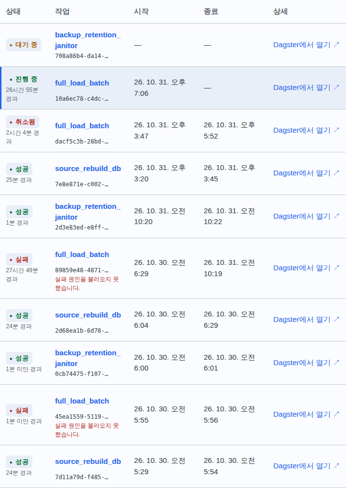

최신 병합 소스 f0ae1c9c71a57da3123a7d1a5e8b35d9f5b07b2e의 UI ARM 이미지는 22:01:27 KST 로컬 빌드·번들·아카이브 검증을 마쳤다. 빌드 58초는 DB 적재 시간에 합산하지 않는다. 같은 소스의 Python wheel 185개 파일을 대조했고 임시 확장한 소유 빌더의 자원 한도도 원래 값으로 복원했다. 실제 활성 배치에서 차단 동작을 검증해 운영 이미지 전송·수신·빌드가 모두 시작 전에 차단됨을 확인했다. API·코드 서버 새 이미지 생성, 운영 ARM 실행 검증·유휴 배포와 새 DB 게시·최종 E2E는 남아 있다.

### 관찰 환경 재시작 뒤 같은 실행으로 복구

2026-11-01 10:12 KST 무렵 로컬 WSL 재시작과 운영 호스트 접속 경로 소실을 확인했다. 현재 기본 경로를 검증하고 작업 대상 두 호스트의 경로만 복구했다. 원격 DB에서는 같은 배치·정합성 작업의 시작 시각과 활성 SQL PID가 유지됐고, 전자지도 포함 원천 manifest 7개도 이전과 같았다. DB 작업을 다시 제출하지 않았다.

10:16:01 KST 실제 Firefox의 재로그인·동일 배치 복구가 통과했다. 전자지도 DONE·정합성 실행·48시간 상한·워크플로 변경 요청 0개를 확인했다. 종료된 관찰 프로세스만 새 관찰로 인계하고 이전 체크포인트·원본 화면·로그를 보존했다. 아래 화면의 선택된 실행 ID와 진행 상태를 대조한다.

성능 확인은 지정 주소 5개의 읽기 전용 건물 후보 조회로 제한해 실측했다. 후보 집합은 같았지만 캐시 영향을 줄인 재비교에서 조건 변경의 일관된 개선은 입증되지 않아 해당 건물 후보 조건은 변경하지 않았다. 전체 좌표 품질 검사 SQL을 중복 실행하지 않았다. 이 제한 조회의 실행 계획·실측과 앞선 전체 쿼리의 읽기 전용 계획 확인은 별도 기록이다.

### 대표 좌표가 있는 주소의 NAVI 전량 조회 생략

별도 검토에서 대표 출입구 좌표가 있는 주소도 NAVI 전체를 정렬·연결하는 경로를 확인했다. [PR #619](https://github.com/digitie/kor-travel-geo/pull/619)는 출입구 좌표가 NULL일 때만 NAVI를 조회하도록 바꿨다. 같은 주소키·읍면동에서 가장 작은 원천 ID를 선택하고 빈 좌표·NULL 주소키·첫 NAVI의 NULL 좌표와 기존 원천 우선순위를 보존한다. 좌표 품질과 관련 정합성 검사의 변경이며, NAVI 건물명을 보강하는 별도 MV SQL은 유지한다.

실제 PostGIS 생성 입력 500개 주소의 두 입력 모드를 독립 예상값과 대조했다. 수정 전 불필요한 NAVI 1,000행 읽기를 재현했고 수정 후 0행을 확인했다. 백엔드 2,000개·Dagster 152개·정적 검사, 최종 CI 5개·실제 PostGIS 109개(새 회귀 3개 포함, 생략 0개)와 리뷰를 통과해 `87992c5a09942fd85c5553565f82993a895eacaf`로 병합됐다. 생성 입력의 개선 폭을 전체 운영 검사 시간으로 환산하지 않는다.

2026-11-01 14:06:00 KST API·코드 서버의 `serving_quality.py` 한 파일만 적용하고 새 프로세스 양쪽에서 같은 생성 입력 결과·NAVI 읽기 0행을 확인했다. 보조 검증이 MV와 좌표 검사의 SQL 문자열 공유를 잘못 가정해 중단됐지만, 반영된 API 파일 해시와 실제 호출자를 대조해 검증 단계부터 이어갔다. API 파일은 다시 쓰지 않고 검증했으며 이어서 코드 서버를 적용했다. 컨테이너 5개·원천 manifest 7개와 기존 활성 SQL은 그대로였다. **이미 실행 중인 검사는 기존 계획으로 계속된다.**

아래는 13:40 Chromium→13:41 Firefox 순차 실제 UI 검증의 원본이다. 새 로그인·로그아웃 뒤 인증 복구와 같은 배치·완료 원천 보존을 대조했고 워크플로 변경 요청은 0개였다. 선택된 전체 배치는 계속 진행 중이므로 이 화면을 전체 DB 게시 완료로 해석하지 않는다. 원본 8개를 보존하고 목록 두 장을 매뉴얼에 첨부했다.

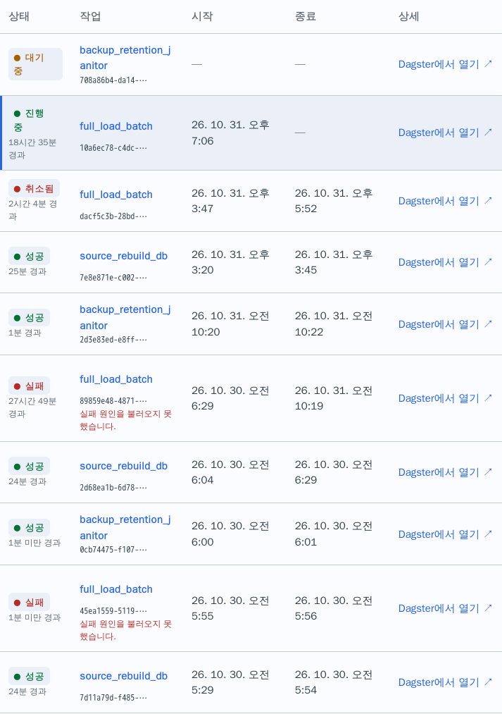

정합성 재개·통계 표시·NAVI 조회 수정을 포함한 앞선 병합 소스 `87992c5a09942fd85c5553565f82993a895eacaf`의 UI ARM 이미지는 14:20:14 KST에 로컬 빌드·번들·아카이브 검증을 완료했다. 소요 시간 13분 40초는 DB 적재 시간과 별도이며, Python wheel의 소스 185개도 같은 병합 소스와 대조했다. API·코드 서버의 새 이미지 생성, 운영 ARM 실행 검증·유휴 확인·정식 배포와 최종 데이터 E2E는 남아 있다.

**테이블 통계 화면은 추정치**다. 분석 이력이 있어 `≈` 표시가 없던 숫자도 실제 행 수와 다를 수 있다. 통계의 갱신 시각도 적재 완료 시각이 아니므로 본 매뉴얼의 완료·실측 판정에는 원본 대조·manifest·DB 작업 기록을 사용한다. PostgreSQL도 `n_live_tup`을 추정 행 수로 정의한다. [공식 통계 설명](https://www.postgresql.org/docs/18/monitoring-stats.html#PGSTAT-ALL-TABLES-VIEW). 표시 보정 [PR #618](https://github.com/digitie/kor-travel-geo/pull/618)은 단위 286개·별도 후보의 Chromium→Firefox 순차 6개·CI 5개와 리뷰를 통과해 `e719f0751d95c3a75cfaa8837fe64001888a2a5d`로 병합됐다. 새 UI 이미지 적용은 아직이며 현재 적재를 보존한다.

앞선 UI 이미지는 운영 적재와 별도의 로컬 Linux ARM 빌드에서 준비했다. 컴파일·타입 검사·이미지 생성 후, 검증 보조 절차가 로컬 태그를 외부 레지스트리에서 찾는 문제가 있었다. 생성된 이미지를 유지하고 이미지의 실제 번들·패키지 파일을 읽어 검증 단계부터 재개했다. 아카이브 SHA256을 기록했고 로컬 빌더 자원도 원래대로 복원했다. 운영 호스트에서의 ARM 실행 검증·유휴 확인·정식 배포는 남아 있으므로 운영 적용 완료로 간주하지 않는다.

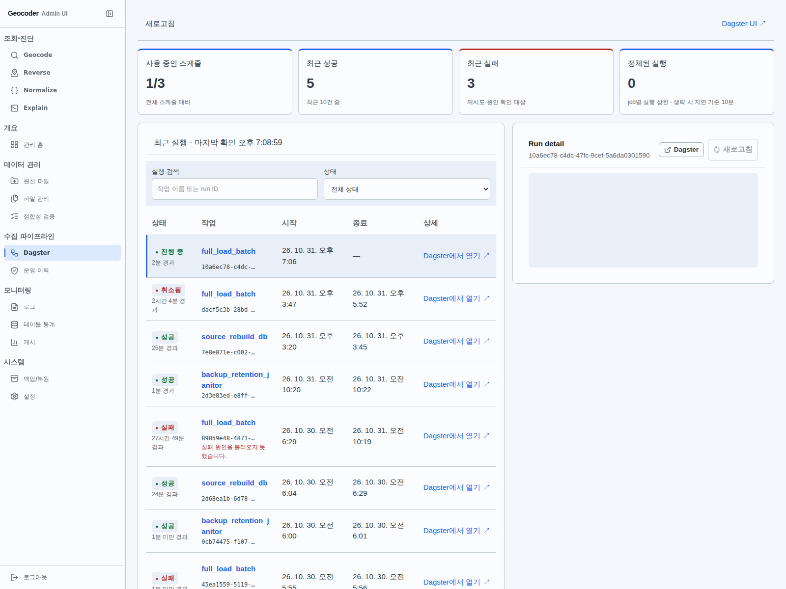

정합성 재개 [PR #615](https://github.com/digitie/kor-travel-geo/pull/615)는 `e62ecd52c39f95312c29ac0953ff925b58cdea28`로 병합됐다. 실제 PostgreSQL 94개(재개 14개, 생략 0개), CI 5개와 Chromium→Firefox API 모의 화면 회귀 14개가 통과했다. API·코드 서버·UI 3종의 새 이미지 검증과 정식 배포를 마쳤으며 18:26:44 KST Manager healthy와 실제 실행 소스·재개 계약을 확인했다. 배포 완료와 실제 정합성 재개·새 DB 게시 성공은 구분한다.

기존 완료 원천과 새 전자지도 복구 작업이 서로 다른 배치에 속하는 경우의 검증도 [PR #617](https://github.com/digitie/kor-travel-geo/pull/617)에서 추가했다. 최종 CI 5개와 실제 PostGIS 106개(재개 26개, 생략 0개)·리뷰를 통과해 `da6be3f1c3034d6b5f33578d654410f405494f5b`로 병합됐다. 새 복구 구성의 실제 자식·취소 순서·파일·해시·월·manifest를 대조하며 원래 실패·취소를 보존한다. 새 이미지 검증·유휴 시점 배포는 아직 남았으므로 현재 운영 기능과 구분한다. 실행 중 컨테이너는 교체하지 않는다.

현재 관리 화면은 원천 배치 취소 버튼을 제공하지 않고 외부 Dagster 콘솔은 인증 오류, 내부 콘솔은 연결 거부였다. 재로그인 뒤 같은 실행을 확인하고 관리 API와 같은 정식 취소 처리·감사 기록으로 중지했으며 실제 UI의 취소 상태를 대조했다. DB·RustFS 서비스를 직접 정지하거나 재시작하지 않았다.

### 강원·경기가 일부만 적재됐는지 확인

2026-10-31 19:05:07 KST 읽기 전용 재검증에서 아래 18개 항목 모두 **실제 DB 행 수 = 원본 DBF 레코드 수**였다. 합계만으로 완료를 판단하지 않고 시도·레이어별로 대조했다. 원천 행 수 확인이며 좌표 정합성·서빙 승격 판정은 뒤의 정합성 검사에서 수행한다.

| 레이어 | 강원 원본 = DB | 경기 원본 = DB |
| --- | ---: | ---: |
| 시도 | 1 | 1 |
| 시군구 | 18 | 47 |
| 읍면동 | 298 | 747 |
| 리 | 1,142 | 1,398 |
| 기초구역 | 1,809 | 6,263 |
| 도로 관리 | 52,223 | 115,796 |
| 도로 구간 | 1,283,140 | 2,683,148 |
| 도로폭 | 90,894 | 215,942 |
| 건물 | 595,196 | 1,652,031 |

부분 적재로 중단된 곳은 경남이다. 취소 당시 도로폭은 99,999건이고 건물은 0건이었다. 복구 입력에서 강원·경기를 제외하고 경남부터 이어가며 미완성 레이어의 중복을 막는다. 불필요한 전체 파일 읽기도 실패 재현 후 SHP 헤더 100바이트만 읽도록 수정·테스트하고 실행 코드에 적용했다. 소스 수정 [PR #616](https://github.com/digitie/kor-travel-geo/pull/616)은 CI 5개·실제 PostGIS 94개(생략 0개)와 리뷰를 통과해 병합됐다. 이 작은 수정은 해당 실행 모듈만 적용했으며 복구 중 이미지를 교체하거나 컨테이너를 재시작하지 않았다.

## 첫 적재·취소 시도의 실행 이력

원천 11종·86개 파일 8,223,492,364바이트의 순차 등록과 원본 크기·전체 SHA256 대조를 마쳤다. 새 백업의 깊은 검증, API·코드 서버·UI 정식 이미지 배포, 새 로그인·로그아웃·보호 화면·인증 프록시 검증도 통과했다.

첫 본 배치는 2026-10-31 10:19:33 KST에 원천 7개 적재 뒤 정합성 오류로 실패했다. 이 시도의 핵심 원천 51개 파일은 모두 처리됐다. 한글 ZIP을 주소·관련 지번 두 작업에서 재사용해 6개 카테고리에서 작업 7개를 실행했다. 정합성 검사 10개도 모두 실행됐고 최종 판정은 ERROR였다. 당시 MV 갱신·새 서빙 릴리스는 차단됐으며 실패 이력을 보존한다.

후속 주소 연결 수정은 PR #611·#612로 머지했다. 사용자는 **원천 보존·불량 좌표 격리·검증된 대체 좌표 적용 후 정상 승격**을 선택했다. 좌표 격리 [PR #613](https://github.com/digitie/kor-travel-geo/pull/613)과 게시 호출 수정 [PR #614](https://github.com/digitie/kor-travel-geo/pull/614)는 각각 실제 PostGIS 80개(새 좌표 정책 13개 포함, 생략 0개)와 CI 5개를 통과해 머지됐다. #614의 수정 전 실패 재현과 수정 후 관련 21개·백엔드 1,990개 통과도 확인했다. 새 API·코드 서버 이미지 배포와 마이그레이션 `0031`은 완료됐고, 실제 실행 컨테이너의 소스 185개 파일·의존성·게시 호출·캐시 권한 검증 및 두 브라우저 live UI 회귀도 통과했다. UI·공용 Dagster 컨테이너는 보존했다.

같은 등록 원천으로 새 재구축 준비 `job_78d60f36940645ee8fe6eec7964edcc0`을 2026-10-31 15:17 KST에 실제 UI에서 제출했다. 준비는 15:20:38–15:45:10 KST, 24분 32초에 완료됐고 Dagster `7e8e871e-c002-47d6-8c2e-4f5bbfce3151`도 SUCCESS다. 새 DB 배치 `batch_b2792a89775c40ab80bd3ceca24f19ed`는 15:47:51 KST에 시작됐으며 Dagster 실행은 `dacf5c3b-28bd-4a24-bcd6-6d8153e35a52`다. 이 재구축을 제출한 당시 운영 버전에는 정합성 재개 경로가 없어 준비와 원천 적재부터 다시 실행했지만, 이후 사용자 지시로 첫 전자지도 단계에서 취소했다. 배치 루트의 15:47:51–17:51:27 KST 실측은 2시간 3분 36초이며 성공 시간으로 세지 않는다. 새 정합성·MV·서빙 릴리스와 성공한 전체 DB 로드 시간은 미확정이다.

매칭 세트 검증과 추가 원천의 무결성 점검은 통과했으며 실패·격리는 0개다. 준비 과정의 캐시 권한·Dagster 연결·하위 작업 검색 문제는 복구·테스트하고 코드에 반영했다. 네 번째 파일 준비는 2026-10-30 06:29:11 KST에 완료됐고, 첫 본 배치는 2026-10-30 06:30:29 KST에 시작해 원천 7개를 순차 적재했으나 정합성 승격 조건을 통과하지 못해 종료됐다. 이전 준비 실패는 아래 복구 기록에서 별도로 확인한다.

파일 전송·초안 생성에는 운영 API에 연결한 검증 UI를 사용했고, 재구축은 정식 운영 UI에서 제출했다. 아래 화면과 대조 기록은 회귀 테스트의 모의 데이터와 구분되는 실제 원천 실행 결과다.

## 1. 원천과 기준월 확인

원본 압축파일을 보존한다. 폴더 이름과 실제 자료 기준월이 같다고 가정하지 않는다.

| UI 카테고리 | 이번 원천 | 기준월 |
| --- | --- | --- |
| 도로명주소 한글 전체분 | `202609_도로명주소 한글_전체분.zip` | `202609` |
| 위치정보요약DB | `202609_위치정보요약DB_전체분.zip` | `202609` |
| 내비게이션용DB | `202609_내비게이션용DB_전체분.7z` | `202609` |
| 도로명주소 전자지도 | 시도별 ZIP 16개 | `202610` |
| 도로명주소 출입구 정보 | `도로명주소출입구_전체분_…zip` 16개 | `202610` |
| 구역·건물·건물군 내 동 도형 | 카테고리별 시도 ZIP 16개 | `202610` |
| 주소DB | `202609_주소DB_전체분.zip` | `202609` |
| 상세주소DB | `202609_상세주소DB_전체분.zip` | `202609` |
| 건물DB | `202609_건물DB_전체분.zip` | `202609` |

이번 폴더에는 90개 파일이 있다. 현재 카탈로그가 지원하는 11개 카테고리는 86개 파일에 해당한다. 도로명·사물주소·상세주소 표시·상세주소 동 표시 전체분 4개는 현재 카탈로그의 적재 대상이 아니므로 원본을 보존한다.

서빙 DB 재구축에 연결된 원천은 한글·위치·내비게이션·전자지도·출입구·구역 6개 카테고리다. 나머지 5개는 검증 또는 후속 기능을 위한 원천 등록 대상이다. 등록 완료가 곧 해당 자료의 서빙 좌표 사용을 뜻하지 않는다.

대표 출입구는 위치정보요약을 우선 사용하고, 도로명주소 출입구는 한글 주소와 기준월이 같을 때만 후보로 선택한다. 이번 도로명주소 출입구는 `202610`, 한글 주소는 `202609`이므로 출입구 원천 6,411,242건의 적재 완료와 실제 대표좌표 사용 건수를 구분한다.

2026년 7월 이후 자료는 전남광주통합특별시 코드 `12`를 포함한 16개 시도다. 이전 17개 시도 자료와 섞지 않는다. [행정안전부의 변경 공지](https://www.mois.go.kr/frt/bbs/type001/commonSelectBoardArticle.do?bbsId=BBSMSTR_000000000052&nttId=127039)를 참고한다.

## 2. 관리자 로그인과 현재 상태 확인

운영 관리 UI에서 로그인하고 **관리 홈 → 원천 파일**로 이동한다. 기존 구성과 사용 가능한 백업을 확인한다. 아래는 이번 실행의 실제 로그인 성공 화면이다.

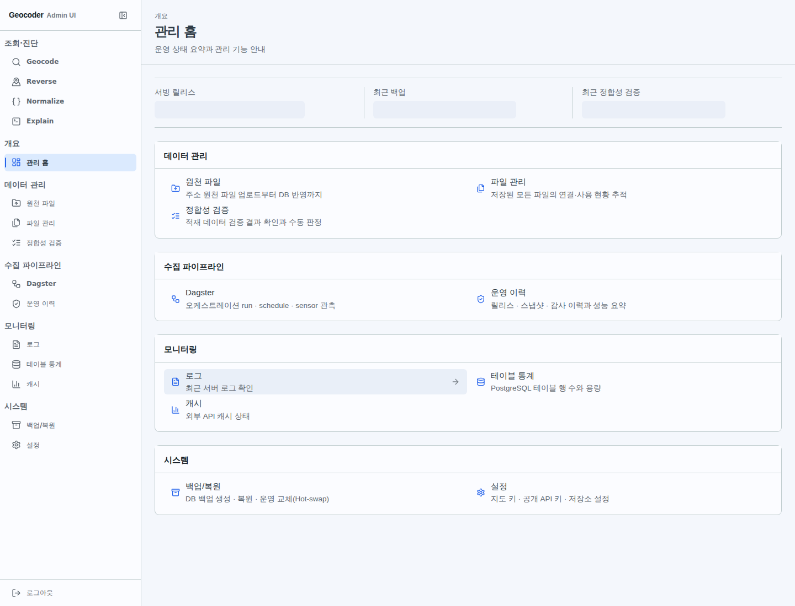

갱신 전 **Geocode**에서 공개 주소 `서울특별시 강남구 테헤란로 152`를 조회해 `OK` 응답과 지도 위치를 기록했다. 완료 뒤 같은 주소를 다시 조회해 비교한다.

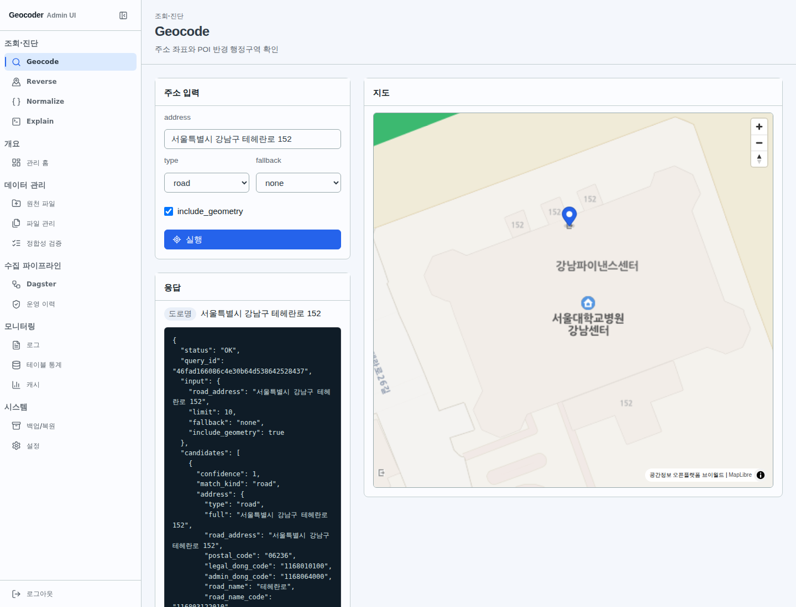

## 3. 백업 확인

**백업/복원**에서 사용할 수 있는 백업과 생성 시각을 확인한다. 새 백업이 필요하면 **백업** 탭에서 실행하고 완료를 확인한 뒤 원천 등록과 DB 적재로 넘어간다. 백업 작업의 완료와 백업 파일의 `available` 상태를 모두 확인한다. 작업 식별자와 결과 화면을 함께 기록한다.

이번 실행은 `serving-ready`, 병렬 작업 수 2, 압축 레벨 3으로 백업했다. 작업 `job_d8ff07a16e9f46779580ababd0a1edd8`은 완료됐고, Dagster 실행도 `SUCCESS`다. 새 파일은 4,480,406,943바이트이며 UI의 첫 행에서 `AVAILABLE`을 확인했다. 아래의 과거 백업 행들과 생성 시각을 구분한다.

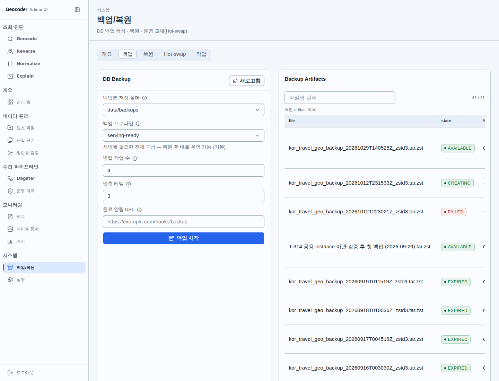

**개요 → 무결성 검증 → CLI 명령 보기**는 `ktgctl backup verify <id> --deep`을 안내한다. 이 단계는 현재 UI에서 직접 실행할 수 없다. 운영자가 실제 백업 ID로 명령을 실행하고 JSON 결과의 `ok`, `archive_sha256_matches`, `internal_checksums_ok`, `manifest_ok`가 모두 `true`인지 확인한다. 명령의 종료 코드만으로 성공을 판단하지 않는다. 복원 드릴과 실제 복원 실행은 이 무결성 확인과 별도다.

이번 새 백업은 위 네 검증 항목이 모두 `true`, 오류 목록은 비어 있는 것을 확인했다.

## 4. 카테고리별 업로드와 등록

**원천 파일 → 업로드 마법사**에서 카테고리와 기준월을 선택한다. 단일 파일 자료는 원본 ZIP·7z를, 시도 자료는 해당 카테고리의 16개 ZIP을 지정한다. 한 카테고리의 업로드·사전 점검·등록 완료를 확인한 뒤 다음 카테고리로 진행한다.

시도별 자료는 **업로드 세션 열기**를 누른 뒤 각 시도 이름에 맞는 파일을 하나씩 선택한다. 완료한 파일은 그대로 두고, 대기·실패한 시도부터 이어서 선택한다. 모든 파일을 전송한 뒤 사전 점검이 실행된다. 손상 파일을 다시 선택하면 해당 파일만 처음부터 교체 전송한다. 한 카테고리를 등록한 뒤 원본과 수신 크기·전체 파일 SHA256을 대조하고 다음 카테고리로 넘어간다.

아래는 전자지도에서 서울·전남광주 파일을 전송한 실제 중간 화면이다. `2/16`은 파일 두 개의 수신 완료를 뜻하며, 카테고리 전체 등록은 모든 파일의 전송·점검 뒤 진행한다.

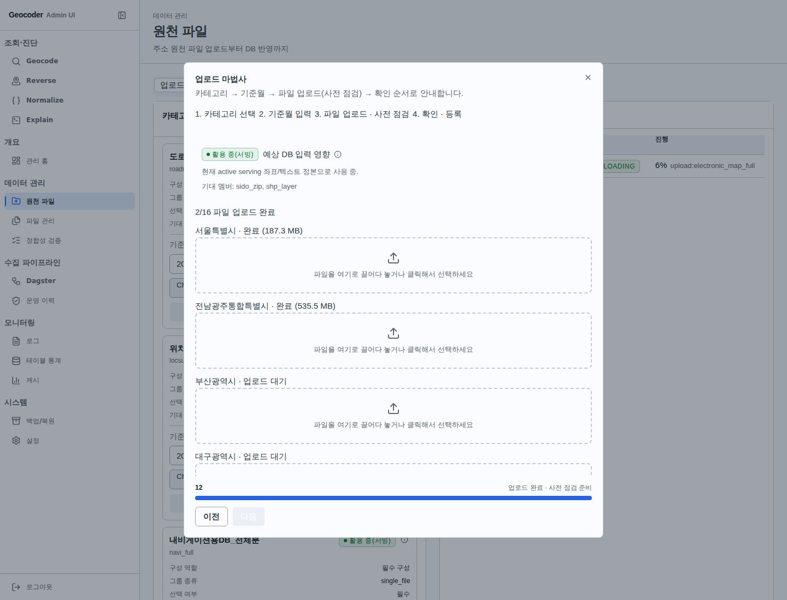

사전 점검에서 필수 멤버 결손은 해결한 뒤 등록한다. SHP의 선택 `.prj` 누락 같은 경고는 내용과 좌표계 해석을 확인하고 기록한다.

### 이번 실행의 등록 확인

| 카테고리 | 기준월 | 파일 수 | 원본 크기·SHA256 대조 | 상태 |
| --- | --- | ---: | --- | --- |
| 위치정보요약DB | `202609` | 1 | 일치 | `available` |
| 도로명주소 한글 전체분 | `202609` | 1 | 일치 | `available` |
| 내비게이션용DB | `202609` | 1 | 일치 | `available` |
| 도로명주소 전자지도 | `202610` | 16 | 모두 일치 | `available` |
| 도로명주소 출입구 정보 | `202610` | 16 | 모두 일치 | `available` |
| 구역의 도형 | `202610` | 16 | 모두 일치 | `available` |
| 도로명주소 건물 도형 | `202610` | 16 | 모두 일치 | `available` |
| 건물군 내 상세주소 동 도형 | `202610` | 16 | 모두 일치 | `available` |
| 주소DB | `202609` | 1 | 일치 | `available` |
| 상세주소DB | `202609` | 1 | 일치 | `available` |
| 건물DB | `202609` | 1 | 일치 | `available` |

최초 실패 세션을 유지하면서 위치정보요약 원본 151,895,900바이트를 다시 전송했다. 전체 SHA256 `0a71f478c9a2f8441f39058b857ae9d2d63754b605180bac5ed4119f7a07ae23`이 원본과 등록 파일에서 같았다.

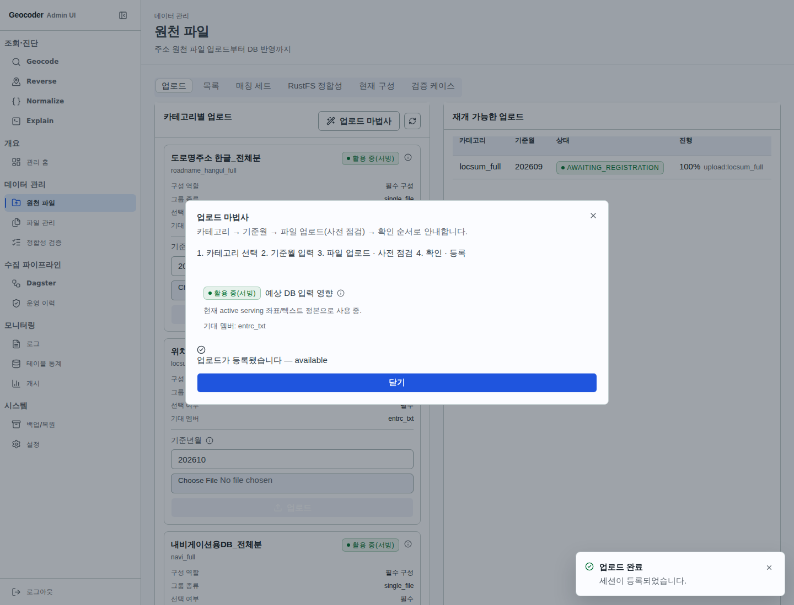

한글 전체분은 92,134,273바이트이며 업로드·사전 점검·등록 뒤 원본 크기와 전체 SHA256이 일치했다.

내비게이션 7z는 333,752,676바이트이며 필수 멤버 점검·등록 뒤 원본 크기와 전체 SHA256이 일치했다.

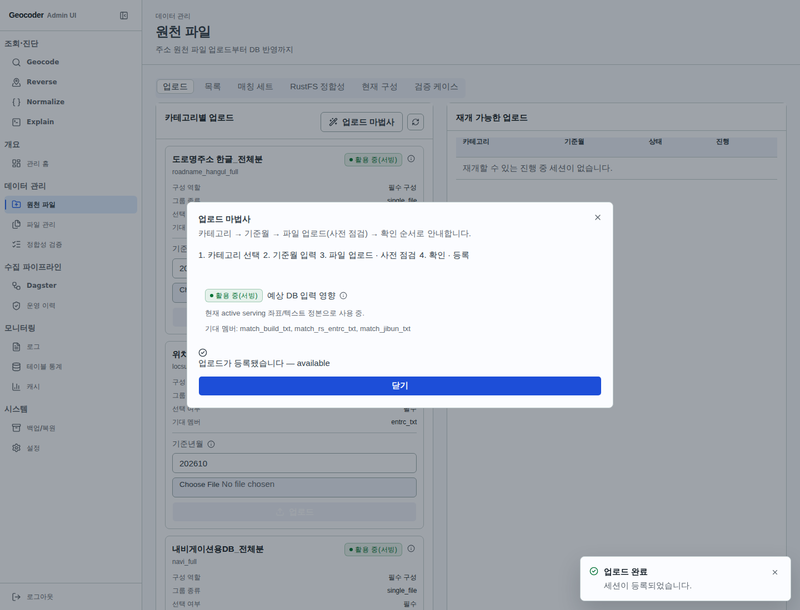

전자지도는 16개 파일 4,572,487,429바이트를 등록했다. 전자지도와 구역 도형에서 선택 `.prj` 누락 경고를 확인했으며, 좌표계는 원천 사양에 따른 `EPSG:5179`다. 필수 레이어 결손이나 점검 실패는 없었다. 출입구 정보는 경고 없이 통과했다.

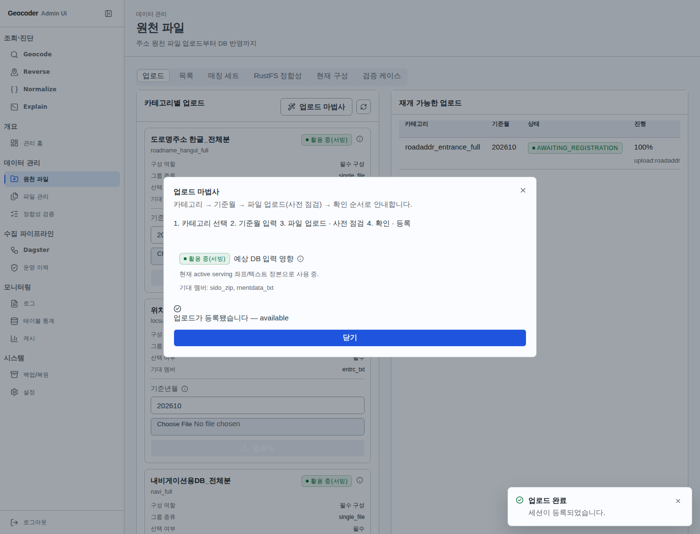

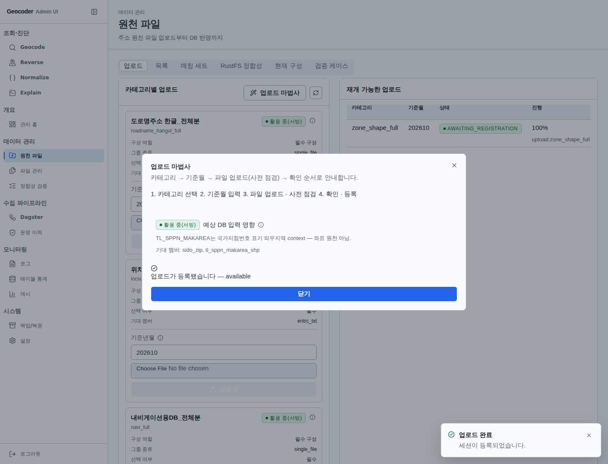

건물 도형은 16개 원본과 대조한 뒤 등록했다. 화면의 **승격 보류(NO-GO)** 표시는 기존 대표좌표 평가 결과이며 등록 성공과 구분한다. 이번 재구축에서도 이 원천을 서빙 좌표로 승격하지 않는다. 선택 `.prj` 누락 경고만 있고 필수 멤버 결손은 없었다.

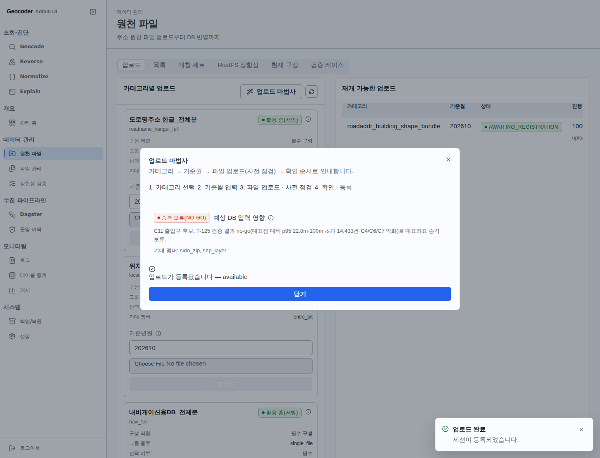

건물군 내 동 도형도 16개 파일의 등록과 원본 대조를 마쳤다. 상세주소 기능 후보 분류를 유지하며 이번 서빙 좌표에는 사용하지 않는다.

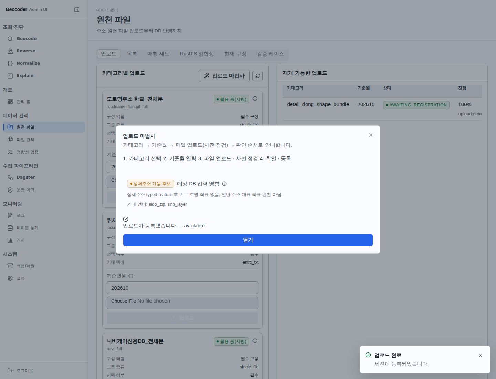

주소DB·상세주소DB·건물DB도 각각 순서대로 등록하고 원본과 대조했다. 주소·건물DB는 검증 전용, 상세주소DB는 상세주소 기능 후보 분류를 유지한다.

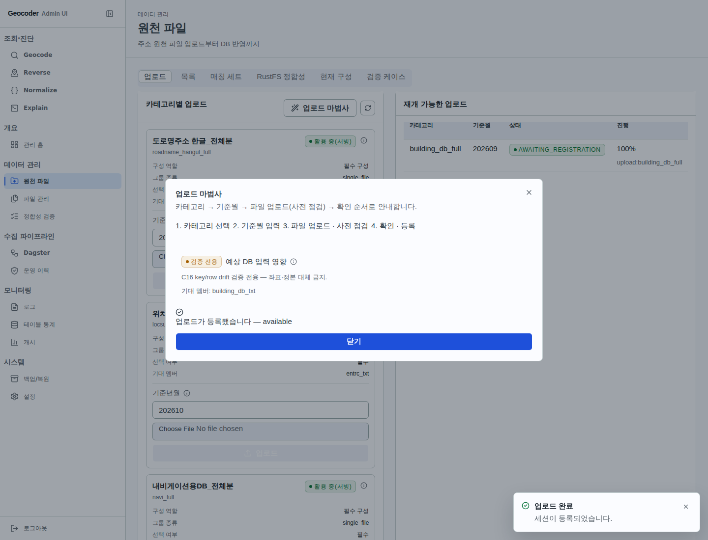

## 5. 매칭 세트와 DB 재구축

**매칭 세트 → 새 매칭 세트 만들기**에서 이름과 구성 프로파일을 입력하고 이번에 등록한 카테고리별 그룹을 선택한다. 기본 구성은 한글·위치·내비게이션·전자지도, 권장 구성은 출입구·구역을 추가한다. 카테고리별 기준월을 다시 확인하고, 서로 다른 월이면 확인란을 체크한 뒤 **초안 생성**을 누른다.

이번 세트는 `f92ec587-370d-43e4-8e22-47fe5de543ae`이며 11개 그룹을 연결한 권장 구성이다. `validate` 결과는 `ok: true`, `state: validated`, 무결성 경보 없음, 거절 사유 없음이다.

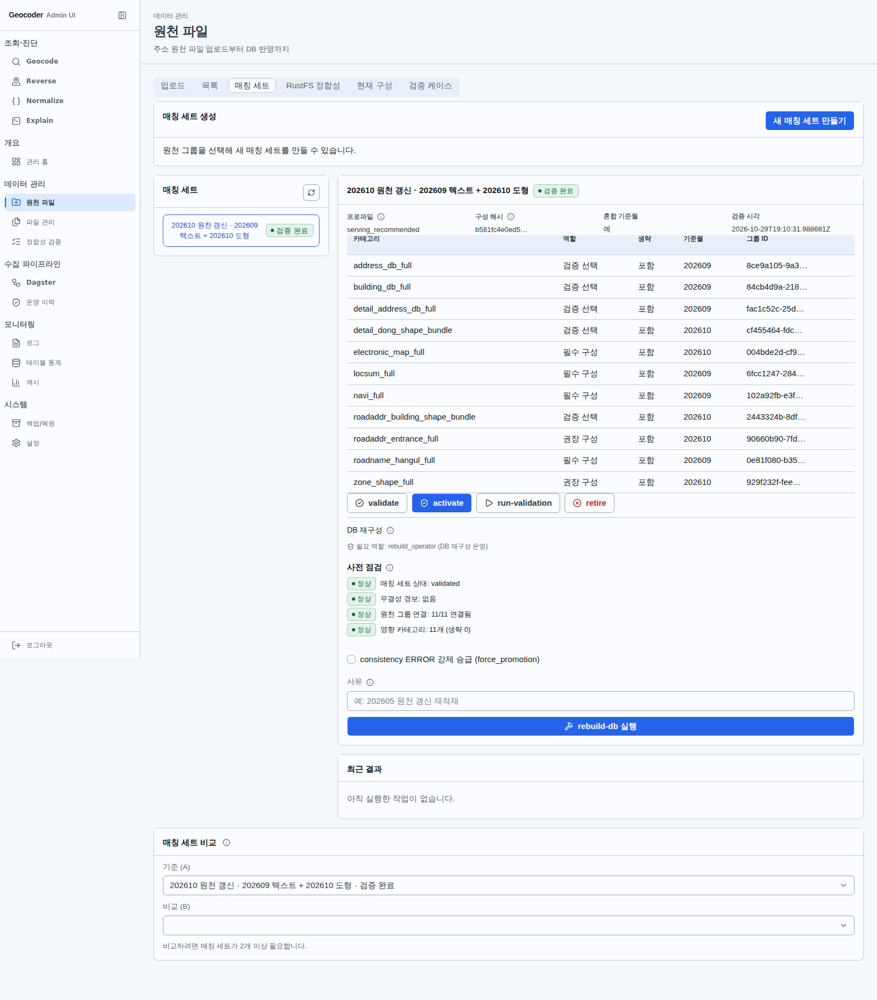

**run-validation**도 실제 원천의 사용 직전 무결성을 확인했다. 실패 0개·격리 그룹 0개이며 C11·C12·C13·C16·C17은 실행 가능, 추가 원천이 없는 C14·C15는 건너뜀이다. 이 결과는 입력 게이트를 뜻하며 무거운 보강 지표 계산의 완료를 뜻하지 않는다.

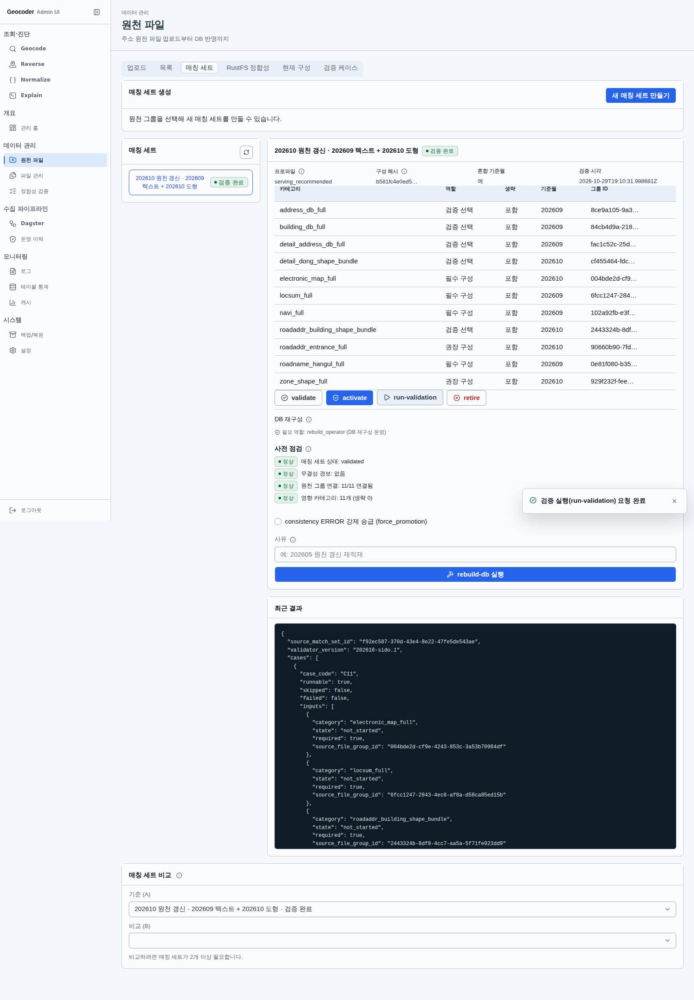

생성만으로 DB가 바뀌지는 않는다. 선택된 초안에서 **검증(validate)** 작업을 실행하고, 검증을 통과한 세트에서 DB 재구축을 시작해 작업 식별자를 기록한다. **Dagster**와 작업 상세 화면에서 각 단계의 종료를 확인한다.

이번 재구축 요청은 정식 운영 UI에서 강제 승격 없이 제출했다.

| 구분 | 식별자·결과 |
| --- | --- |
| 최초 준비 작업 | `job_f20aa6c94bb1407ca6210f9afc2f1b6a` — 권한 오류로 실패, 하위 배치 없음 |
| 최초 준비 Dagster 실행 | `de6758d2-b725-42e0-a591-faa9aea43996` — `FAILURE` |
| 최초 제출 시각 | 2026-10-30 04:27 KST |
| 두 번째 준비 작업 | `job_eab457d8d3d445298557594e7d828573` — 하위 작업 제출 실패 |
| 재시도 Dagster 실행 | `5d2b2442-d038-482b-8fde-828c3bce88a8` |
| 재시도 제출 시각 | 2026-10-30 04:41 KST |
| 세 번째 준비 작업 | `job_a3a7722ffc50461187dd15e8c37f25fe` — 준비 완료, 하위 배치 실패 |
| 세 번째 준비 Dagster 실행 | `7d11a79d-f485-437c-9feb-412b6eda5420` |
| 세 번째 제출 시각 | 2026-10-30 05:29 KST |
| 세 번째 하위 배치 | `batch_6cc24f4a45f944f289d7952048b34a85` — 준비 작업 오선택으로 실패, 원천 적재 없음 |
| 네 번째 준비 작업 | `job_a67da58095c94e318d423a69794f9d06` — 준비 완료 |
| 네 번째 준비 Dagster 실행 | `2d68ea1b-6d78-42a5-86ed-5f406c53d9bd` |
| 네 번째 제출 시각 | 2026-10-30 06:03 KST |
| 첫 시도의 원천 적재 배치 | `batch_977f870ebfd54b68a4199b96a07523eb` — 원천 7/7 완료·정합성 ERROR로 전체 배치 실패 |
| 첫 시도의 Dagster 실행 | `89859e48-4871-4af6-81d9-9b73d9484f14` |
| 실제 원천 적재 시작 | 2026-10-30 06:30 KST |
| 강제 승격 | 사용하지 않음 |

[두 번째 준비 요청 원본 화면](assets/match-set-rebuild-submitted-retry.png)

[세 번째 준비 요청 원본 화면](assets/match-set-rebuild-submitted-third.png)

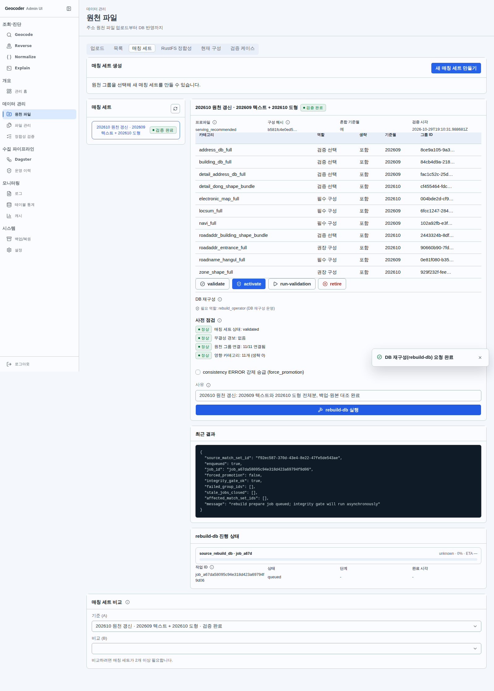

아래는 세 번째 시도의 **파일 준비와 하위 배치 제출 성공** 화면이다. 이 뒤 배치 자체는 별도 오류로 실패했으므로 DB 갱신 완료를 뜻하지 않는다.

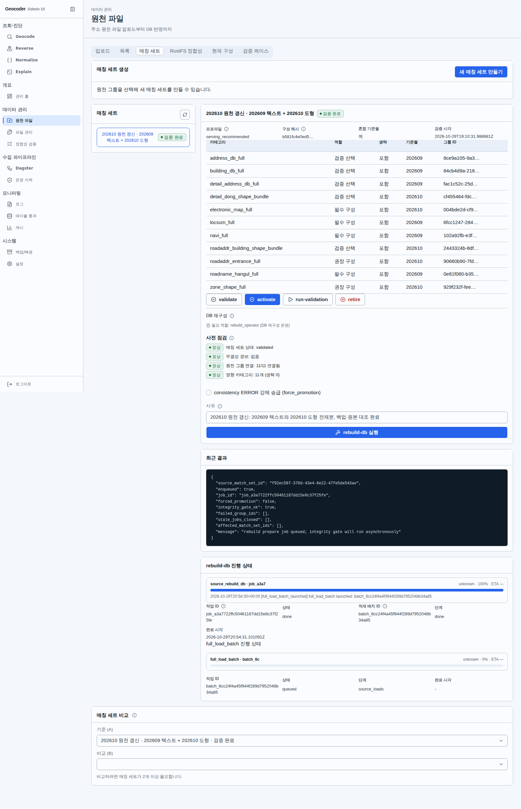

준비 작업은 무결성 확인과 압축파일 준비 뒤 하위 `full_load_batch`를 실행한다. 준비 작업의 `done`만으로 완료로 판단하지 않는다. 하위 배치의 원천 적재 7개·정합성·MV 갱신과 새 서빙 릴리스까지 확인한다.

이번 배치는 다음 원천 작업을 순서대로 실행한다. 한글 원천 하나에서 텍스트와 관련 지번을 나누어 적재하므로 서빙 원천 6종에서 작업 7개가 만들어진다. 원천 작업 7개는 모두 완료됐으나 정합성 최종 ERROR로 후속 MV가 차단됐다. MV 갱신·새 서빙 릴리스와 실제 UI 조회까지 확인해야 전체 배치 완료로 판단한다.

| 순서 | 작업 | 원천 기준월 | 현재 결과 |
| --- | --- | --- | --- |
| 1 | `shp_polygons_load` — 전자지도 | 202610 | 완료 |
| 2 | `locsum_load` — 위치정보요약 | 202609 | 완료 |
| 3 | `navi_load` — 내비게이션 | 202609 | 완료 |
| 4 | `roadaddr_entrance_load` — 출입구 | 202610 | 완료 |
| 5 | `juso_text_load` — 한글 주소 | 202609 | 완료 |
| 6 | `juso_parcel_link_load` — 관련 지번 | 202609 | 완료 |
| 7 | `sppn_makarea_load` — 구역 도형 | 202610 | 완료 |

전자지도는 각 시도에서 경계·코드·도로 레이어를 순서대로 읽고 건물 도형을 마지막에 처리한다. 16개 시도의 레이어가 끝난 뒤에도 도형 정리·통계·반경 파생 테이블 처리가 남는다. 건물 누적 건수만으로 전체 배치 진행률을 계산하지 않으며, 같은 건수에서 도로 레이어나 후처리가 실행 중일 수 있다.

전체분 DB 재구축은 새 원천에 없는 이전 키도 정리한다. 모든 시도의 파일과 기준월을 확인하고, 복구할 수 있는 백업이 완료된 뒤 실행한다. 빈 원천이나 일부 행만 읽는 설정으로 전체분을 교체하지 않는다.

전자지도 작업 `job_b394d22f53cd4cfea0faf6553b0a013e`는 2026-10-30 13:34:26 KST에 완료됐다. 건물 도형 10,684,220건은 원천 16개 DBF 헤더 합계와 정확히 일치했다. 같은 배치에서 위치정보요약이 이어서 시작됐고, 실제 작업 설정은 원천 7개 모두 `replace=true`·행 수 제한 없음으로 확인했다.

아래 실행 목록은 **첫 전자지도 종료 뒤에도 전체 배치는 진행 중**인 것을 보여준다. 전자지도 종료 시각은 작업의 DB 기록으로 대조했으며 전체 배치의 성공으로 세지 않는다.

위치정보요약 작업 `job_502413d0f91245489821218e49e9b27b`는 2026-10-30 15:28:20 KST에 완료됐다. DB 기록상 소요 시간은 1시간 53분 54초이며 적재 기록은 6,410,686건·기준월 202609다. 임시 COPY 이후 이전 키 정리와 본 테이블 반영까지 마쳤고, 내비게이션은 15:28:20 KST에 이어서 시작했다.

아래는 원천 두 개 완료 뒤에도 같은 전체 배치가 계속 실행 중인 당시의 원본 화면이다. 원천 2/7 완료와 전체 배치 완료를 구분한다.

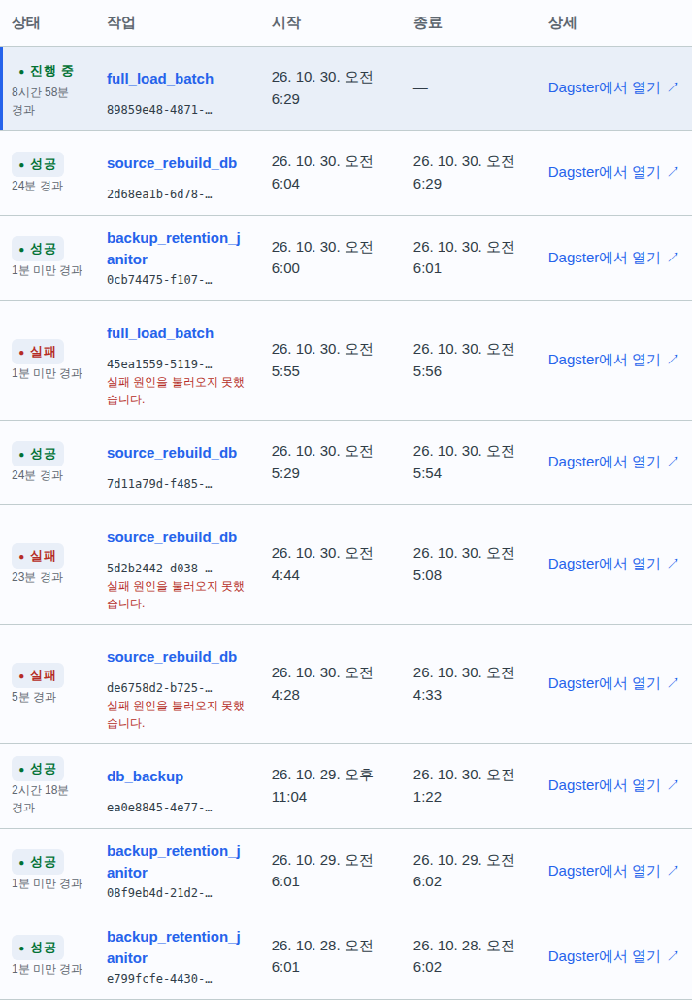

위치정보요약 원본을 전수 재집계하면 물리 입력은 6,424,765행이고, 좌표가 없는 14,079행을 제외한 처리 대상은 6,410,686행이다. 원천 자연키의 중복으로 3행이 합쳐져 실제 저장은 6,410,683행이다. 이 차이는 원본 SHA256을 확인한 같은 ZIP에서 재현됐으며 좌표가 같은 중복 키와 나머지 속성의 차이를 확인했다. 처리 건수와 저장 건수를 같은 값으로 기록하지 않는다.

내비게이션 작업 `job_08af2a85066d4b99847bc4dbf1de2a3b`는 2026-10-30 19:58:34 KST에 완료됐다. 실측 소요 시간은 4시간 30분 14초이고 중심점 적재 기록은 10,683,827건·기준월 202609다. 중심점 반영과 내비게이션 출입구 처리를 같은 트랜잭션에서 마친 뒤, 도로명주소 출입구가 같은 배치에서 19:58:34 KST에 시작됐다.

아래 원본 실행 목록은 세 번째 원천 종료 뒤에도 같은 전체 배치가 계속 진행 중인 화면이다. 원천 3/7 완료와 개별 작업 시각은 DB 기록으로 대조했으며 전체 배치 완료와 구분한다.

출입구 원천은 16개 ZIP의 RNENTDATA TXT를 전수 집계한 물리 입력 6,422,987행이다. 좌표가 없는 행 제외와 키 중복 정리 전의 수치이며, 최종 테이블 행 수와 구분한다. COPY 종료 뒤에도 본 테이블 입력과 트랜잭션 확정이 남으므로 파일 읽기 완료를 적재 완료로 세지 않는다.

출입구 작업 `job_b3eb598bf39e48a99309652e775b04ea`는 2026-10-30 21:56:17 KST에 완료됐다. 실측 소요 시간은 1시간 57분 43초이며 처리·반영 기록은 모두 6,411,242행·기준월 202610이다. 원본 16개 파일을 좌표 조건으로 다시 전수 집계해 좌표값이 없는 11,745행을 제외한 6,411,242행이 처리 기록과 정확히 일치함을 확인했다. 키 중복 정리로 추가 감소한 행은 없었다. 한글 주소 작업은 같은 배치에서 21:56:18 KST에 이어서 시작됐다.

뒤이은 C10의 실제 테이블 집계에서도 도로명주소 출입구 6,411,242행을 확인했다. 원본 입력 6,422,987행과 저장된 행 수를 구분한다.

아래 원본 실행 목록은 네 번째 원천 종료 뒤에도 같은 전체 배치가 계속 진행 중인 화면이다. 원천 4/7 완료와 개별 작업 시각은 DB 기록으로 대조했으며 전체 배치 완료와 구분한다.

한글 주소 작업 `job_34606af037ab405fbe7f060899e9da7a`는 2026-10-31 01:34:18 KST에 완료됐다. 2026-10-30 21:56:18 KST부터 실측 3시간 38분 1초가 걸렸으며 적재 기록은 6,424,765건·기준월 202609다. COPY 뒤 이전 키 정리와 본 테이블 반영·트랜잭션 확정을 마쳤다. 같은 한글 ZIP의 관련 지번 작업은 01:34:18 KST에 이어서 시작했다.

아래는 다섯 번째 원천 종료 뒤에도 같은 전체 배치가 계속 진행 중인 원본 화면이다. 원천 5/7 완료와 개별 작업 시각은 DB 기록으로 대조했으며 전체 배치 완료와 구분한다.

관련 지번 작업 `job_ce3f3f08c1604ca3ab3c47a79353a374`는 2026-10-31 02:15:22 KST에 완료됐다. 실측 소요 시간은 41분 4초이며 적재 기록은 1,770,572건·기준월 202609다. 같은 한글 ZIP의 주소·관련 지번 두 작업이 모두 끝났고 구역 도형은 02:15:23 KST에 이어서 시작했다.

아래는 여섯 번째 원천 종료 뒤에도 같은 전체 배치가 계속 진행 중인 원본 화면이다. 원천 6/7 완료와 개별 작업 시각은 DB 기록으로 대조했으며 전체 배치 완료와 구분한다.

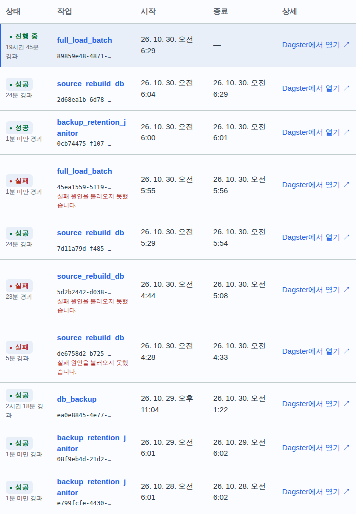

마지막 구역 도형 작업 `job_f950fd26b2cb4c6a8413622f405137c3`는 2026-10-31 02:23:38 KST에 완료됐다. 실측 소요 시간은 8분 16초이며 적재 기록 24,204건·기준월 202610은 원본 16개 DBF의 헤더 합계와 정확히 일치했다. 핵심 51개 파일의 원천 적재가 끝났고 정합성 검사는 02:23:39 KST에 시작됐다.

아래는 원천 7개를 모두 마친 뒤에도 같은 전체 배치가 정합성 검사를 계속하는 원본 화면이다. 원천 완료와 정합성·MV·새 릴리스까지의 전체 배치 완료를 구분한다.

### 정합성 오류로 종료된 실행

2026-10-31 10:19:33 KST에 정합성 보고서가 ERROR로 확정돼 전체 배치가 실패했다. 보고서 작업의 완료와 전체 배치의 성공을 구분한다. MV 작업은 생성되지 않았고 새 서빙 릴리스도 게시되지 않았다. 원천 7개 완료 기록과 적재 데이터를 보존해 원인을 진단한다.

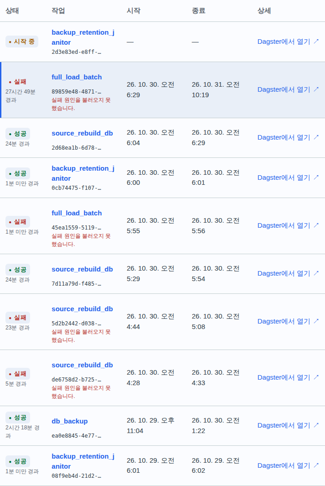

| 검사 | 결과 | 위반 건수 | 확인 내용 |
| --- | --- | ---: | --- |
| C1 | WARN | 30,802 | 텍스트만 존재 |
| C2 | ERROR | 30,181 | 도형만 존재: 주소 미연결 29,587·키 누락 594 |
| C3 | WARN | 3,790,441 | 대표 출입구 미해소 |
| C4 | ERROR | 3,020 | 50m 초과 3,020건 중 500m 초과 12건 |
| C5 | WARN | 206 | 내비게이션 중심점 거리 |
| C6 | ERROR | 701 | 우편번호 구역 밖 |
| C7 | ERROR | 5,988 | 읍면동 경계 밖 |
| C8 | WARN | 22,257 | 도로 연결 |
| C9 | OK | 0 | 지번 연결 |
| C10 | WARN | 7 | 집계 대상 7개 테이블·기준월 2개 |

보고서 식별자는 consistency_2ded5afac6244b078125173a89ec108a다. 아래 원본 화면은 실제 ERROR 결과와 C4 거리 표본을 보여준다. 가장 먼 표본은 약 181km로, 원본 좌표·변환·주소 연결을 대조하기 전에는 정상 좌표로 취급하지 않는다.

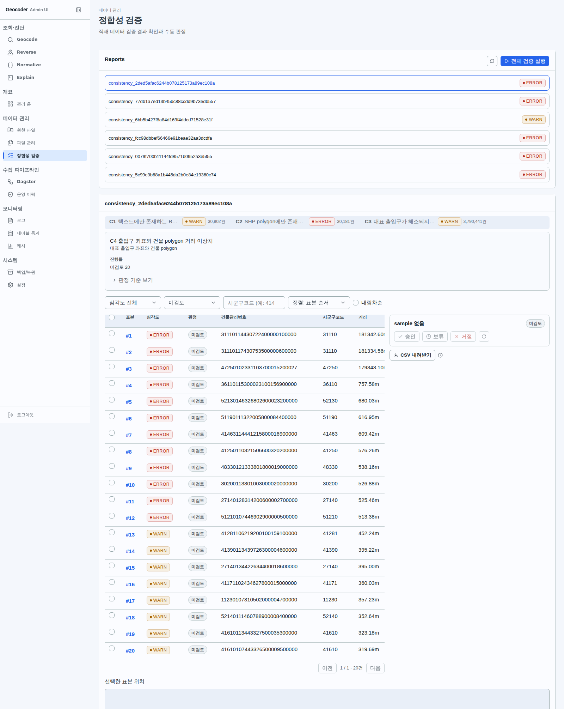

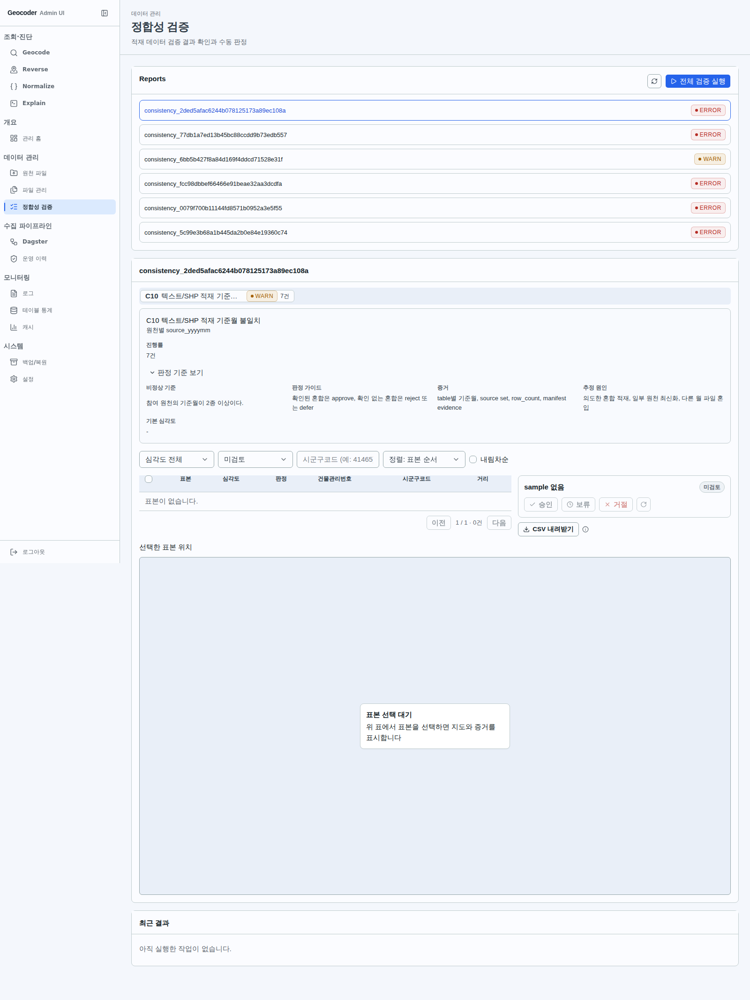

진단에서 같은 도로·건물번호·우편번호의 위치정보요약 읍면동 코드 끝 00과 한글 주소의 상세 리 코드가 전체 일치 조건 때문에 연결되지 않는 표본을 확인했다. 또한 배치의 주소 연결 호출이 정합성 뒤 MV 단계에만 있어 검사 전 연결 처리가 누락됐다. [PR #611](https://github.com/digitie/kor-travel-geo/pull/611)에서 검사 전 연결·읍면동 8자리 비교·재적재의 이전 파생 연결 제거를 수정했다. 순서와 실패 전파 회귀는 수정 전 실패·수정 후 통과이며 실제 PostgreSQL을 포함한 CI 5개를 통과했다. 11:11:57 KST에 운영 코드 서버 3개 파일의 반영·새 import·컨테이너 및 이미지 보존을 확인했다. 신규 전체 재검증은 아직 남아 있다.

C2 표본의 같은 주소는 원본 한글에서도 도로 코드 `112004103113`, 도형에서는 `111404103113`이었다. [PR #612](https://github.com/digitie/kor-travel-geo/pull/612)는 기존 코드 조회를 보존하면서 도형의 소재지 시군구와 도로 번호 조합으로도 연결한다. 법정동 10자리·건물구분·본번/부번 조건과 원본 코드·물리 건물관리번호는 보존한다. 실제 PostgreSQL의 양쪽 코드 조회·다른 법정동 제외·식별자 보존·품질 CSV 회귀를 포함한 CI 5개를 통과해 머지했다. 새 식 인덱스와 정식 이미지 반영, 아래 두 브라우저의 같은 주소 도형·지도 검증까지 완료했다. 전체 원천의 정합성 재검증은 새 DB 배치에서 진행한다.

### 원본 좌표와 경계 위반 대조

C4 대표 5개 표본을 원본 ZIP의 해당 행과 대조한 결과 좌표가 모두 DB와 같았다. 다음 3개는 약 179–181km 떨어져 있어 코드 연결 수정과 구분되는 원천 품질 문제다. 읽기 전용 추가 검증에서 이 3개 주소의 NAVI 후보 4개 모두 같은 주소·기준월이고 대응 건물·기대 우편구역·읍면동 경계 내부임을 확인했다. 아직 실제 좌표 대체나 승격에 사용하지 않았다.

| 주소 | 기존 보고서의 건물 도형 거리 | 원본 좌표와 DB | NAVI 대체 후보 검증 |
| --- | ---: | --- | --- |
| 울산광역시 중구 병영성11길 1 | 181,342.60m | 일치 | 주소·월 일치, 경계 3종 통과 |
| 울산광역시 중구 종가20길 6 | 181,334.56m | 일치 | 주소·월 일치, 경계 3종 통과 |
| 경상북도 상주시 성동로 152-27 | 179,343.10m | 일치 | 후보 2개 모두 주소·월 일치, 경계 3종 통과 |

우편번호 구역 위반 3개 표본은 경계에서 약 2.65–6.51m, 읍면동 경계 위반 3개 표본은 약 0.26–10.16m였다. 이는 전체 위반의 최솟값·최댓값이 아니다. 큰 좌표 오류와 경계 주변의 차이를 같은 원인으로 묶지 않는다. 후속 처리 방침은 아래와 같이 확정됐으며, 실제 재검증 결과가 나오기 전에는 새 승격을 완료로 기록하지 않는다.

### 확정된 후속 처리 방침

사용자는 1번인 **불량 좌표 격리·검증된 대체 좌표 적용 후 정상 승격**을 선택했다. 원천 정정이나 예외 승격에 대한 회신 대기 상태는 해소됐다. 강제 승격을 승인한 것은 아니며 `forced_promotion`은 사용하지 않는다.

1. 원본 압축파일·원천 테이블의 좌표·식별자·기준월은 보존한다. 별도 판정 이력에 원천 manifest, 원본 좌표, 사유와 대체 좌표의 출처를 기록한다.
2. 대표 좌표의 주소·기준월과 건물·우편구역·읍면동 경계를 검사한다. 건물 거리의 50m 경고·500m 오류 기준과 경계 포함 판정은 유지한다. 서빙에 부적합한 좌표를 격리하며 원천 오류 건수를 없애지 않는다.
3. 같은 주소·기준월의 NAVI 좌표 중 대응 건물 내부이고 기대 우편구역·읍면동 경계 안에 있는 좌표만 대체로 사용한다. 검증된 대체가 없으면 그 주소의 좌표를 제공하지 않는다. 불량 원래 좌표로 되돌리지 않는다.
4. 원문 주소에 연결되지 않는 도형도 원천에 보존하고 일반 서빙 조회에서 제외한다. 정합성 보고서는 원천 위반·격리·대체·좌표 미제공과 실제 서빙 오류를 구분한다. 격리되지 않은 서빙 오류는 계속 ERROR로 차단한다.
5. 정합성이 통과한 동일 판정 이력으로 MV를 만들고 새 릴리스를 검증한다. 실제 격리·대체·미제공 건수, 원천 보존 여부, Geocode/Reverse 화면과 소요 시간은 실행 후 기록한다.

위 표본의 대체 후보는 읽기 전용 공간 검증을 통과했다. 전체 자료의 실제 판정 이력과 서빙 대체 결과는 아직 없으며, 기존 실패 보고서의 위반 건수를 수정 후 잔여 오류나 고유 주소 수로 간주하지 않는다.

### 코드 배포 뒤 두 브라우저 회귀

병합 소스 `991068d7225b68a233e840d9a996904836f28719`의 새 API·코드 서버를 정식 Manager 잠금 안에서 배포하고, 2026-10-31 14:59:30 KST에 서비스 검증 `healthy`를 확인했다. 실행 중인 두 컨테이너에서도 소스 파일 해시·의존성·게시 호출 계약을 확인했다. DB 주소 연결 인덱스와 좌표 판정 이력 스키마 `0031` 검증도 통과했다.

Chromium과 Firefox에서 새 로그인·잘못된 비밀번호 차단·보호된 관리자 조회를 확인했다. `서울특별시 성동구 동호로5길 207`은 외부 fallback 없이 실제 건물 도형과 지도 마커를 표시했고, 같은 좌표의 200m Reverse에도 같은 건물이 포함됐다. 실제 지도 worker와 VWorld 타일 수신도 검증했다. 이 검사는 **기존 서빙 버전에서의 코드 배포 검증**이며 새 원천 DB 전체 갱신 완료를 뜻하지 않는다.

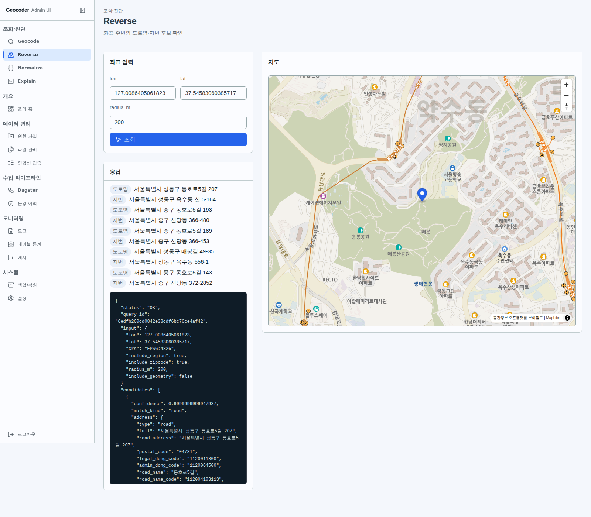

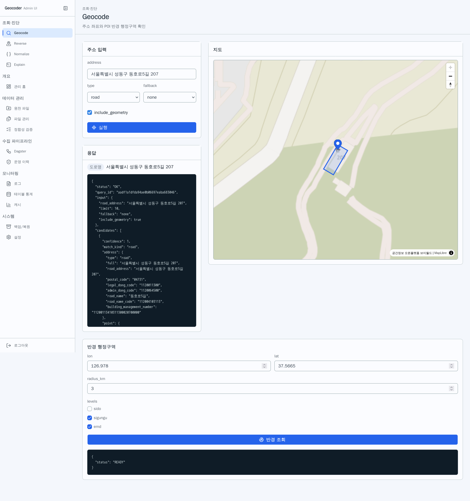

### 격리 방침을 반영한 같은 원천 재실행

이전 원천 7개 완료·정합성 ERROR·MV 미실행을 보존하고, 새 이미지와 두 브라우저 검증 뒤 같은 검증 완료 매칭 세트로 재구축을 제출했다. **consistency ERROR 강제 승급**은 체크하지 않았으며 응답의 `forced_promotion`도 `false`다. 아래 요청 완료 화면과 준비 작업의 대기 상태는 전체 적재 성공과 구분한다.

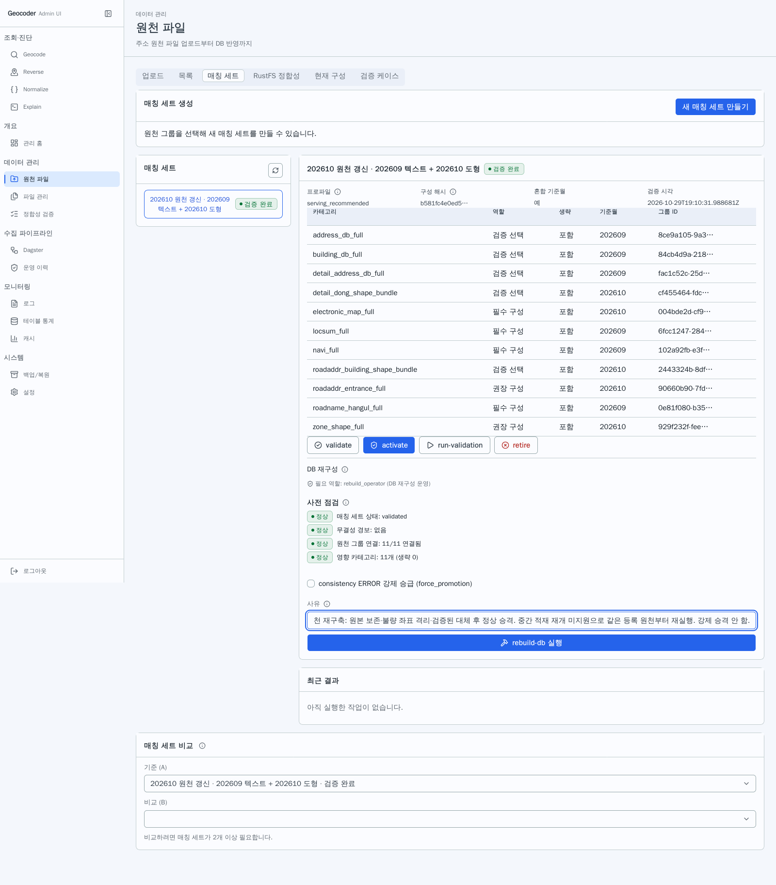

새 준비는 무결성 검증·파일 준비를 마쳤고 후속 전체 배치가 원천 7개의 순차 실행을 시작했다. 첫 전자지도 작업 `job_8713482b22c5494a975bbcd810effd0b`는 15:47:52 KST에 시작됐으나, 이후 사용자 지시로 17:53:52 KST에 취소됐다. 동일한 실행의 실제 Dagster 태그에서 `dagster/max_runtime=172800`을 확인했다. 이는 자동 종료 상한 48시간이며 예상 완료 시간이나 실측 소요 시간이 아니다.

실제 UI에서 로그아웃·재로그인한 뒤 기존 전체 배치를 다시 선택하는 복구 검증도 통과했다. 복구 전후 배치·실행 식별자가 같고 재구축·재시도·취소 요청은 발생하지 않았다. 다음 원본은 새 배치의 실행 목록과 상세다. 원천 0/7·첫 전자지도 실행 상태는 같은 배치의 DB 작업 기록으로 별도 대조했다.

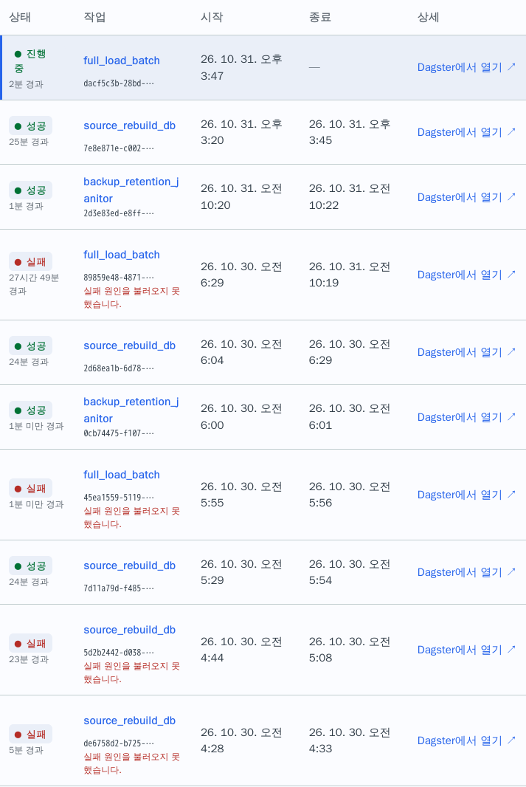

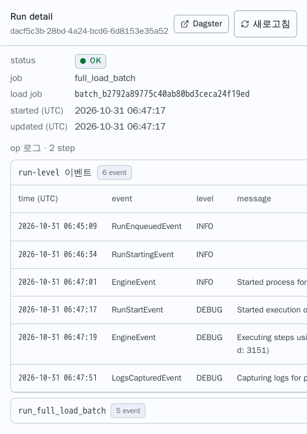

## 6. 실패한 단계에서 재개

실패 메시지·작업 식별자·마지막 성공 단계를 먼저 기록한다. 실행 중인 작업이 남았는지 확인하고 중복 실행하지 않는다.

- 업로드 실패: **재개 가능한 업로드**에서 세션을 연다. 저장한 원본과 수신 크기·체크섬이 다르면 해당 파일을 다시 업로드한다.
- 사전 점검 실패: 잘린 파일이나 빠진 멤버를 해결하고 같은 세션에서 사전 점검을 다시 실행한다.
- 원천 적재 중 실패·취소: 부분 적재 상태를 완료로 바꾸지 않는다. 완료된 원천의 검증 가능한 백업·체크포인트를 먼저 확인한다. 이번에는 최신 사용자 승인에 따라 유실 전자지도만 복구하고 완료한 나머지 원천은 보존한다. 전체 재구축을 중복 제출하지 않는다.
- 정합성 오류: 원인을 해결하고 재검증한다. 확인되지 않은 오류를 넘겨 서빙 승격하지 않는다.

### 원천 적재부터 다시 시작한 이유

첫 본 배치의 원천 7개는 당시 적재 완료됐다. 좌표 격리 정책은 완료된 기존 원천에도 적용할 수 있으므로, 정책 자체가 재적재를 요구하는 것은 아니다. 다만 이후 새 전체분의 전자지도가 대상 테이블을 비우고 다시 채웠으므로, 현재 원천 상태를 옛 완료 이력만으로 증명할 수 없다.

재구축을 제출한 당시 운영 UI는 원천 7개→정합성→MV·릴리스를 하나의 Dagster 실행 단위로 묶었고, 실패 배치를 정합성부터 재개하거나 완료 원천 자식을 재사용하는 기능이 없었다. PR #615는 이 재개 경로를 추가한다. 기존 Dagster 같은 단계 재실행은 원천 부분을 건너뛰는 재개가 아니며, 완료 상태 자식을 새 실행이 다시 인수할 수 없다.

**정합성 검증** 화면의 개별 재검사는 가능하지만 새 독립 작업이다. 이 결과를 실패한 전체 배치의 정합성 게이트·매칭 세트와 연결해 후속 MV·정상 서빙 승격까지 이어가는 UI 경로는 없다. 별도 MV 갱신 API는 독립 `manual_rebuild` 경로이므로 이번 전체분 배치 재개의 대체로 사용하지 않았다.

당시 “재개가 불가능하면 처음부터” 방침에 따라 수정·테스트·새 이미지 배포 뒤 전체 재구축 경로를 사용했다. 이후 새 원천 적재 금지 지시로 이 재적재를 취소했고, 복구점 부재 확인 뒤 사용자가 유실 전자지도만 신속히 복구하도록 승인했다. 등록한 원천 업로드는 보존한다. 이전 원천 적재 실측만 약 20시간이므로 이 반복 비용과 취소 시간을 성공한 새 적재 시간으로 합산하지 않는다.

### 정합성 단계부터 재개

완료 원천을 보존한 실패·취소 전체 배치는 **원천 파일 → 매칭 세트 → 같은 세트 선택 → 실행 방식: 정합성부터 재개**에서 이전 전체 배치 ID와 사유를 입력한다. 파일 식별자·해시·기준월과 완료 작업·현재 manifest가 일치해야 한다. 원천이 일부만 적재됐거나 다른 원천 쓰기가 끼어들면 요청을 거부한다. 이전 실패를 성공으로 고치지 않고 새 배치에서 정합성·정상 게이트·MV·릴리스를 실행한다. 강제 승격을 함께 선택할 수 없다.

이 기능은 #615의 새 UI·API·코드 서버 배포에 포함됐다. 위의 시도별 유실 복구 제출과 구분하며, 실제 DB 재개 완료 여부는 실행 결과로 확인한다.

배포한 실제 운영 화면을 지정 Linux 환경의 Chromium→Firefox 순서로 검증했다. 두 브라우저 모두 기존 취소 상태·동일 복구 실행의 진행 상태·변경 원천을 가리키는 옛 배치의 거부·원천이 미완료인 취소 배치의 거부를 통과했다. 실제 API가 두 요청을 각각 409로 거부했고 검증 전후 원천·배치 식별자는 같으며 새 원천 작업은 0개였다. 이 결과는 잘못된 재개 차단의 성공이며 실제 DB 재개 성공을 뜻하지 않는다.

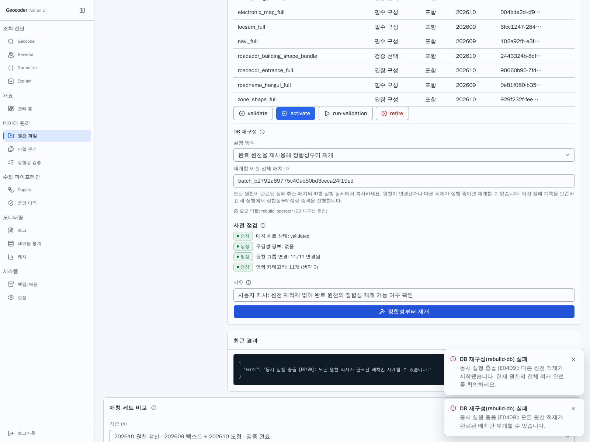

추가 원본: [Chromium 취소 상태](assets/resume-live-chromium-20261031T100852068Z-cancelled.png), [Chromium 변경 원천 거부](assets/resume-live-chromium-20261031T100852068Z-changed-original-rejected.png), [Chromium 미완료 원천 거부](assets/resume-live-chromium-20261031T100852068Z-incomplete-cancelled-rejected.png), [Firefox 취소 상태](assets/resume-live-firefox-20261031T100910223Z-cancelled.png), [Firefox 동일 복구 실행](assets/resume-live-firefox-20261031T100910223Z-repair-running.png), [Firefox 변경 원천 거부](assets/resume-live-firefox-20261031T100910223Z-changed-original-rejected.png). 화면은 수정하지 않고 SHA256 동일성을 확인해 보존했다.

### 브라우저 실행 환경과 세션 복구

Linux Firefox의 처음 실행 환경에서는 WebGL2가 제공되지 않아 주소 응답이 OK여도 지도 캔버스가 생성되지 않았다. 실제 실패 화면은 아래와 같다. 가상 디스플레이와 Mesa 소프트웨어 렌더러에서 WebGL2를 검증한 뒤 Firefox의 지도·타일·worker·Geocode·Reverse 전체 회귀가 통과했다. Chromium의 완료 검증은 보존하고 실패했던 Firefox 단계만 재실행했다. UI의 WebGL2 확인을 제거하거나 빈 지도를 성공 화면으로 사용하지 않았다.

관리 UI 세션은 브라우저 식별값에 연결된다. Firefox 세션을 Chromium에서 재사용해 401이 발생한 뒤 브라우저별 세션을 구분하고 같은 Firefox 세션으로 재구축을 제출했다. 인증 차단을 우회하거나 브라우저 식별 검증을 완화하지 않았다. 이 인증 실패에서는 DB 재구축 요청이 생성되지 않았다.

### 긴 적재 중 연결·로그인 복구

브라우저나 관찰 연결이 끊겼다면 먼저 **Dagster** 화면(`/admin/dagster`)을 다시 연다. 로그인 화면으로 이동하면 UI에서 로그인한 뒤 **Recent runs**의 기존 `full_load_batch` 실행을 선택한다. **Run detail**의 전체 배치 식별자와 현재 실행 식별자가 앞서 기록한 값과 같은지 확인한다. 작업 상태와 원천 자식의 상태를 조회하고, 연결이 끊겼다는 이유만으로 재구축을 다시 제출하지 않는다.

이번 실행은 실제 UI 로그아웃·재로그인 뒤 같은 배치와 원천 자식 7개를 다시 확인했다. 이 관찰 복구 과정에서 적재·취소 요청은 발생하지 않았다. 아래는 같은 실행을 복구한 당시의 진행 화면이며 DB 완료 화면은 아니다.

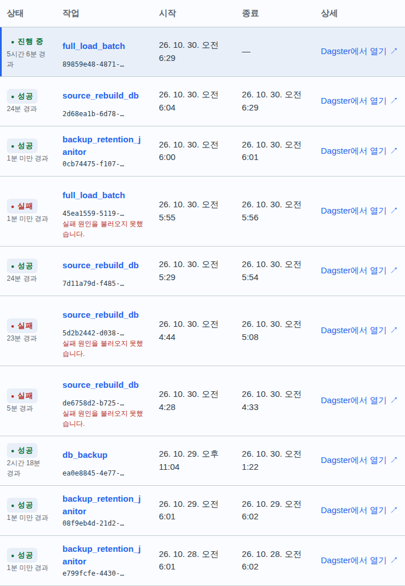

### 장시간 전체분의 자동 종료 상한

실행이 길어질 때는 같은 실행 ID·시작 시각과 현재 단계·실행 신호를 대조하고 실제 자동 종료 상한을 확인한다. `dagster/max_runtime`은 초 단위이며 172,800초는 48시간이다. 이 값은 허용 상한이고, 전체 DB 실측 시간은 7절의 DB 시작·종료 기록으로 계산한다.

이번에는 원천 7개 적재만 19시간 53분이 걸렸고 정합성 공간 검사도 이어져 배치가 22시간에 가까워졌다. 2026-10-31 04:31:50 KST에 현재 실행 `89859e48-4871-4af6-81d9-9b73d9484f14`의 상한 태그 하나를 기존 86,400초에서 172,800초로 높였다. 실제 Dagster 1.13.24의 경계 5건과 독립 임시 instance의 상태·다른 태그 보존 검증을 먼저 통과했다. 상세 UI는 태그 조회만 지원해 공식 instance API로 변경하고, 같은 실행 ID·시작 시각·진행 상태와 다른 태그 보존을 API·실제 UI에서 확인했다.

[PR #610](https://github.com/digitie/kor-travel-geo/pull/610)은 최종 태그를 만드는 복구 정책에 전국 전체분의 48시간 상한을 반영했으며 CI 5개와 리뷰 대기 뒤 머지됐다. 관련 회귀·Dagster 150개·백엔드 1,973개(170개 건너뜀), Ruff·백엔드 타입·의존 방향 검사를 통과했다. 추가 Dagster strict의 기존 진단 13개는 main과 같고 새 진단은 0개다. 운영에서는 이미지·컨테이너를 유지한 실행 설정 보정으로 같은 배치를 계속했다.

아래 원본은 `max_runtime: 172800`과 같은 배치를 표시한다. 이 Linux 브라우저의 시각은 UTC이며 본문의 실측 표는 KST다. `Started`는 진행 중을 뜻하며 정합성·MV·새 릴리스까지의 완료 판정은 별도로 확인한다.

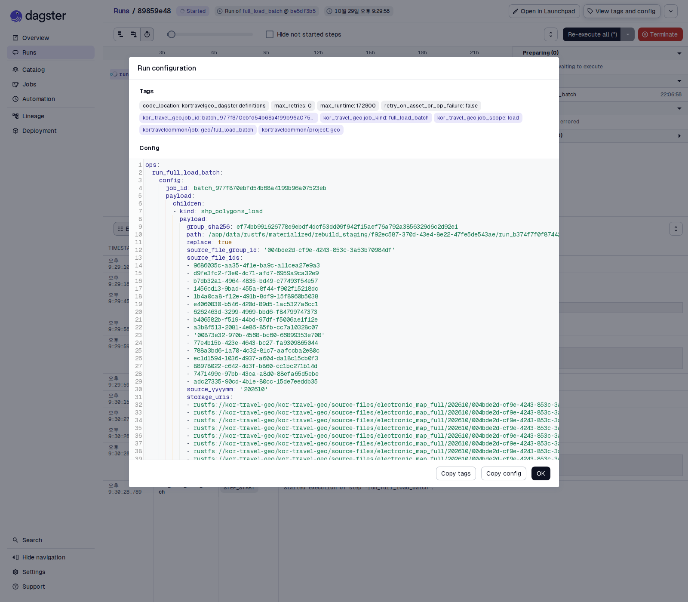

2026-10-31 06:30:57 KST의 공식 실행 기록에서 Dagster 시작 뒤 24시간이 지난 같은 실행의 `STARTED`와 상한 172,800초를 재확인했다. 아래는 06:31:26 KST에 촬영한 실제 UI 원본으로, 24시간 경과 표시와 동일 배치·48시간 상한을 보여준다. 이 확인은 실행 상한 보정의 실제 경계 검증이며 전체 DB 완료를 뜻하지 않는다.

### 이번 실행의 실패와 수정

이번 첫 실패는 업로드 완료 표시 뒤 `필수 member 누락: entrc_*`가 나왔으나 원인은 프록시에서 본문이 잘린 것이었다. 원본은 보존했고 잘린 파일은 등록하지 않았다.

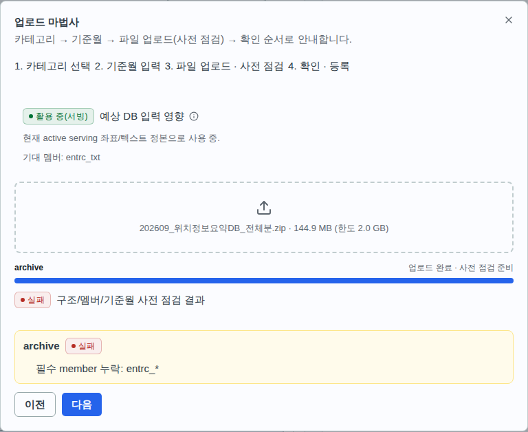

전자지도는 16개 전송을 마친 뒤 압축파일 점검 중 프록시의 5분 응답 헤더 제한으로 실패했다. 아래 화면의 `16/16`과 **사전 점검 다시 시도**를 확인한다.

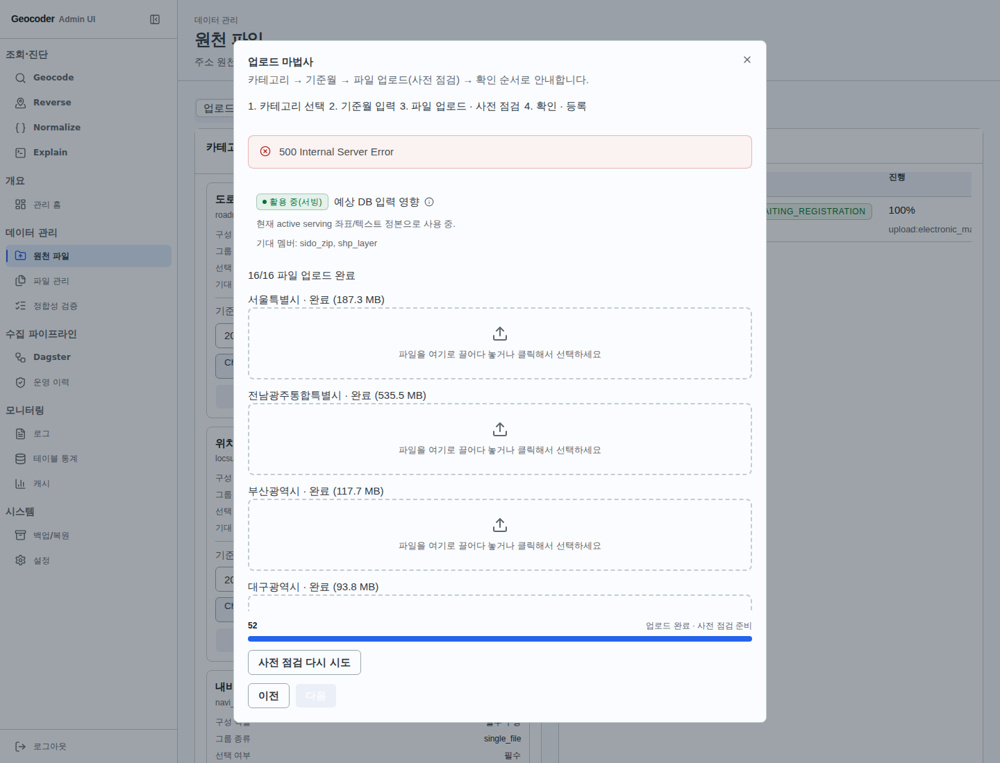

원천 점검 요청에만 충분한 응답 대기를 적용하고 단위·실제 HTTP·두 브라우저 회귀를 통과한 뒤, 같은 세션에서 사전 점검부터 재개했다. 16개 파일을 다시 전송하지 않았다. 재점검에서 경고와 기준월을 확인하고 등록했다.

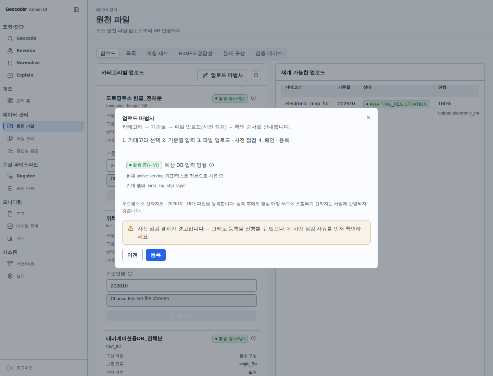

재구축의 첫 준비 작업은 원천 무결성을 통과한 뒤 `/app/data/rustfs` 생성 권한으로 실패했다. 백업 바인드의 부모 `/app/data`가 `root` 소유인 것을 확인했고, 필요한 캐시 디렉터리를 실제 실행 사용자 소유로 준비했다. 같은 사용자와 백업 바인드를 포함한 새 컨테이너에서 기존 실패·수정 뒤 쓰기 성공을 대조했다. 운영 이미지 ID와 패키지 코드는 유지했다.

Dockerfile에는 기본 데이터 디렉터리를 기존 소유권 설정 전에 생성하는 한 줄 수정을 반영했다. [PR #606](https://github.com/digitie/kor-travel-geo/pull/606)은 CI 5개와 리뷰 대기 뒤 머지됐다. 이후 컨테이너를 재생성할 때는 이 수정이 반영된 이미지를 사용한다. 실패한 준비 작업과 Dagster 실행이 모두 종료됐음을 확인하고 같은 등록 원천·매칭 세트로 준비를 다시 시작했다. 업로드는 반복하지 않았다.

두 번째 준비는 압축 원천 준비를 끝냈으나 코드 서버에 공용 Dagster 접속 주소가 빠져 하위 적재 제출에 실패했다. 생성된 실패 배치의 원천 자식 7개는 모두 취소됐으며 실제 적재는 시작하지 않았다. 같은 worker의 설정 경로에서 연결 실패를 재현하고 API와 같은 공용 주소를 읽게 한 뒤 버전·하위 작업 조회 성공을 확인했다. 이미지와 컨테이너를 유지한 설정 보정이며 Manager 정본의 재발 방지 구성은 별도로 반영한다.

실패한 실행이 모두 종료됐음을 확인하고 같은 등록 원천에서 세 번째 준비를 시작했다. 현재 UI는 준비 중간부터 이어서 실행하는 기능이 없어 파일 준비부터 다시 수행한다. 업로드·등록·매칭 세트 검증은 보존했다. 이후 코드 서버를 재생성할 때는 데이터 디렉터리 수정 이미지와 공용 접속 주소 구성을 함께 적용한다.

공용 접속 선언의 재발 방지는 [Manager PR #575](https://github.com/digitie/kor-travel-docker-manager/pull/575)로 머지됐다. 세 번째 시도는 준비를 마치고 배치를 제출했지만, 완료된 준비 작업을 원천 자식으로 잘못 고르는 조회 오류로 배치가 즉시 실패했다. 원천 7개는 모두 시작 전 취소됐다.

실제 부모가 해당 배치인 자식만 선택하도록 한 줄 수정하고 수정 전 SQL 회귀 실패·수정 후 통과, 전체 테스트와 실제 PostgreSQL CI를 확인했다. 운영의 읽기 전용 조회에서도 8개 오선택에서 원천 7개 선택으로 바뀐 것을 확인했고 이미지·컨테이너는 유지했다. [PR #607](https://github.com/digitie/kor-travel-geo/pull/607)은 머지됐다. 모든 이전 작업 종료를 확인한 뒤 같은 원천으로 네 번째 준비부터 다시 시작했다.

주소 응답은 200이지만 지도가 worker 로딩 실패로 남는 문제도 확인했다. 실제 worker 생성 주소가 빈 값인 것을 재현하고, 설치된 같은 버전의 worker를 정적 번들 자산으로 지정했다. [PR #608](https://github.com/digitie/kor-travel-geo/pull/608)은 테스트·실제 후보 지도 검증·CI·리뷰 대기 뒤 머지됐다.

정식 UI 이미지 `kor-travel-geo-ui:rel-e70e4827d250`를 기존 Manager 변경 잠금 안에서 UI 하나에만 적용했다. 헬스체크·현재 이미지 대조, 새 로그인·로그아웃·비인증 차단·인증 프록시 200을 확인했고 API·코드 서버 컨테이너는 유지했다. 실제 운영 Geocode/Reverse의 worker 각 1개와 VWorld 타일 각 16개 수신도 확인했다.

아래는 **원천 적재 진행 중에 UI 교체만 검증한 화면**이다. 지도·좌표 표시 성공과 DB 갱신 완료는 구분한다. 운영 건물 도형과 새 데이터 버전은 원천 적재·정합성·MV 갱신 뒤 다시 확인한다.

[운영 Geocode의 worker·지도 표시 확인](assets/production-map-geocode-success.png)

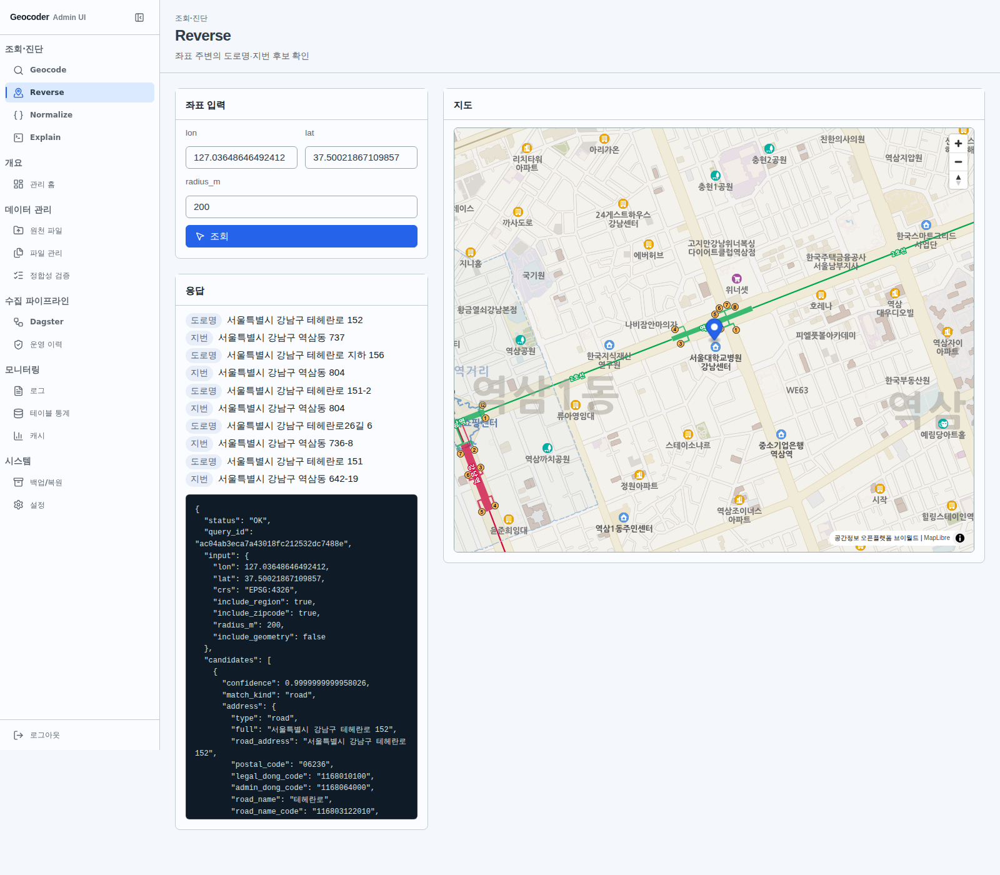

이벤트 날짜가 58797년으로 표시되는 문제는 원본 응답의 밀리초 문자열을 초로 해석한 오류였다. [PR #609](https://github.com/digitie/kor-travel-geo/pull/609)에서 이벤트만 밀리초로 변환하고 실행 메타데이터의 초 단위 처리는 유지했다. 실제 응답 기반 회귀·전체 프론트 검사·두 브라우저 E2E·CI·리뷰 대기를 통과한 뒤 정식 UI 이미지 `kor-travel-geo-ui:rel-0545f8389820`를 UI 하나에만 적용했다.

새 로그인·로그아웃·비인증 차단·인증 프록시 200, 동일 실행의 실제 이벤트 날짜를 다시 확인했다. API·코드 서버 컨테이너 ID와 시작 시각은 유지됐다. 아래는 **2026-10-30 12:55 KST의 시간 표시 수정 성공** 화면이며, 당시 DB 배치는 계속 실행 중이었다.

[UI 교체 뒤 같은 배치의 진행 상태 확인](assets/dagster-event-time-fixed-runs.png)

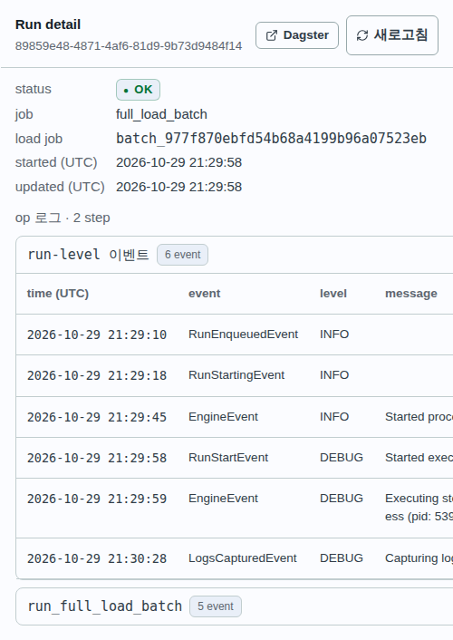

상세 시간 열은 UTC이며 이 매뉴얼의 작업 시간 표는 KST다. 상세의 `status OK`는 조회 응답 상태이므로 적재 완료로 판단하지 않는다. 전체 완료는 실행 목록의 성공, 원천·정합성·MV 작업 종료와 새 서빙 릴리스로 확인한다. 전체 DB 실측 시간은 아래의 DB 배치 기록을 기준으로 한다.

이후 코드 서버를 재생성할 때는 PR #606·#607·#610 이후 수정이 반영된 이미지와 Manager #575의 공용 접속 구성을 함께 사용한다. 준비·적재 작업을 실행 중인 코드 서버는 재생성하지 않는다. 이번 후속 교체는 이전 작업 종료를 확인하고 새 재구축 제출 전에 진행했다.

## 7. 완료 판정

### 전체 DB 로드 실측 시간

한 번의 배치 작업 시간은 `full_load_batch`의 `started_at`부터 `finished_at`까지로 계산한다. 해당 배치에서 새로 실행한 원천·정합성·MV 갱신과 서빙 릴리스 기록을 포함한다. 업로드·백업·파일 준비와 이전 실패·취소 이력은 각각 별도로 보존한다. DB에 저장된 시작·종료 시각을 사용하며, 아래 표는 KST(UTC+09:00)다. 시작·종료 시각은 초 아래를 생략해 표시하고 소요 시간은 원래 시각 차를 초 단위로 반올림한다. 따라서 표의 표시 시각만 뺀 값과 실측 소요 시간이 1초 다를 수 있다.

이번 복구 배치는 완료 원천 6종과 전자지도 두 지역을 재사용하고 유실 전자지도만 적재한다. 따라서 복구 배치의 시작부터 새 게시까지의 시간을 **원천 전체를 처음부터 새로 적재한 시간**으로 표기하지 않는다. 최초 시도 DB 시작부터 릴리스 기록 커밋 뒤 최종 MV 자식의 finished_at까지를 이번 업데이트의 전체 경과 시간으로 추가 기록한다. 릴리스 activated_at은 통계·지문 계산을 포함한 트랜잭션 시작 시각일 수 있으므로 별도 참고값으로 남긴다. 복구 배치 자체는 started_at부터 finished_at까지이며 게시 직후의 작업 마무리 시간도 포함한다. 재사용한 완료 작업 시간과 이전 실패·취소·수정 대기를 각각 구분하고, 정합성 내부 구간을 배치 시간에 다시 더해 중복 집계하지 않는다. 종료 전에는 이 값들을 예상치로 채우지 않는다.

UI의 Dagster 실행 시작은 워커 준비를 포함해 DB 작업 시작보다 앞설 수 있다. 2026-10-31 15:47:17 KST의 Dagster 시작·15:47:51 KST의 DB 시작은 이후 취소된 배치다. 현재 복구 배치는 Dagster 19:06:18 KST·DB 19:06:55 KST에 시작했다. 전체 DB 실측에는 해당 DB 기록을 일관되게 사용하고 두 시계나 다른 배치를 섞지 않는다.

| 구간 | 시작 시각(KST) | 종료 시각(KST) | 실측 소요 시간 |
| --- | --- | --- | --- |
| **첫 본 배치 — 실패한 시도** | **2026-10-30 06:30:29** | **2026-10-31 10:19:33** | **27시간 49분 5초** |
| 전자지도 | 2026-10-30 06:30:29 | 2026-10-30 13:34:26 | 7시간 3분 57초 |
| 위치정보요약 | 2026-10-30 13:34:26 | 2026-10-30 15:28:20 | 1시간 53분 54초 |
| 내비게이션 | 2026-10-30 15:28:20 | 2026-10-30 19:58:34 | 4시간 30분 14초 |
| 출입구 | 2026-10-30 19:58:34 | 2026-10-30 21:56:17 | 1시간 57분 43초 |
| 한글 주소 | 2026-10-30 21:56:18 | 2026-10-31 01:34:18 | 3시간 38분 1초 |
| 관련 지번 | 2026-10-31 01:34:18 | 2026-10-31 02:15:22 | 41분 4초 |
| 구역 도형 | 2026-10-31 02:15:23 | 2026-10-31 02:23:38 | 8분 16초 |
| 정합성 검사 — 최종 ERROR | 2026-10-31 02:23:39 | 2026-10-31 10:19:33 | 7시간 55분 54초 |
| MV 갱신·서빙 릴리스 | 미실행 | 정합성 오류로 차단 | 해당 없음 |
| 파일 준비 — 네 번째 시도, 별도 구간 | 2026-10-30 06:05:15 | 2026-10-30 06:29:11 | 23분 55초 |
| 격리 보완 후 새 준비, 별도 구간 | 2026-10-31 15:20:38 | 2026-10-31 15:45:10 | 24분 32초 |
| **격리 보완 후 새 DB 배치(취소)** | **2026-10-31 15:47:51** | **2026-10-31 17:51:27** | **2시간 3분 36초(취소)** |
| 새 배치의 전자지도(취소) | 2026-10-31 15:47:52 | 2026-10-31 17:53:52 | 2시간 6분 0초(취소) |
| 유실 전자지도 복구 배치 | 2026-10-31 19:06:55 | 2026-11-02 19:41:58 | 48시간 35분 3초 |
| 복구 배치의 전자지도 자식 — 유실분·후처리 | 2026-10-31 19:06:56 | 2026-11-01 01:20:59 | 6시간 14분 2초 |
| 복구 배치의 좌표 품질 판정 — 정합성 내부 구간 | 2026-11-01 03:04:05 | 2026-11-01 19:00:48 | 15시간 56분 44초 |
| 복구 배치의 C1 — 완료 로그 기준 | 2026-11-01 19:00:49 | 2026-11-01 21:45:36 | 약 2시간 44분 47초 |
| 복구 배치의 C2 — 완료 로그 기준 | 2026-11-01 21:45:37 | 2026-11-01 23:02:28 | 약 1시간 16분 51초 |
| 복구 배치의 C3 — 완료 로그 기준 | 2026-11-01 23:02:29 | 2026-11-01 23:47:17 | 약 44분 48초 |
| 복구 배치의 C4 — 완료 로그 기준 | 2026-11-01 23:47:17 | 2026-11-02 07:40:20 | 약 7시간 53분 2초 |
| 복구 배치의 C5 — 완료 로그 기준 | 2026-11-02 07:40:21 | 2026-11-02 12:24:44 | 약 4시간 44분 23초 |
| 복구 배치의 C6 — 완료 로그 기준 | 2026-11-02 12:24:44 | 2026-11-02 14:06:47 | 약 1시간 42분 3초 |
| 복구 배치의 C7 — 완료 로그 기준 | 2026-11-02 14:06:48 | 2026-11-02 15:15:35 | 약 1시간 8분 47초 |
| 복구 배치의 C8 — 완료 로그 기준 | 2026-11-02 15:15:35 | 2026-11-02 16:03:43 | 약 48분 7초 |
| C8 완료 로그부터 C9 완료 로그 간격 — C9 SQL 실측 아님 | 2026-11-02 16:03:43 | 2026-11-02 16:05:04 | 1분 21초 |
| 복구 배치의 C10 — 완료 로그 기준 | 2026-11-02 16:05:04 | 2026-11-02 16:09:25 | 약 4분 20초 |
| 복구 배치의 정합성 전체 — 위 내부 구간 포함 | 2026-11-01 01:20:59 | 2026-11-02 16:09:27 | 38시간 48분 28초 |
| 복구 배치의 MV·릴리스 기록 | 2026-11-02 16:09:27 | 2026-11-02 19:41:58 | 3시간 32분 31초 |
| 최초 DB 시작부터 MV·릴리스 기록 완료까지 전체 경과 | 2026-10-30 06:30:29 | 2026-11-02 19:41:58 | 85시간 11분 29초 |

실패한 첫 본 배치 식별자는 `batch_977f870ebfd54b68a4199b96a07523eb`다. 이 시도의 종료와 소요 시간은 DB 기록으로 확정했다. 성공한 전체 DB 갱신 시간은 아니며 원천 7개 구간만 합하면 19시간 53분 9초다. 새 준비 `job_78d60f36940645ee8fe6eec7964edcc0`의 완료 시간과 새 배치 `batch_b2792a89775c40ab80bd3ceca24f19ed`의 취소 구간 2시간 3분 36초도 별도 기록했다. 이전 실패와 수정 대기를 포함한 전체 경과 시간은 최종 성공 시간과 구분한다. 최종 성공 시각·전체 실측은 본문 처음의 최종 표에서 확인하며 예상 완료 시각을 실측값으로 넣지 않는다.

적재 작업 완료, 정합성 결과, 새 서빙 릴리스와 데이터 기준월을 확인한다. Geocode·Reverse를 실제 UI에서 실행해 결과를 확인하고 각 성공 화면을 기록한다. 최종 실행 결과와 전체 로드 실측 시간은 본문 처음의 완료 기록에서 확인한다. 현재까지의 성공 화면과 결과는 본문 처음에 연결한 GitHub Wiki에도 게시한다.
